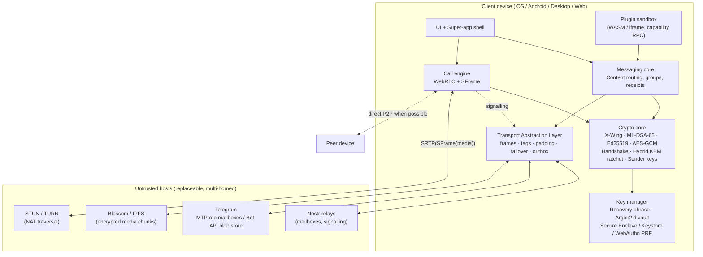
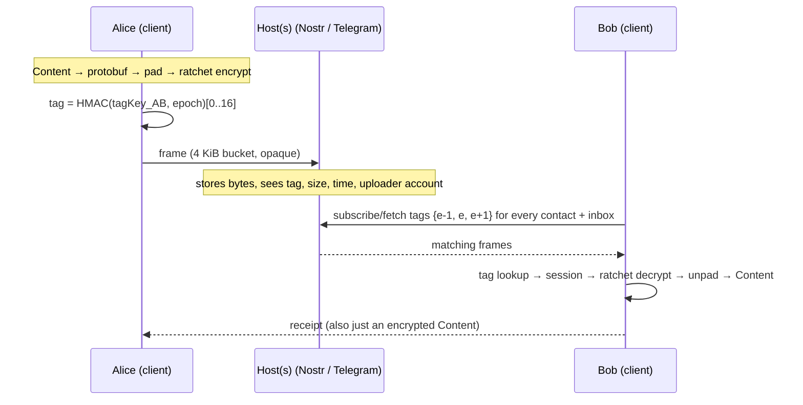

# SMA: Architecture Overview and Threat Model

SMA (working name, "Super Messaging App") is a messenger with post-quantum end-to-end encryption and no servers of its own. It borrows storage and transport from hosts it does not trust (Telegram, Nostr relays, IPFS/Blossom, TURN relays) and treats every one of them as an adversary that stores opaque bytes.

This document sets the goals, the threat model, the overall system shape and the decisions that the module documents (01–07) then specify in detail.

---

## 1. Goals and non-goals

| # | Goal | How it is met |
|---|------|---------------|
| G1 | **No servers we operate or pay for** | Every host is a pluggable, replaceable transport (01). The only costed component is optional TURN, and the client works without it (04). |
| G2 | **Post-quantum E2EE for everything** | X-Wing (ML-KEM-768 + X25519) for every key agreement, composite Ed25519 + ML-DSA-65 for every signature, AES-256-GCM for every payload (02). |
| G3 | **The host sees only opaque blobs** | 16-byte rotating PRF tag plus bucket-padded ciphertext. No version byte, no type, no sender, no recipient key id (05 §2). |
| G4 | **Identity = a user-held master secret** | A 24-word recovery phrase derives every long-term key. A passphrase or hardware key only unlocks the local vault (03). |
| G5 | **Super-app features** | Text, groups, files, P2P calls and sandboxed plugins all reuse the same encrypted `Content` channel (05). |

**Non-goals.** Being honest about these is part of the security model.

- **Hiding from your own transport account.** If you use Telegram's MTProto API, Telegram knows your phone number, IP address and online times. SMA hides *content and the conversation graph inside the host*, not *the fact that your account uses the host*. Use Nostr with throwaway keys, Tor or a proxy when that matters.
- **Disguising traffic or evading a host's policies.** Frames are opaque, but SMA does not pretend to be something else. If a host throttles or refuses us, the client fails over to another host (01 §6). Fighting the host is a race the host always wins, by banning accounts.
- **Zero cost in an absolute sense.** Volunteers run Nostr relays, Telegram pays for its cloud, and TURN bandwidth costs someone money. The goal is that *this project* runs no infrastructure and has no per-user bill.

---

## 2. Threat model

### 2.1 Adversaries

| Adversary | Capabilities | Example |
|-----------|-------------|---------|
| **A1 Transport host** | Reads, stores, drops, reorders, replays and forges any frame it carries. Sees account identifiers, IPs and timing. | Telegram, a Nostr relay operator, an IPFS pinning service |
| **A2 Network observer** | Passive or active on the wire, possibly state-level | ISP, Wi-Fi operator |
| **A3 Harvest-now-decrypt-later** | Records everything today and has a cryptographically relevant quantum computer (CRQC) in the future | Any well-resourced A1/A2 |
| **A4 Active quantum attacker** | A CRQC available *during* a session | A1/A2 after "Q-day" |
| **A5 Malicious contact or group member** | A legitimate participant who tries to impersonate others or forge messages | Insider |
| **A6 Device compromise** | Temporary read access to one device's memory or storage | Malware, a border search |
| **A7 Lost or coerced secrets** | Has the passphrase, or forces the user to unlock | Theft, coercion |

### 2.2 What each adversary learns

| Asset | A1 host | A2 network | A3 HNDL | A4 active-Q | A5 insider | A6 device |
|-------|:------:|:----------:|:-------:|:-----------:|:----------:|:---------:|
| Message content | ✗ | ✗ | ✗ (X-Wing) | ✗ (X-Wing + ML-DSA) | ✓ only their own conversations | ✓ past and present sessions; future traffic after healing ✗ |
| Who talks to whom | ✗ inside a shared mailbox; ✓ when using a per-chat Telegram channel | ✗ / IP-level | same as A1 | same as A1 | group membership | ✓ |
| Sender identity (first contact) | ✗ sealed (02 §3) | ✗ | ✗ | ✗ | ✓ | ✓ |
| Message size | bucket only (4 KiB … 1 MiB) | bucket | bucket | bucket | ✓ | ✓ |
| Timing and volume | ✓ | ✓ | ✓ | ✓ | ✓ | ✓ |
| User's host account (phone number, IP) | ✓ for MTProto; ✗ for Nostr with ephemeral keys + Tor | IP | — | — | ✗ | ✓ |
| Call media | ✗ (SFrame over DTLS) | ✗ | ✗ (SFrame keys from the PQ ratchet) | ✗ | ✓ in-call | ✓ |
| Call IPs | TURN sees both IPs; P2P reveals IPs to the peer | ✓ | — | — | ✓ unless relay-only mode | ✓ |

✗ = protected, ✓ = learned.

### 2.3 Security properties

| Property | Mechanism | Holds against |
|----------|-----------|---------------|
| Confidentiality | X-Wing KEM → HKDF → AES-256-GCM | Classical and quantum; breaking it requires breaking ML-KEM-768 **and** X25519 |
| Authenticity of identities | Composite Ed25519 + ML-DSA-65; fingerprint pinned out of band | Classical and quantum (requires breaking both schemes) |
| Message integrity | AEAD under per-message keys | Everyone outside the session |
| Forward secrecy | Symmetric chain plus a KEM ratchet step on every reply | A6 after the fact |
| Post-compromise security | Fresh X-Wing randomness on each turn (02 §4.3) | A6, after one round trip |
| Replay protection | One-time message keys; handshake replay cache | A1 |
| Deniability of content | Messages authenticated by symmetric keys only | Transcript cannot prove authorship to third parties |
| Metadata minimisation | Rotating tags, padding, sealed sender | A1, A2 (not traffic analysis) |

The one property this design deliberately trades away is **handshake deniability**. The first message carries a composite signature, so the recipient can prove to others that the sender opened a session at time T. Message contents stay deniable. 02 §3.5 explains why and gives the deniable variant.

---

## 3. System architecture



The same system, layer by layer:

```
┌──────────────────────────────────────────────────────────────────────────────┐
│ L5  Apps          chat · groups · files · calls · plugins (mini-dApps)       │
├──────────────────────────────────────────────────────────────────────────────┤
│ L4  Content       protobuf sma.v1.Content (text, file manifest, call signal, │
│                   group key, receipts, plugin payload)                        │
├──────────────────────────────────────────────────────────────────────────────┤
│ L3  Sessions      handshake (X-Wing ×2-3, composite sig) → hybrid KEM ratchet │
│                   sender keys for groups · HPKE sealed boxes for one-shots    │
├──────────────────────────────────────────────────────────────────────────────┤
│ L2  Padding       ISO 7816-4 inside the AEAD → frame lands on a size bucket  │
├──────────────────────────────────────────────────────────────────────────────┤
│ L1  Frame         tag[16] ‖ ciphertext        (no other cleartext fields)     │
├──────────────────────────────────────────────────────────────────────────────┤
│ L0  Transports    Nostr · Telegram MTProto · Telegram Bot blob store ·        │
│                   Blossom/IPFS · WebRTC data channel · (Matrix)               │
└──────────────────────────────────────────────────────────────────────────────┘
```

### 3.1 Message lifecycle



---

## 4. Super-app layer

All features are `Content` variants that ride the same encrypted channel. No feature has its own transport or crypto.

| Feature | Content variant | Notes |
|---------|-----------------|-------|
| Text, edits, reactions, deletes | `Text`, `Edit`, `Reaction`, `Delete` | Deletes are requests; the recipient's client honours them |
| Disappearing messages | `Content.expire_after_s` | Enforced client-side; message keys are already gone |
| Files and media | `FileManifest` + `BlobRef` | Chunked, per-file key, stored on any blob host (05 §5) |
| Calls | `CallSignal` | SDP, ICE and SFrame key seed (04) |
| Groups | `GroupControl`, `GroupKeyDistribution` | Hash-chained membership log + sender keys (02 §6) |
| Multi-device | `DeviceSync` | Own-devices channel (03 §4) |
| Plugins | `PluginMessage` | Opaque payload routed to a sandboxed plugin |

### 4.1 Plugin (mini-dApp) model

- **Packaging.** A `PluginManifest` signed by the developer's composite key, plus a content-addressed WASM/JS bundle fetched from any blob host. The client verifies `bundle_sha256` and the developer signature, then pins the developer key on first install (TOFU) and shows key changes.
- **Sandbox.** The plugin runs in a WASM runtime or a cross-origin iframe with `sandbox` and a strict CSP. It has **no network access and no access to keys**. Its only I/O is a capability RPC over `postMessage`:
  - `conversation.send(payload)` wraps the payload in a `PluginMessage` and sends it through the host app's ratchet. The plugin never sees ciphertext or keys.
  - `storage.kv` gives encrypted, quota-limited per-plugin storage.
  - `ui.render` draws into a declarative UI tree, so a plugin cannot imitate host chrome such as safety-number screens.
  - `payments.request` requires a user confirmation sheet drawn by the host app. Possible rails are Lightning via Nostr Wallet Connect (NIP-47) or a TON/EVM wallet connector. The plugin only receives a signed receipt.
- **Examples.** Split-the-bill, polls, secret notes (one-view `Content` with `expire_after_s`, key destroyed on read), shared to-do lists (CRDT state in `PluginMessage`) and turn-based games.

---

## 5. Key decisions

| Decision | Choice | Rationale | Rejected alternative |
|----------|--------|-----------|----------------------|
| KEM | **X-Wing** (ML-KEM-768 + X25519, SHA3-256 combiner) | Hybrid security in one primitive. Fixed sizes (pk 1216 B, ct 1120 B). Proven combiner. Supported by hpke-js and Apple CryptoKit. | ML-KEM alone (no hedge against a lattice break); Kyber-1024 (larger, no real gain at this layer) |
| Signatures | **Composite Ed25519 + ML-DSA-65** | Survives a quantum break of Ed25519 *or* a classical break of ML-DSA | SLH-DSA (signatures of 8–30 KB); Falcon (floating-point signing is hard to implement safely) |
| AEAD | **AES-256-GCM** (messages), **XChaCha20-Poly1305** (vault) | GCM is hardware accelerated everywhere. XChaCha's 192-bit nonce is safe for random nonces under a long-lived key. | AES-GCM with random nonces under a long-lived key |
| Ratchet | **Double Ratchet with an X-Wing KEM ratchet** in place of the DH ratchet | Every asymmetric step is hybrid. Same alternation structure and healing as the Double Ratchet. ~2.4 KB per header fits document transports. | Signal's SPQR "Triple Ratchet" (bandwidth-optimal but far more complex; kept as the sparse mode for constrained links, 02 §4.4) |
| Groups | **Sender keys** distributed over pairwise PQ sessions | Works without a server that orders messages | MLS (RFC 9420) needs a delivery service to order commits; offered when a total-order channel exists (02 §6.3) |
| Wire format | **Fixed binary L1 + protobuf L4** | No cleartext structure on the wire; protobuf only inside encryption | Protobuf or JSON envelopes (field keys are a fingerprint) |
| Primary transport | **Nostr relays + optional Telegram MTProto**; Blossom/IPFS for blobs | No phone number, many independent operators, free | Telegram-only (one operator, phone-linked identities, ToS risk) |
| Media E2EE | **SFrame (RFC 9605)** keyed from the ratchet, on top of DTLS-SRTP | DTLS key exchange in WebRTC is still classical in practice | Trusting DTLS-SRTP alone |
| Identity root | **BIP-39 24-word phrase** | 256-bit entropy, users already understand it, deterministic recovery | Passphrase-derived identity ("brain wallet"): brute-forceable once anything derived from it is public |

---

## 6. Document map

| Doc | Module |
|-----|--------|
| [01-transport.md](01-transport.md) | Transport and storage: Telegram vs decentralised, payload opacity, fallback |
| [02-crypto-protocol.md](02-crypto-protocol.md) | Primitives, handshake, hybrid KEM ratchet, authentication, groups |
| [03-key-management.md](03-key-management.md) | Recovery phrase, Argon2id, hardware keys, multi-device, backup |
| [04-calls-webrtc.md](04-calls-webrtc.md) | Call signalling, SFrame, STUN/TURN without infrastructure |
| [05-data-schema.md](05-data-schema.md) | Byte layouts, protobuf schema, JSON examples, file chunking |
| [06-reference-implementation.md](06-reference-implementation.md) | The TypeScript reference: code walkthrough, tests, benchmarks |
| [07-roadmap.md](07-roadmap.md) | Implementation phases, security programme, risks |
