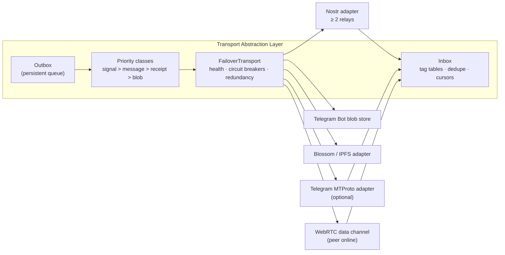
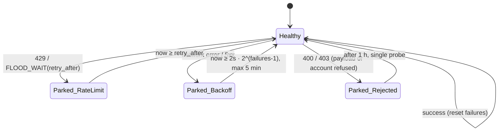
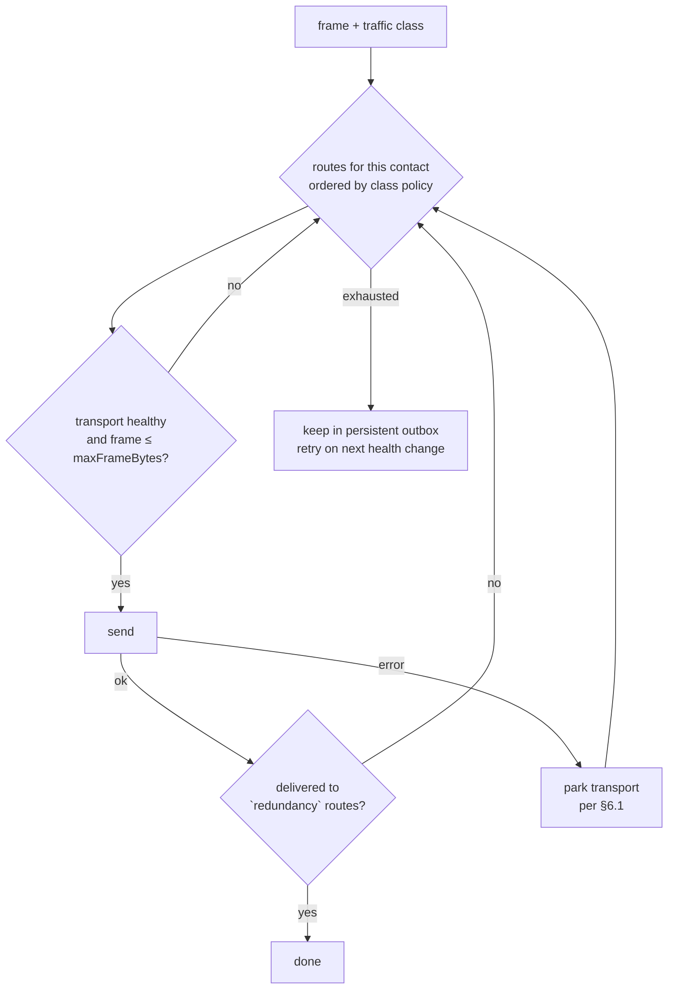

# Module 1: Transport and Storage Strategy

The transport layer moves and stores **frames**: `tag[16] ‖ ciphertext`, padded to a fixed size bucket (05 §2). Every host is assumed to be adversary A1 (00 §2). It may read, drop, delay, replay or forge frames, and none of those actions may break confidentiality or authenticity. They can only cost availability.

---

## 1. What a transport must provide

| Requirement | Why | Minimum |
|-------------|-----|---------|
| Store-and-forward | Recipients are offline most of the time | Hours to days of retention |
| Binary or text payloads | Frames are 4 KiB to 1 MiB | 1 MiB per object; larger media is chunked into blobs |
| Low-latency delivery | Call signalling needs it | < 1 s push or long-poll |
| Cheap to use at zero cost | G1 | Free tier or volunteer-operated |
| Weak identity linkage | 00 §2 | Ideally no phone number, e-mail or payment identity |
| Many independent operators | No single party can censor or correlate | ≥ 2 unrelated hosts per user |

---

## 2. Telegram as a transport

Telegram offers two very different APIs. They are evaluated separately.

### 2.1 Bot API (`api.telegram.org/bot<token>/…`)

| Property | Value | Consequence |
|----------|-------|-------------|
| Upload limit | 50 MB per file (cloud Bot API) | Frames (≤ 1 MiB) and 1 MiB blob chunks fit easily |
| Download limit | **20 MB** via `getFile` | Blob chunks must stay ≤ 20 MB; SMA uses 1 MiB chunks |
| Rate limits | ~1 msg/s per chat, 20 msg/min per group, ~30 msg/s per bot; HTTP 429 with `parameters.retry_after` | Fine for one user's traffic; a single shared bot does **not** scale |
| `file_id` | Unique per bot, permanent, not transferable to another bot | It works as a handle in a *personal* blob store, not as a pointer shared with contacts |
| **Bot ↔ bot visibility** | Telegram Bots FAQ: "bots will not be able to see messages from other bots regardless of mode" | **Alice's bot cannot talk to Bob's bot through a group.** Delivery of channel posts authored by another admin bot is undocumented; treat it as unsupported. |
| Identity | Bot token from @BotFather; the bot is tied to the creating user's account | Telegram knows which account owns the bot |

**What the Bot API is good for: a personal encrypted blob store.** A user's own bot uploads to the user's own private channel (bot as admin). It is used for encrypted backups, media chunks shared through `Locator.telegram = "bot:<file_id>"` (fetched only by that user's own devices), and device-to-device sync. `TelegramBotTransport.putBlob` / `getBlob` in the reference implementation does exactly this.

### 2.2 MTProto user API (TDLib, GramJS, Telethon, Pyrogram)

| Property | Value | Consequence |
|----------|-------|-------------|
| Account | A normal Telegram account, which requires a phone number (Fragment "+888" anonymous numbers are purchasable with TON) | **Telegram knows the phone number of every participant** |
| File limit | 2 GB per file (4 GB with Premium) | Generous blob store |
| Rate limits | `FLOOD_WAIT_X` errors with a mandatory wait of X seconds | Must be honoured; repeated violations get accounts limited |
| Updates | Real-time push via MTProto updates | Good latency for messages and call signalling |
| App registration | `api_id`/`api_hash` from my.telegram.org; Telegram API Terms of Service apply | Abuse-like patterns (mass automation, many accounts) risk bans |

**What MTProto is good for: user ↔ user mailboxes.** Both parties' *user* accounts are members of a private channel or supergroup that serves as the mailbox. Telegram stores the frames durably and pushes them in real time.

### 2.3 Topologies

| # | Topology | Works? | What Telegram learns |
|---|----------|:------:|----------------------|
| T1 | **Per-conversation private channel**, both user accounts are members (MTProto) | ✓ | The membership graph: accounts A and B share a channel. Volume and timing. |
| T2 | **Shared board**: many users in one large channel, recipients filter by tag (MTProto) | ✓ | Who is a member and who posts when, but not who talks to whom. Every member downloads all traffic (costs bandwidth). |
| T3 | **Personal blob store**: own bot → own private channel (Bot API) | ✓ | That the account stores N blobs of bucketed size |
| T4 | Bot ↔ bot mailbox through a shared group (Bot API) | ✗ | Blocked by design (2.1) |
| T5 | Bot posts into a chat read by an MTProto user client | ✓ | Same as T1 |

### 2.4 What the host can see

| Observable | T1 | T2 | Nostr (ephemeral keys, ≥ 2 relays) |
|------------|----|----|------------------------------------|
| Plaintext, keys, sender inside the frame | never | never | never |
| Frame size | bucket | bucket | bucket |
| Uploading account | phone-linked account | phone-linked account | throwaway key per event |
| Conversation graph | ✓ | ✗ | ✗ (tag subscriptions: see §5.3) |
| IP address | ✓ (unless a proxy is used) | ✓ | ✓ (unless Tor) |
| Online times | ✓ | ✓ | ✓ |

### 2.5 Verdict on Telegram

Telegram gives free, durable, high-capacity storage and fast push. It is also **one operator**, ties every account to a phone number, and its ToS lets it ban accounts that behave like an infrastructure backend. SMA therefore uses Telegram as **one adapter among several**, never as the only path:

- **Recommended:** T3 (personal blob store via Bot API) for backups and media, and T2/T1 (MTProto) as an *optional* mailbox for users who already have Telegram and accept its metadata exposure.
- **Not recommended:** a single app-wide bot. It is a central operator, its rate limit is shared by every user, and banning one token takes everyone down.

---

## 3. Decentralised alternatives

| Transport | Model | Latency | Retention | Object size | Identity linkage | Cost | Notes |
|-----------|-------|---------|-----------|-------------|------------------|------|-------|
| **Nostr relays** | Signed JSON events over WebSocket, many independent relays | ~100 ms push | Relay policy (days to forever); NIP-40 `expiration` | Relay-specific; read NIP-11 `limitation.max_message_length` (commonly tens to hundreds of KB) | None: a fresh keypair per event | Free (volunteer); paid relays ~$/month | **Primary mailbox and signalling.** Ephemeral kinds 20000–29999 are forwarded, not stored: ideal for call signalling. |
| **Blossom** | HTTP blob servers, objects addressed by SHA-256 (BUD-01/02) | HTTP | Server policy | MBs | Upload auth by Nostr key (may be ephemeral) | Free tiers, cheap paid | **Media chunks.** Content addressing gives integrity for free. |
| **IPFS** | Content-addressed P2P | Seconds to minutes | **Only while someone pins** | 1 MiB blocks (chunked) | PeerID; IP visible to the DHT | Free when self-pinned; pinning services have tiers | Good secondary blob locator |
| **Arweave** | Permanent paid storage | Minutes | **Forever** | Any | Wallet | Pay per byte | **Do not use for messages.** Permanent ciphertext is the ideal target for harvest-now-decrypt-later, and nothing can ever delete it. Acceptable only for public, signed objects (plugin bundles). |
| **Matrix** | Federated rooms on homeservers | ~100 ms | Homeserver policy | Media repo (MBs) | Account on a homeserver | Free public homeservers | Usable as a dumb mailbox (room = board). The homeserver sees room membership. |
| **Waku** | P2P relay + store nodes (libp2p) | Seconds | Store-node policy | ~150 KB messages | PeerID | Free (network-operated) | Censorship-resistant option; smaller ecosystem |
| **WebRTC data channel** | Direct P2P | Lowest | None (online only) | Unlimited stream | IPs revealed to the peer | Free (+ TURN when needed) | **Bulk transfer when both peers are online**; needs signalling over one of the above |

---

## 4. Recommended architecture: Transport Abstraction Layer (TAL)



**Role assignment (defaults):**

| Traffic class | Primary | Fallback 1 | Fallback 2 |
|---------------|---------|-----------|-----------|
| Call signalling (`CallSignal`) | WebRTC data channel if already connected | Nostr ephemeral event (kind 2xxxx) on 2 relays | Telegram MTProto |
| Messages (`RatchetMessage`, `PreKeyMessage`) | Nostr (redundancy 2) | Telegram MTProto | Matrix |
| Media chunks (`BlobRef`) | Blossom (2 servers) | Telegram Bot blob store (own devices) / IPFS | Direct WebRTC transfer |
| Backups (`BackupManifest`) | Telegram Bot blob store | Blossom | Any HTTPS bucket |
| Contact cards (`ContactCard`, encrypted) | Blossom | Nostr replaceable event | Telegram |

The transport interface, as implemented in [`reference/src/transport/types.ts`](../reference/src/transport/types.ts):

```ts
interface Transport {
  readonly name: string;
  readonly maxFrameBytes: number;
  send(mailbox: string, frame: Uint8Array): Promise<string>;  // host message id
  fetch(mailbox: string, cursor?: string): Promise<{ frames: StoredFrame[]; cursor?: string }>;
}
class RateLimitedError extends Error { retryAfterMs: number }   // 429, FLOOD_WAIT
class TransportRejectedError extends Error {}                    // 400/403: payload or account refused
```

### 4.1 Telegram MTProto adapter (sketch)

The reference implementation ships the Bot API adapter. An MTProto adapter has the same shape. The sketch below uses GramJS; check its signatures against the current GramJS release before use.

```ts
import { Api, TelegramClient } from 'telegram';
import { StringSession } from 'telegram/sessions/index.js';
import { CustomFile } from 'telegram/client/uploads.js';
import { FloodWaitError } from 'telegram/errors/index.js';

export class TelegramMtprotoTransport implements Transport {
  readonly name = 'telegram-mtproto';
  readonly maxFrameBytes = 1 << 20;
  constructor(private client: TelegramClient) {}         // session string lives in the encrypted vault

  async send(chat: string, frame: Uint8Array): Promise<string> {
    try {
      const msg = await this.client.sendFile(chat, {
        file: new CustomFile('data.bin', frame.length, '', Buffer.from(frame)),
        forceDocument: true,                               // never "photo"/"video" re-encoding
        attributes: [new Api.DocumentAttributeFilename({ fileName: 'data.bin' })],
        silent: true,
      });
      return `${chat}:${msg.id}`;
    } catch (e) {
      if (e instanceof FloodWaitError) throw new RateLimitedError(this.name, e.seconds * 1000);
      throw e;
    }
  }

  async fetch(chat: string, cursor = '0') {
    const frames = [];
    let last = Number(cursor);
    for await (const m of this.client.iterMessages(chat, { minId: last, reverse: true, limit: 200 })) {
      last = Math.max(last, m.id);
      if (!m.document) continue;
      const bytes = (await this.client.downloadMedia(m)) as Buffer;
      try { decodeFrame(bytes); frames.push({ id: `${chat}:${m.id}`, frame: new Uint8Array(bytes) }); } catch {}
    }
    return { frames, cursor: String(last) };
  }
}
```

### 4.2 Nostr adapter (wire mapping)

| Nostr field | Value |
|-------------|-------|
| `pubkey` / `sig` | A **fresh secp256k1 key per event**, so events cannot be linked by author |
| `kind` | An application-specific regular kind for messages (stored); an ephemeral kind in 20000–29999 for call signalling (forwarded, not stored). Events are shaped like NIP-59 gift wraps (random key, blurred timestamp), but the content is an SMA frame, not a NIP-59 seal. |
| `content` | `base64url(frame)` (`armorFrame`): no prefix, no JSON structure |
| `tags` | `["z", <bucket tag>]` (§5.3) and `["expiration", <now + 14 d>]` (NIP-40) |
| `created_at` | Randomised within ±1 h, as in NIP-59 gift wraps, to blur timing |
| Relays | Sender writes to ≥ 2 of the recipient's relays (`NostrMailbox.relays`); recipient reads from all of them |

---

## 5. Payload opacity

### 5.1 What a host can inspect, and what we give it

The goal is not to "bypass" the host. A host can always see what it stores. The goal is that **what it stores carries no information beyond its size bucket and arrival time**.

| Rule | Implementation |
|------|----------------|
| No plaintext fields | Frame = `tag ‖ ciphertext`. No version, type, length, key id or protobuf keys in clear (05 §2). The recipient learns the frame type from which tag table matched. |
| No stable identifiers | Tags are `HMAC(tagKey, epoch)[0..16]` and rotate hourly. Sender identity is sealed inside the first message. Initial key ids are found by trial decryption. |
| Size quantisation | ISO 7816-4 padding inside the AEAD to buckets of 4 KiB · 8 KiB · … · 1 MiB. Media is cut into equal 1 MiB chunks. |
| Neutral host metadata | Telegram: `application/octet-stream`, file name `data.bin`, no caption, `disable_content_type_detection`, never sent as photo/video (avoids re-encoding and thumbnailing). Nostr: no meaningful tags beyond the bucket tag. |
| Bound to its tag | Sealed boxes use the tag as AEAD associated data; ratchet messages bind header and body. A host cannot move a body under another tag or splice frames. |
| Validated before upload | `TelegramBotTransport.send` refuses any byte string that is not a bucket-sized frame, so a bug cannot leak an unpadded plaintext. |

### 5.2 Base64 vs binary

| Carrier | Encoding | Overhead | Where |
|---------|----------|----------|-------|
| Document / file / blob | Raw binary frame | 0 % | Telegram documents, Blossom, IPFS, WebRTC |
| Text-only field | `base64url` without padding or prefix (`armorFrame`) | +33 % | Nostr `content`, Matrix `body` |
| Telegram text message | Not used | — | A 4096-character message limit holds ~3 KB, smaller than the smallest frame. Telegram text is the wrong carrier. |

### 5.3 Tag subscriptions: the remaining metadata leak

Asking a relay for "events with tag X" tells the relay that this connection cares about X during this epoch. Options, from cheapest to most private:

1. **Exact tags** (default for Telegram T1 and small deployments). Efficient, and the relay links one connection to a set of tags.
2. **Bucket tags.** The Nostr event carries only `tag[0..b]` (b = 1–2 bytes) as its indexed `z` tag, and the recipient subscribes to its buckets and discards non-matching frames locally. Each bucket is shared by ~1/2⁸ or 1/2¹⁶ of all traffic, which makes `b` a privacy versus bandwidth knob.
3. **Fetch everything** (T2 shared board). The host learns nothing from reads, at the cost of downloading all traffic.
4. **Tor/Arti per subscription batch.** The relay cannot tie tag sets to an IP.

---

## 6. Fallback architecture

### 6.1 Per-transport circuit breaker

Implemented in [`reference/src/transport/failover.ts`](../reference/src/transport/failover.ts). Send and fetch health are tracked separately, because a send quota must never stop us from receiving.



### 6.2 Send path



### 6.3 Failure scenarios

| Scenario | Detection | Response |
|----------|-----------|----------|
| Telegram rate-limits (429 / FLOOD_WAIT) | `RateLimitedError(retryAfterMs)` | Park sends for exactly `retry_after`; route via Nostr meanwhile; keep reading from Telegram |
| Telegram rejects documents or restricts the account | 400/403 → `TransportRejectedError` | Park for 1 h; tell the user; contacts' next `ContactCard` update drops the Telegram mailbox |
| Telegram bans the account or bot | Persistent 401/403 | Remove the adapter; publish an updated `MailboxAddress` list through the remaining transports |
| A Nostr relay censors or drops events | Event missing on read-back (sender verifies on a second relay) | Writes already go to ≥ 2 relays; rotate to another relay from the contact's list |
| Network-level blocking of a host | Connection failures | Exponential backoff; user-configurable SOCKS/MTProto proxy or Tor (Arti); other hosts continue |
| All transports down | Every route parked | Frames stay in the persistent outbox (encrypted at rest); WebRTC direct transfer if the peer is reachable on the LAN |
| Duplicate delivery via redundancy | Same SHA-256 of frame | Dropped by the inbox dedupe; a second copy would also fail ratchet decryption (its key is consumed) |

**Ordering is never taken from the transport.** The ratchet tolerates up to `MAX_SKIP = 1000` out-of-order messages per chain, and the UI orders by `Content.sent_at_ms` within a conversation, flagging large skew.

---

## 7. Summary

```
                 ┌────────────── messages / first contact ──────────────┐
                 │  Nostr relays ×2 (ephemeral keys)   ← primary        │
                 │  Telegram MTProto channel           ← optional       │
 Alice ──frame──►│  Matrix room                        ← optional       │──► Bob
                 ├────────────── media / backups ───────────────────────┤
                 │  Blossom ×2 · IPFS · Telegram Bot blob store (own)   │
                 ├────────────── calls ─────────────────────────────────┤
                 │  Nostr ephemeral signalling → WebRTC P2P / TURN      │
                 └──────────────────────────────────────────────────────┘
 Every arrow carries the same opaque, bucket-padded frame. Losing any one host costs
 latency, never confidentiality.
```
