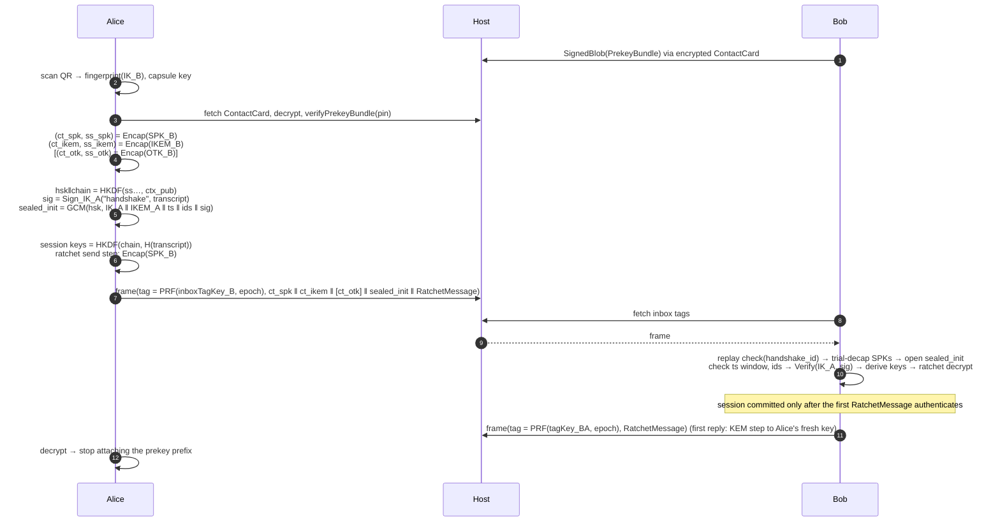
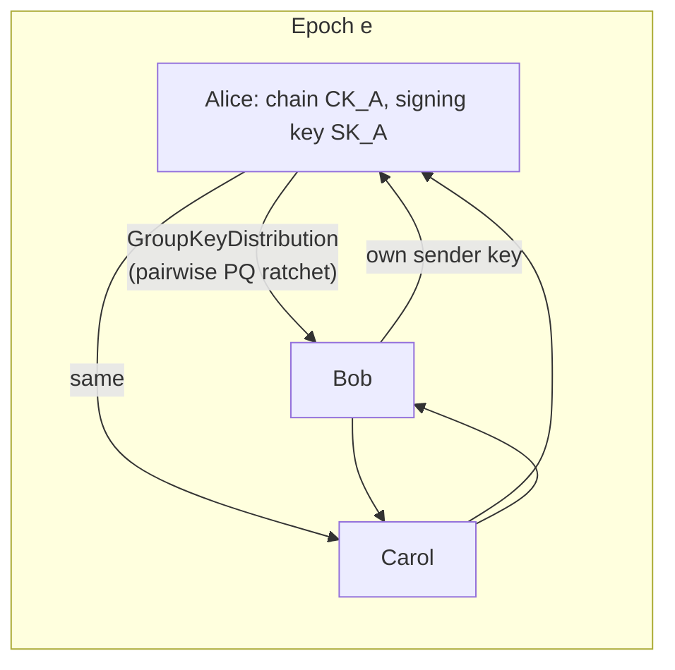

# Module 2: Cryptographic Protocol (Post-Quantum E2EE)

Everything here is implemented and tested in [`reference/src`](../reference/src) unless a section is marked **(specified, not in reference)**.

---

## 1. Primitive suite

| Role | Primitive | Standard | Sizes (bytes) | Security |
|------|-----------|----------|---------------|----------|
| KEM | **X-Wing** = ML-KEM-768 + X25519, combiner `SHA3-256(ss_M ‖ ss_X ‖ ct_X ‖ pk_X ‖ "\.//^\")` | FIPS 203 + RFC 7748, draft-connolly-cfrg-xwing-kem | pk 1216 · sk 32 (seed) · ct 1120 · ss 32 | NIST cat. 3 (PQ) **and** ~128-bit classical; secure while either component holds |
| Signature | **Composite** Ed25519 ‖ ML-DSA-65 over `M' = label ‖ len(ctx) ‖ ctx ‖ SHA-512(M)` | RFC 8032 + FIPS 204, after draft-ietf-lamps-pq-composite-sigs | pk 1984 · sig 3373 | Unforgeable while either component holds |
| AEAD (messages) | AES-256-GCM | NIST SP 800-38D | key 32 · nonce 12 · tag 16 | 2¹²⁸ against Grover |
| AEAD (vault, random nonces) | XChaCha20-Poly1305 | draft-irtf-cfrg-xchacha | key 32 · nonce 24 · tag 16 | 192-bit random nonces are safe under a long-lived key |
| KDF | HKDF-SHA-256 (protocol), HKDF-SHA-512 (key hierarchy) | RFC 5869 | — | — |
| MAC / PRF | HMAC-SHA-256 | RFC 2104 | 32 | — |
| Public-key encryption | HPKE base mode, suite `(KEM 0x647a X-Wing, KDF 0x0001 HKDF-SHA256, AEAD 0x0002 AES-256-GCM)` | RFC 9180 | enc 1120 | Interoperates with hpke-js (tested) and other X-Wing HPKE stacks |
| Password hashing | Argon2id | RFC 9106 | — | Memory-hard |

Why these:

- **Hybrid everywhere.** ML-KEM and ML-DSA are new. X25519 and Ed25519 are old and well understood but fall to Shor's algorithm. Hybrids cost ~1 KB extra per handshake and remove the need to bet on either.
- **X-Wing rather than an ad hoc "concatenate and hash" combiner.** It is a fixed, analysed construction with test vectors and two independent implementations; the test suite checks byte-for-byte interop.
- **ML-DSA-65 rather than SLH-DSA or Falcon.** SLH-DSA signatures are 8–30 KB. Falcon's floating-point signing is hard to implement in constant time. ML-DSA-65 matches ML-KEM-768's security category.

---

## 2. Key inventory

| Key | Type | Lifetime | Where it lives | Derivation / rotation |
|-----|------|----------|----------------|------------------------|
| Recovery phrase | 24 BIP-39 words (256-bit) | Forever | User's paper / steel; never on a server | Generated once (03 §2) |
| Root key | 64-byte HKDF PRK | Forever | Vault only | `HKDF-Extract(SHA-512, salt="SMA/v1/root", BIP39-seed)` |
| **IK**: identity signing key | Composite Ed25519 + ML-DSA-65 | Years | Vault | From root (labels `identity/ed25519-seed`, `identity/ml-dsa-65-seed`) |
| **IKEM**: identity KEM key | X-Wing | Years | Vault | From root (`identity/x-wing-seed`) |
| **SPK**: signed prekey | X-Wing, signed inside the bundle | 7 days + 7 days grace | Vault | Random; rotated weekly; ≤ 3 kept |
| **OTK**: one-time prekey | X-Wing, signed | Single use, inside one invite | Vault | Random; deleted on first use |
| Device key | Composite (may be hardware-bound) + X-Wing | ~1 year | Secure Enclave / Keystore / vault | Random per device, certified by IK (03 §4) |
| Session keys RK, CKs/CKr, HK/NHK, MK | 32-byte symmetric | Seconds to days | Vault (ratchet state) | Ratchet (§4) |
| Session tag keys | 32-byte HMAC keys | Session | Vault | Handshake output |
| Inbox tag key | 32-byte HMAC key | Years (rotatable) | Vault + every ContactCard | From root (`inbox/tag-key`) |

---

## 3. Session establishment (KEM-only PQXDH analogue)

### 3.1 Prekey bundle

A `SignedBlob{ body = PrekeyBundle, signer = IK_B, signature = CompositeSign(IK_B, body, "prekey-bundle") }` containing `IK_B`, `IKEM_B`, `SPK_B{id, pk, created, expires}`, device certificates and `published_at_ms`. It is public, so it can be stored on any host. Alice accepts it only if `SHA-256("SMA/v1/fingerprint" ‖ IK_B)` equals the fingerprint she **pinned out of band** (QR code, invite link, previously verified contact). Without that pin a lying host could substitute its own bundle.

### 3.2 Flow



### 3.3 Key schedule (exact)

```
ss         = ss_spk ‖ ss_ikem ‖ [ss_otk]
cts        = ct_spk ‖ ct_ikem ‖ [ct_otk]
ctx_pub    = SHA-256("SMA/v1/handshake/public" ‖ IK_B ‖ IKEM_B ‖ SPK_B ‖ [OTK_B] ‖ cts)
hsk ‖ chain = HKDF-SHA256(ikm = ss, salt = 0³², info = "SMA/v1/handshake/k1" ‖ ctx_pub, L = 64)

init_fields = IK_A(1984) ‖ IKEM_A(1216) ‖ u64(ts_ms) ‖ u32(spk_id) ‖ u32(otk_id | 0xFFFFFFFF)
transcript  = ctx_pub ‖ init_fields
sig         = CompositeSign(IK_A, transcript, context = "handshake")
sealed_init = AES-256-GCM(key = hsk, nonce = 0¹², aad = ctx_pub, init_fields ‖ sig)     // 6605 B; hsk single-use

rk ‖ hkA ‖ nhkB ‖ tagAB ‖ tagBA = HKDF-SHA256(chain, 0³², "SMA/v1/handshake/session" ‖ SHA-256(transcript), 160)
ad           = SHA-256("SMA/v1/ad" ‖ IK_A ‖ IK_B)                                       // AEAD AD for every message
handshake_id = SHA-256(ct_spk ‖ ct_ikem)[0..16]                                         // replay-cache key
```

### 3.4 Responder rules

0. **Spam gate (optional, before any crypto).** With no server, nothing filters unsolicited first-contact frames. An inbox may require a proof-of-work stamp: `SHA-256(frame)` must start with *k* zero bits. The sender grinds the 12-byte random header nonce of the trailing RatchetMessage until it does, so the wire format does not change. The check costs one hash and runs before ~10 ms of decapsulation. Typical *k* = 16–20, raised by the user under attack. Other levers: rotate the inbox tag key, or accept first contact only through OTK invite tags.
1. **Replay cache first.** If `handshake_id` is known, this is a later copy of the initiator's prefix: decrypt the trailing RatchetMessage with the existing session. The cache must outlive sessions until the SPK's grace period ends.
2. **No key ids on the wire.** Decapsulate `ct_spk` with each live SPK (current plus up to 2 previous). ML-KEM's implicit rejection gives a pseudorandom secret for a wrong key, so the `sealed_init` AEAD fails and the next SPK is tried. Cost: ≤ 3 decapsulations (~4.5 ms each in pure JS).
3. **OTK selection by tag.** Invites that include an OTK also carry a dedicated invite tag key. A hit on that tag table tells Bob which OTK (and the 3-ciphertext layout) to use. Delete the OTK after the first successful decryption.
4. Check `spk_id` and `otk_id` against the key that worked, and the timestamp window `now − (7 d + 7 d) ≤ ts ≤ now + 10 min`.
5. Verify `sig` with `IK_A`. **Then** decrypt the RatchetMessage, and commit the session only if that succeeds.
6. Surface `fingerprint(IK_A)` to the UI. Unknown means a "message request"; changed means a key-change warning (§5.4).

### 3.5 Security properties

| Property | Holds? | Reason |
|----------|:------:|--------|
| Confidentiality vs HNDL (A3) | ✓ | Every secret passes through ML-KEM-768 inside X-Wing |
| Initiator → responder authentication (PQ) | ✓ | Composite signature over a transcript binding all ciphertexts and both identities |
| Responder authentication (PQ, implicit) | ✓ | Only the holder of `IKEM_B` can derive `ss_ikem`; `SPK_B` is signed by `IK_B` |
| KCI resistance | ✓ | Knowing Bob's secrets does not let anyone produce Alice's signature |
| Forward secrecy vs later `IKEM_B` leak | ✓ | `ss_spk` (SPK deleted after grace) |
| Forward secrecy vs `IKEM_B` + live `SPK_B` leak | partial | The initiator's first chain is exposed until Bob's first reply; OTK invites close this gap |
| Replay of first message | ✓ | `handshake_id` cache plus timestamp window; replayed ratchet messages fail (key consumed) |
| Initiator identity hiding (sealed sender) | ✓ | `IK_A` exists only inside `sealed_init` (tested: not on the wire) |
| Responder identity hiding | vs host ✓ | Inbox tags are a PRF of a key known only to Bob's contacts |
| Handshake deniability | ✗ (deliberate) | Bob holds a transferable signature that Alice opened a session at `ts` |
| Message deniability | ✓ | Messages are authenticated only by symmetric ratchet keys |

**Deniable variant (specified, not in reference).** Omit `sig`. In Bob's first reply, add one more encapsulation `(ct_a, ss_a) = Encap(IKEM_A)` and mix `ss_a` into the root before deriving Bob's sending chain. Bob marks the session "unauthenticated" until he receives a message from Alice's *next* chain, which only the holder of `IKEM_A` can produce. Mutual PQ authentication then completes after 1.5 round trips, with only KEM-based (deniable) authentication. It costs one extra 1120-byte ciphertext and a weaker first-message UX, so it is offered as a per-contact setting.

---

## 4. Hybrid KEM Double Ratchet

The Double Ratchet (Signal, header-encryption variant) with the DH ratchet **replaced by an X-Wing KEM ratchet**. Because X-Wing already contains X25519, every asymmetric step is hybrid, and no second ratchet is needed to "add" PQ security.

### 4.1 State

| Variable | Meaning |
|----------|---------|
| `RK` | Root key |
| `kemSelf` | Our current X-Wing key pair; its public key is advertised in all our headers |
| `kemPeer` | Peer's latest advertised encapsulation key |
| `ctOut` | Encapsulation to `kemPeer` that opened our current sending chain |
| `CKs`, `CKr` | Sending / receiving chain keys |
| `HKs`, `HKr`, `NHKs`, `NHKr` | Current and next header keys, each direction |
| `Ns`, `Nr`, `PN` | Message numbers: sending, receiving, previous sending chain length |
| `MKSKIPPED` | `(HK, n) → MK`, ≤ 1000 per chain, ≤ 2000 total (oldest evicted) |

### 4.2 Functions

```
KDF_RK(rk, ss)  = HKDF-SHA256(ikm = ss, salt = rk, info = "SMA/v1/ratchet/root", 96) → (rk', ck, nhk)
KDF_CK(ck)      = (ck' = HMAC-SHA256(ck, 0x02), mk = HMAC-SHA256(ck, 0x01))
MSG_KEYS(mk)    = HKDF-SHA256(mk, 0³², "SMA/v1/ratchet/message", 44) → (key 32, nonce 12)

HEADER          = 0x01 ‖ ctOut(1120) ‖ ek_self(1216) ‖ u32(PN) ‖ u32(N)                 // 2345 B
ENC_HEADER      = nonce(12, random) ‖ AES-256-GCM(HKs, nonce, aad = AD, HEADER)         // 2373 B
BODY            = AES-256-GCM(MSG_KEYS(mk), aad = AD ‖ ENC_HEADER, padded plaintext)
RatchetMessage  = ENC_HEADER ‖ BODY
```

### 4.3 Algorithm

```python
def init_initiator(seed, responder_spk_pub):            # Alice, right after the handshake
    ct, ss          = XWing.Encap(responder_spk_pub)
    RK, CKs, NHKs   = KDF_RK(seed.rk, ss)
    kemSelf         = XWing.KeyGen(); kemPeer = responder_spk_pub; ctOut = ct
    HKs, NHKr       = seed.hkA, seed.nhkB;  CKr = HKr = None;  Ns = Nr = PN = 0

def init_responder(seed, spk_pair):                       # Bob: his SPK is his first KEM pair
    RK = seed.rk; kemSelf = spk_pair; kemPeer = ctOut = CKs = CKr = HKs = HKr = None
    NHKs, NHKr = seed.nhkB, seed.hkA;  Ns = Nr = PN = 0

def encrypt(st, pt):
    CKs, mk = KDF_CK(CKs)
    h       = ENC_HEADER(HKs, ctOut, kemSelf.pub, PN, Ns);  Ns += 1
    return h ‖ AEAD(mk, aad = AD ‖ h, pt)

def decrypt(st, msg):                                    # on ANY exception: keep the old state
    st' = copy(st)
    if (pt := try_skipped(st', msg)): return st', pt
    if   (hdr := HDEC(HKr,  msg)): new_chain = False
    elif (hdr := HDEC(NHKr, msg)): new_chain = True
    else: raise
    if new_chain:
        skip(st', hdr.pn)                                 # store keys of the old chain
        kem_ratchet(st', hdr)
    skip(st', hdr.n)
    CKr, mk = KDF_CK(CKr); Nr += 1
    return st', AEAD_DEC(mk, aad = AD ‖ enc_header, body)

def kem_ratchet(st, hdr):
    PN, Ns, Nr = Ns, 0, 0
    HKs, HKr   = NHKs, NHKr
    ss_in             = XWing.Decap(hdr.ct, kemSelf.sk)    # receive step
    RK, CKr, NHKr     = KDF_RK(RK, ss_in)
    kemPeer           = hdr.ek
    ctOut, ss_out     = XWing.Encap(kemPeer)               # send step, fresh randomness
    kemSelf           = XWing.KeyGen()
    RK, CKs, NHKs     = KDF_RK(RK, ss_out)
```

### 4.4 Why one KEM key pair per party is enough

A DH ratchet gets "my new key" and "secret for your key" from one 32-byte value. A KEM needs two values, so each header carries `ct` (to the peer's key) **and** `ek` (our next key). Chains alternate strictly: a party opens a new sending chain only on receiving the peer's *newest* chain, whose headers advertise the key the reply must use. So the `ct` in any new-chain header is always addressed to the receiver's **current** `kemSelf`. Delayed messages from older chains carry headers under old header keys and are handled through `MKSKIPPED` without any decapsulation. The out-of-order test cases in [`test/ratchet.test.ts`](../reference/test/ratchet.test.ts) exercise exactly this.

### 4.5 Properties

| Property | Mechanism | Tested |
|----------|-----------|:------:|
| Forward secrecy | Chain keys are one-way; message keys deleted after use | replay test |
| Post-compromise security | After a state theft, the victim's next send step uses fresh X-Wing randomness. The peer's next chain is encapsulated to a key the thief never saw. Healing takes one round trip. | ✓ `heals after a state compromise` |
| PQ for both | Every `ss` is an X-Wing secret | ✓ (construction) |
| Header confidentiality | Counters, `ct` and `ek` encrypted under header keys; no plaintext key on the wire | ✓ |
| Atomicity | Decryption works on a copy; a forged message cannot desynchronise the session | ✓ tamper test |
| DoS bound | ≤ 1000 skipped keys per chain, ≤ 2000 stored | ✓ |

### 4.6 Cost (measured, pure JS, one core of a 2.1 GHz Xeon; `npm run bench`)

| Operation | Time |
|-----------|------|
| X-Wing keygen / encap / decap | 1.3 / 3.2 / 4.5 ms |
| Ratchet message, same chain (encrypt + decrypt) | 0.9 ms |
| Round trip with two KEM steps | 17 ms |
| Header overhead per message | 2389 B (2373 header + 16 tag); smallest frame 4 KiB |

Native implementations (liboqs, BoringSSL, CryptoKit, RustCrypto) are typically an order of magnitude faster.

### 4.7 Sparse mode for constrained links (specified, not in reference)

For transports where 2.4 KB per message matters (SMS-like channels, LoRa meshes), use the structure of Signal's Triple Ratchet:

- Keep a **classical X25519 DH ratchet** on every step (32 B per header).
- Run the **X-Wing KEM ratchet in epochs**: `ek` and `ct` are split into 64-byte chunks, protected by a systematic erasure code, and spread over consecutive messages (as in SPQR). When an epoch's KEM exchange completes, mix its secret into the root: `RK, … = KDF_RK(RK, dh_out ‖ kem_ss)`.
- Message keys combine both: `mk = HKDF(mk_dh ‖ mk_kem_epoch)`.

| Design | Per-message overhead | PQ healing | Complexity |
|--------|---------------------|------------|------------|
| SMA default (dense KEM ratchet) | ~2.4 KB | every round trip | low |
| Sparse / SPQR-style | ~100 B amortised | every epoch (several messages) | high |
| Signal PQXDH only (2023) | 32 B | never (PQ only in handshake) | low |
| Apple PQ3 | periodic ML-KEM rekey | periodic | medium |

---

## 5. Authentication and verification

### 5.1 Fingerprints and safety numbers

- `fingerprint = SHA-256("SMA/v1/fingerprint" ‖ IK)`, 32 bytes, covering both Ed25519 and ML-DSA keys.
- **Safety number.** For each party, take `SHA-512("SMA/v1/safety-number" ‖ fp)`. Split the first 30 bytes into six 5-byte integers and reduce each mod 10⁵ to get 30 digits. Sort the two 30-digit strings and concatenate them into 12 groups of 5. Both screens show the same number, and it changes if either identity changes.

### 5.2 QR codes and invite links

PQ keys do **not** fit in a QR code: a bundle is ~8 KB, while a robust QR code holds a few hundred bytes. The QR therefore encodes a `ContactCapsule`:

```
ContactCapsule { version, fingerprint[32], capsule_key[32], card_locators[], expires_at }   ≈ 100–150 B
```

1. Bob's client encrypts a `ContactCard` (signed bundle, inbox tag key, mailboxes, optional OTK) under `capsule_key` and uploads it to two blob hosts.
2. Alice scans the QR, fetches the card, decrypts it and verifies the bundle against the pinned `fingerprint`.
3. Scanning in person is verification: the contact is marked **verified**. Bob scans Alice's capsule in turn, or Alice's first message carries her card.

Invite links carry the same capsule in the URL **fragment** (`https://…/#c=<base64url>`), which browsers never send to a server.

### 5.3 Key transparency without a server (specified, not in reference)

Each user maintains a **signed, hash-chained key history**: every PrekeyBundle, device addition or removal, and identity transition is a `SignedBlob` carrying the hash of the previous entry. Clients gossip the latest head they know for each contact inside ordinary encrypted `PrekeyRefresh` messages. Two different signed heads at the same height are a **publicly verifiable equivocation proof**, and the client shows a hard warning. This catches a host, or a compromised device, that serves different keys to different contacts.

### 5.4 Key changes

| Situation | Client behaviour |
|-----------|------------------|
| New SPK, same IK | Silent (expected weekly) |
| New device certified by the same IK | Notice in the conversation |
| **Different IK** for a known contact | Sending blocked until the user acknowledges; a **verified** contact gets a full-screen warning and must be re-verified |
| IK rotation by the owner | `KeyTransition { old_ik, new_ik, reason }` signed by **both** keys and published in the key history; contacts auto-accept only when both signatures verify |

---

## 6. Groups

### 6.1 Membership log

A group is identified by `group_id` (32 random bytes). Its state is a hash-chained log of `GroupControl` entries (`create`, `add`, `remove`, `metadata`), each signed by an admin's composite key and carrying `parent_hash` and the new `epoch`. Members accept an entry only if the signer is an admin at the parent epoch and the parent is their current head. Two concurrent changes at the same epoch are resolved deterministically: the lowest `SHA-256(entry)` wins and the loser is re-proposed.

### 6.2 Sender keys



- Each member creates, per epoch, a sender chain key `CK` and an ephemeral composite signing key. It sends `GroupKeyDistribution{group_id, epoch, key_id, iteration, chain_key, signing_key}` to every other member **over the pairwise hybrid ratchet** (never broadcast).
- **Group message (specified, not in reference):**
  ```
  group_secret_e   distributed with each GroupControl entry (pairwise)
  tag              = HMAC(HKDF(group_secret_e, "group/tag"), epoch)[0..16]
  sender_header    = AES-256-GCM(HKDF(group_secret_e, "group/header"), random nonce, key_id ‖ iteration)
  body             = AES-256-GCM(MSG_KEYS(mk_iteration), aad = tag ‖ sender_header, padded Content)
  SenderKeyMessage = sender_header ‖ body ‖ CompositeSign(SK_sender, tag ‖ sender_header ‖ body)
  ```
  The per-message composite signature (3373 B) stops one member from forging another member's messages. MACs cannot do this, because every member knows every chain key.
- **Add member:** a new epoch. Existing members send their current sender keys to the newcomer, who cannot read earlier history.
- **Remove member:** a new epoch. **Every** remaining member rotates its sender key and distributes it pairwise. That is O(n²) messages, acceptable up to a few hundred members.

| Property | Sender keys in SMA |
|----------|--------------------|
| Confidentiality vs quantum | ✓ (keys travel over X-Wing sessions) |
| Authentication vs quantum | ✓ (composite signature) |
| Forward secrecy | ✓ per chain (symmetric ratchet) |
| Post-compromise security | only at epoch changes |

### 6.3 MLS when an ordering service exists

MLS (RFC 9420) gives O(log n) membership changes and PCS on every commit, but it needs a delivery service that **totally orders** commits. Where a group already has one (a single Telegram channel, whose `message_id` gives a total order, or a designated relay that the group trusts for ordering only), SMA can run MLS with a hybrid PQ ciphersuite (X-Wing + ML-DSA, following the IETF MLS PQ ciphersuite work) and wrap MLS messages as frames. Sender keys remain the default because they need no ordering at all.

---

## 7. Sealed boxes (HPKE)

`sealBox(pk, pt, info, aad)` = `enc ‖ ct`, RFC 9180 base mode with the suite in §1.

| Use | Recipient key | `info` | `aad` |
|-----|---------------|--------|-------|
| One-shot anonymous message to an inbox | `IKEM` | `SMA/v1/sealed-box` | frame tag |
| Device-link provisioning | new device's ephemeral X-Wing key from its QR | `SMA/v1/device-link` | link nonce |
| Backup key wrapping (to a recovery contact) | contact's `IKEM` | `SMA/v1/backup-share` | share index |
| ContactCard | — (symmetric, `capsule_key`) | — | — |

---

## 8. Domain-separation labels

Every derivation has a unique, versioned label. A label change is a protocol version bump.

| Label | Used in |
|-------|---------|
| `SMA/v1/root` | HKDF-Extract salt for the root key |
| `SMA/v1/identity/ed25519-seed`, `…/ml-dsa-65-seed`, `…/x-wing-seed` | Identity key derivation |
| `SMA/v1/backup/aead-key`, `SMA/v1/backup/locator` | Backups |
| `SMA/v1/inbox/tag-key`, `SMA/v1/device/link-key` | Inbox, linking |
| `SMA/v1/argon2id/<purpose>` | Argon2id associated data |
| `SMA/v1/fingerprint`, `SMA/v1/safety-number` | Verification |
| `SMA-v1-COMPOSITE-SIG-Ed25519-ML-DSA-65` + contexts `prekey-bundle`, `handshake`, `device-cert`, `group-control`, `group-message`, `key-transition` | Signatures |
| `SMA/v1/handshake/public`, `…/k1`, `…/session`, `SMA/v1/ad` | Handshake |
| `SMA/v1/ratchet/root`, `SMA/v1/ratchet/message` | Ratchet |
| `SMA/v1/tag` | Routing tags |
| `SMA/v1/sealed-box`, `SMA/v1/device-link`, `SMA/v1/backup-share` | HPKE `info` |
| `SMA/v1/sframe/<role>` | Call media keys (04) |

---

## 9. Implementation requirements

| Hazard | Requirement |
|--------|-------------|
| Randomness | Only `crypto.getRandomValues` / `SecRandomCopyBytes` / `/dev/urandom`. Never `Math.random`. Abort if the CSPRNG is unavailable. |
| Constant time | JS engines give no constant-time guarantees. Production mobile and desktop builds should use a native core (Rust: RustCrypto `ml-kem`/`ml-dsa`, libcrux; or liboqs) via FFI. Web builds use WASM of the same core. The pure-JS reference is the executable spec. |
| ML-KEM implicit rejection | A wrong ciphertext yields a random secret, not an error. Every decapsulation result must be authenticated (AEAD) before use. |
| ML-KEM key validation | Encapsulation keys must pass the FIPS 203 modulus check (done by the library on `encapsulate`). |
| Nonce discipline | Message keys: derived nonce (key used once). Header keys: random 96-bit nonce (one chain per key). Vault and long-lived keys: XChaCha20 (192-bit random nonce). File chunks: `prefix ‖ index` under a per-file key. |
| State atomicity | Ratchet and handshake updates are all-or-nothing; persist the new state **before** displaying plaintext. |
| Parsing | Fixed-length readers with bounds checks; reject trailing bytes; protobuf only after decryption. |
| Zeroisation | Best effort in JS (`fill(0)`); a native core uses `zeroize`. Never log keys or plaintext. |
| Ratchet state | Never back up, sync or restore it: two devices running the same state reuse message keys. Restore = new sessions (03 §5). |
