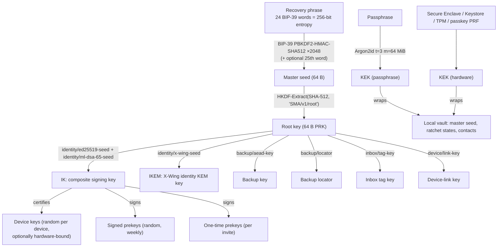
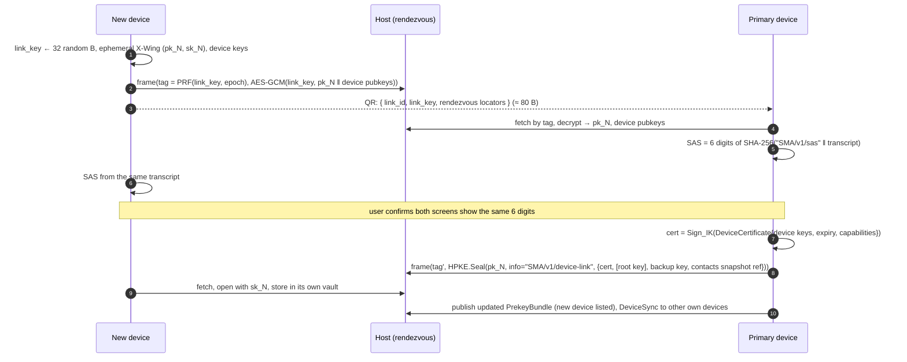
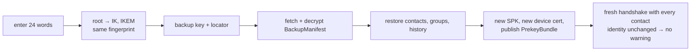

# Module 3: Key Management and Master Passphrase Architecture

There is no backend to reset a password, hold an escrow copy or relay device links. Every key-management flow therefore starts from something the user holds: the **recovery phrase**, a **passphrase**, a **hardware key** or **another of their devices**.

---

## 1. Key hierarchy



Two rules follow from this hierarchy:

1. **Recoverable = derived from the phrase.** Identity keys, the backup key, the backup locator and the inbox tag key are deterministic, so the phrase alone restores the identity on a new device. That is tested: the same phrase gives the same fingerprint.
2. **Low-entropy secrets only unlock, never derive.** A passphrase guards the *local* vault. If a passphrase-derived key ever protected something stored on Telegram or IPFS, an attacker could brute-force it offline forever, quantum computer or not.

---

## 2. Recovery phrase

| Step | Detail |
|------|--------|
| Generate | 256 bits from the OS CSPRNG → BIP-39 English mnemonic (`generateRecoveryPhrase()`), 24 words including an 8-bit checksum |
| Show | Once, during onboarding, on a screen excluded from screenshots and screen recording (`FLAG_SECURE` / `isSecureTextEntry`) |
| Confirm | The user re-enters 4 random words before the account is usable |
| Normalise | NFKD, trim, collapse whitespace, validate the checksum (`recoveryPhraseToSeed()`); 24 words only |
| Duress identity | The optional BIP-39 passphrase ("25th word") derives a completely different root, so under coercion a user can reveal a decoy identity |
| Storage advice | Paper or steel, offline. Never in the cloud, never photographed. |

```ts
// reference/src/kdf.ts
export function recoveryPhraseToSeed(phrase: string, bip39Passphrase = ''): Uint8Array {
  const normalized = phrase.normalize('NFKD').trim().split(/\s+/).join(' ');
  if (!bip39.validateMnemonic(normalized, english)) throw new Error('invalid recovery phrase (checksum)');
  if (normalized.split(' ').length !== 24) throw new Error('recovery phrase must have 24 words');
  return bip39.mnemonicToSeedSync(normalized, bip39Passphrase);
}
export function deriveRootKey(masterSeed: Uint8Array): Uint8Array {
  return extract(sha512, masterSeed, utf8ToBytes('SMA/v1/root'));
}
export function deriveSubkey(rootKey: Uint8Array, label: KeyLabel, length = 32): Uint8Array {
  return expand(sha512, rootKey, utf8ToBytes(`SMA/v1/${label}`), length);
}
```

PBKDF2 with 2048 rounds is weak as a password hash, but the input already has 256 bits of entropy, so stretching adds nothing. The BIP-39 step is kept for compatibility with existing phrase tooling.

---

## 3. Passphrase and Argon2id

### 3.1 Parameters

| Profile | Argon2id `t`, `m`, `p` | Use | Pure-JS time (measured) |
|---------|------------------------|-----|--------------------------|
| `interactive` | 3, 64 MiB, 1 | Unlocking the local vault | ~1.4 s (Node, one core) |
| `offDevice` | 4, 256 MiB, 1 | Anything passphrase-protected that leaves the device (discouraged, §5.4) | several seconds; use native/WASM Argon2 |
| `insecureTest` | 1, 8 MiB, 1 | Unit tests only | ~80 ms |

- RFC 9106 §4's second recommended option is t=3, m=64 MiB, p=4. The reference uses p=1 because JS is single-threaded; memory and passes are the same. Native builds (libsodium `crypto_pwhash`, platform Argon2) should use p=4 and **calibrate** at first launch to ≥ 0.5 s, with m as high as the device tolerates.
- Parameters, salt (16 random bytes) and nonce are stored in the vault header. The whole header is AEAD associated data, so downgrading the cost parameters breaks decryption (tested).
- The Argon2 associated-data input `X` is `SMA/v1/argon2id/<purpose>`, so one passphrase gives independent keys for independent purposes.
- Passphrases are NFKC-normalised, so `café` typed on any keyboard gives the same key (tested).
- Bounds are enforced (`t ≤ 16`, `m ≤ 1 GiB`, `p ≤ 16`) so a tampered header cannot force a multi-GiB allocation.

### 3.2 Vault format

```
vault = 0x01 ‖ u32 t ‖ u32 m_KiB ‖ u8 p ‖ salt[16] ‖ nonce[24] ‖ XChaCha20-Poly1305(KEK, nonce, aad = header, secret)
KEK   = Argon2id(NFKC(passphrase), salt, t, m, p, X = "SMA/v1/argon2id/vault-kek", dkLen = 32)
```

```ts
// Example 1 (reference/examples/01-derive-keys.ts)
const seed  = recoveryPhraseToSeed(phrase);
const root  = deriveRootKey(seed);
const id    = identityFromRootKey(root);               // IK + IKEM + fingerprint
const vault = await sealVault(seed, passphrase, ARGON2.interactive);
const again = await openVault(vault, passphrase);      // throws on wrong passphrase / tampering
```

### 3.3 Passphrase policy

- Vault passphrase: zxcvbn score ≥ 3, or ≥ 5 Diceware words. The vault only defends against someone who already has the device.
- Rate limiting: the app cannot enforce it on a stolen disk image, and Argon2id is the only real defence. With a hardware KEK (§4) the OS adds attempt counters and biometrics.

---

## 4. Hardware-backed protection

The **vault key** (256-bit random) encrypts the vault. It is stored *wrapped* once per unlock method, and any one unwrap opens the vault.

| Platform | Hardware KEK | Notes |
|----------|-------------|-------|
| iOS / macOS | Secure Enclave P-256 key, `kSecAttrTokenIDSecureEnclave`, access control `.biometryCurrentSet` or `.devicePasscode`; wrap via ECIES (`SecKeyCreateEncryptedData`, `eciesEncryptionCofactorX963SHA256AESGCM`) | Non-exportable. On iOS 26+, CryptoKit exposes ML-KEM and ML-DSA, including Secure Enclave variants (e.g. `SecureEnclave.MLDSA65`), which allows **hardware-bound PQ device keys**. Check availability on target hardware. |
| Android | Keystore AES-256-GCM key, StrongBox when `FEATURE_STRONGBOX_KEYSTORE` is present, `setUserAuthenticationRequired(true)`, `setUnlockedDeviceRequired(true)` | Keystore has no PQ algorithms; device keys stay in software, wrapped by the hardware AES key |
| Web | **WebAuthn PRF extension** (passkey): `prf.eval.first = SHA-256("SMA/v1/webauthn-prf")` → HKDF → KEK | A serverless second factor. The passkey never leaves the authenticator. Fall back to the passphrase where PRF is unsupported. |
| Windows | TPM-backed key via CNG (`NCRYPT_PROV_MICROSOFT_PLATFORM_CRYPTO_PROVIDER`) or DPAPI-NG | |
| Linux | TPM 2.0 sealed object (`tpm2-tss`) or Secret Service | |

Identity keys (IK, IKEM) are **not** generated inside hardware, because hardware keys are non-exportable and could not be restored from the phrase. Hardware protects the vault, and optionally binds *device* keys to the device.

---

## 5. Multi-device without a server

### 5.1 Model

- One **user identity** (IK). Each device has its own **device keys** (composite signing + X-Wing) and a `DeviceCertificate` signed by IK. Certificates are listed in the PrekeyBundle.
- **Per-device sessions.** Contacts run a separate ratchet with each of the user's devices. A sender fans out to every recipient device plus its own other devices (sent-message sync). Cost: N frames per message for N devices. Accepted for correctness: shared ratchet state across devices would reuse message keys.
- **Device classes:**
  - *Full device*: receives the root key and can certify devices, recover and rotate keys.
  - *Linked device* (default for secondary devices): receives only its certificate, the backup **read** key and contact snapshots. It cannot add devices.

### 5.2 Linking protocol

A QR code cannot hold a 1216-byte X-Wing key comfortably, so the new device uses the same capsule pattern as contact exchange.



If both devices are on the same network, the provisioning blob can go over a WebRTC data channel instead, with the rendezvous used only for signalling.

### 5.3 Revocation

1. A remaining full device publishes a bundle without the revoked certificate and sends `DeviceSync{revoked_device_id}` to the user's other devices.
2. Contacts drop their sessions with that device on seeing the new bundle.
3. If the revoked device was a **full** device, it held the root key: rotate the inbox tag key and backup key, and perform an **identity rotation** (02 §5.4) because the root itself is compromised. Contacts must re-verify, since an attacker holding the old IK can also sign transitions. The key-history equivocation check (02 §5.3) makes a competing transition visible.

---

## 6. Backup and recovery

### 6.1 What is backed up

| Data | Backed up | Why |
|------|:---------:|-----|
| Contacts (fingerprints, verification state, ContactCards) | ✓ | |
| Group membership logs and metadata | ✓ | |
| Message history | ✓ (optional) | Chunked and encrypted like media |
| Plugin data | ✓ (per plugin opt-in) | |
| **Ratchet / session state** | **✗ never** | Restoring it on another device would reuse message keys and break forward secrecy |
| Signed prekeys, OTKs | ✗ | Regenerated |

### 6.2 Format and location

```
backup_key  = HKDF-Expand(root, "SMA/v1/backup/aead-key", 32)
locator     = HKDF-Expand(root, "SMA/v1/backup/locator", 32)
manifest    = XChaCha20-Poly1305(backup_key, nonce, aad = locator, BackupManifest{contacts[], groups[], history[]: BlobRef})
```

The manifest is published under an address derived from `locator`: a Nostr parameterised replaceable event with `d = hex(SHA-256(locator))` signed by a key derived from the locator, a Blossom object, or the user's Telegram bot blob store. The address is unguessable without the phrase and reveals nothing about the identity. `BlobRef`s inside point to chunked, encrypted data on any blob host (05 §5).

### 6.3 Restore flow



### 6.4 Optional recovery paths

- **Passphrase-only recovery** (discouraged). The manifest key is derived as `Argon2id(passphrase, salt = SHA-256("SMA/v1/backup-salt" ‖ handle), offDevice params)`. Anyone who knows the handle can attack the passphrase offline, so this requires ≥ 7 Diceware words (~90 bits) and an explicit warning.
- **Social recovery** (recommended second path). Split the 32-byte phrase entropy with Shamir's secret sharing (k-of-n, e.g. 3-of-5, SLIP-39 style). Each share goes to a guardian contact as `HPKE.Seal(IKEM_guardian, info = "SMA/v1/backup-share", aad = share_index)`. To recover, the user contacts guardians out of band; each returns their share to a fresh one-time key that the user's new device shows as a QR code. No single guardian learns anything.

---

## 7. Lifecycle

| Key | Rotation | Trigger | Overlap |
|-----|----------|---------|---------|
| SPK | Weekly | Timer | Old SPKs kept for a 7-day grace (≤ 3 live) |
| OTK | Per invite | Invite created | Deleted after first use or at invite expiry |
| Device certificate | Yearly | Timer / revocation | New one issued before expiry |
| Inbox tag key | On demand | Spam to the inbox, revoked full device | Old key watched for 1 week |
| Session tag keys | Per session | New handshake | — |
| Identity (IK, IKEM) | Rare | Root compromise, algorithm migration | `KeyTransition` signed by both keys |
| Algorithms | Protocol version | Cryptanalysis (e.g. move to ML-KEM-1024 / ML-DSA-87) | Version-labelled derivations (`SMA/v2/...`) |
