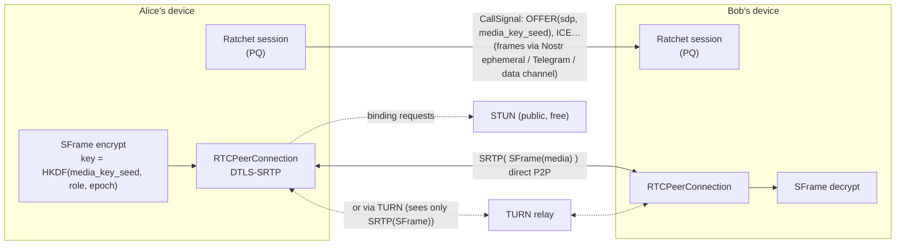
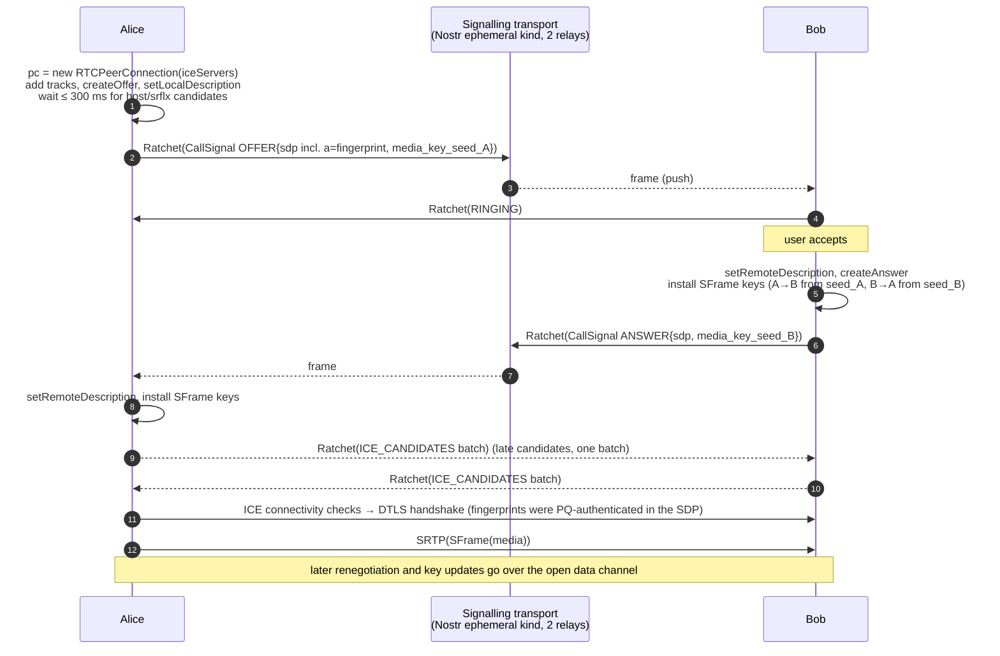
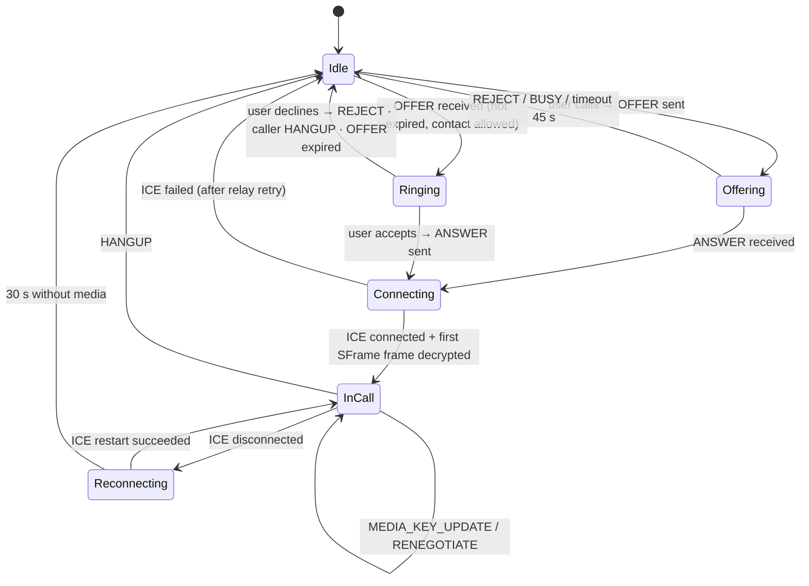

# Module 4: Real-Time Communication (Calls and WebRTC)

Calls are peer-to-peer WebRTC sessions. All signalling travels as encrypted `CallSignal` contents through the same hybrid ratchet as text messages. Media is encrypted twice: by WebRTC's DTLS-SRTP, and by **SFrame** keys that come from the post-quantum ratchet. The only infrastructure involved is STUN (free) and TURN (optional, and the only component that costs bandwidth).

---

## 1. Architecture



---

## 2. Signalling over the encrypted messaging layer

### 2.1 Messages

`CallSignal` (proto: `sma.v1.CallSignal`):

| Type | Payload | Sent by |
|------|---------|---------|
| `OFFER` | `call_id`, `sdp`, `media_key_seed` (32 B), `video`, `expires_at_ms` (now + 60 s) | Caller |
| `RINGING` | `call_id` | Callee device(s) |
| `ANSWER` | `call_id`, `sdp`, callee's own `media_key_seed` | Callee |
| `ICE_CANDIDATES` | `call_id`, batch of `IceCandidate` | Both |
| `RENEGOTIATE` | `call_id`, `sdp` (add or remove video, ICE restart) | Both, usually over the data channel |
| `MEDIA_KEY_UPDATE` | `call_id`, new `media_key_seed`, `key_epoch + 1` | Both, every 10 min or on participant change |
| `HANGUP` / `REJECT` / `BUSY` | `call_id`, `reason` | Both |

They inherit everything from the ratchet: PQ confidentiality, mutual authentication, replay protection and header encryption. The relay sees a 4 KiB frame like any other message.

### 2.2 Call setup



### 2.3 Rules

- **Latency.** Signalling uses the fastest healthy route (01 §4): an open data channel, then a Nostr ephemeral event (forwarded, not stored), then Telegram MTProto push. Target: OFFER to RINGING in under 1 s.
- **Half-trickle.** Every signalling message is a ≥ 4 KiB frame, so per-candidate trickle is wasteful. Send the OFFER after ≤ 300 ms with the host and server-reflexive candidates gathered so far, then **one** `ICE_CANDIDATES` batch when gathering completes, plus ICE restarts as needed.
- **Expiry.** Drop an `OFFER` after `expires_at_ms`. A device that comes online later shows "missed call" instead of ringing.
- **Multi-device.** The OFFER fans out to all of the callee's devices. The first `ANSWER` wins, and the caller sends `HANGUP{reason:"answered elsewhere"}` to the rest.
- **Glare** (both call each other at once). Use the WebRTC "perfect negotiation" pattern: the peer with the lexicographically **lower fingerprint** is *polite*. It rolls back its own offer and answers the incoming one.
- **Privacy of IPs.** For contacts that are not verified, or when the user enables "hide my IP", set `iceTransportPolicy: "relay"` so only TURN-relayed candidates are used. Browsers already obfuscate host candidates as mDNS `.local` names.

---

## 3. Media encryption

### 3.1 Why DTLS-SRTP is not enough

WebRTC derives SRTP keys from a DTLS handshake. In deployed browser stacks that handshake is classical ECDHE: DTLS 1.2 is the norm, and hybrid ML-KEM groups (X25519MLKEM768 is specified as DTLS-OK for (D)TLS 1.3) are not reliably negotiated by WebRTC implementations yet. A harvest-now-decrypt-later adversary that records the SRTP stream, for example at a TURN relay, could decrypt it once ECDHE falls. So:

1. **Fingerprint binding.** The DTLS certificate fingerprints (`a=fingerprint`) travel inside the PQ-authenticated ratchet, so nobody can MITM the DTLS handshake *today*.
2. **SFrame** (RFC 9605) end-to-end frame encryption, keyed from the ratchet, makes the media payload PQ-confidential *regardless of DTLS*.

### 3.2 SFrame keys

```
base_key(role, epoch) = HKDF-SHA256(ikm = media_key_seed_role, salt = call_id,
                                    info = "SMA/v1/sframe/" ‖ role ‖ u32be(epoch), L = 32)
role  ∈ { "caller", "callee" }  (group calls: participant index)
KID   = (epoch << 1) | role_bit       (SFrame key id, varint in the SFrame header)
suite = AES_256_GCM_SHA512_128 (RFC 9605 cipher suite 0x0005); sframe_key / sframe_salt are derived from base_key exactly as RFC 9605 specifies
```

- Each direction has its own seed and is sent by its owner inside the ratchet (OFFER / ANSWER), so neither party can force the other's keys.
- **Rekeying.** `MEDIA_KEY_UPDATE` carries a new seed and `epoch + 1`. Receivers keep the previous epoch's key for 5 s so frames in flight still decrypt.
- **Unencrypted prefix.** In a pure P2P call the whole encoded frame is encrypted. If an SFU is ever involved (§5), leave the codec's payload descriptor bytes in clear (for VP8: 10 bytes on key frames, 3 on delta frames) so the SFU can still route by layer.

### 3.3 Implementation surfaces

| Platform | API |
|----------|-----|
| Browsers | WebRTC Encoded Transform: `RTCRtpScriptTransform` in a worker (legacy Chromium: `createEncodedStreams()`) |
| iOS / Android / desktop native | libwebrtc `FrameEncryptorInterface` / `FrameDecryptorInterface` (`RTCRtpSender.setFrameEncryptor`) |

Browser sketch (worker side). This is an SFrame-*style* transform kept minimal for readability; production code should use a complete RFC 9605 implementation (for example a Rust/WASM `sframe` crate) for header encoding and key-id handling.

```ts
// sframe-worker.ts: runs inside the RTCRtpScriptTransform worker
let keys = new Map<number, CryptoKey>();   // KID → AES-256-GCM key (installed via postMessage)
let sendKid = 0;
let counter = 0n;

onmessage = async (e) => {
  if (e.data.type === 'key') keys.set(e.data.kid, await crypto.subtle.importKey('raw', e.data.raw, 'AES-GCM', false, ['encrypt', 'decrypt']));
  if (e.data.type === 'send-kid') sendKid = e.data.kid;
};

onrtctransform = (event: any) => {
  const { readable, writable, options } = event.transformer;
  const encrypting = options.side === 'send';
  readable
    .pipeThrough(new TransformStream({
      async transform(frame: any, ctl) {
        const data = new Uint8Array(frame.data);
        if (encrypting) {
          const ctr = counter++;
          const iv = new Uint8Array(12); new DataView(iv.buffer).setBigUint64(4, ctr);
          const hdr = new Uint8Array(9); hdr[0] = sendKid; new DataView(hdr.buffer).setBigUint64(1, ctr);
          const ct = new Uint8Array(await crypto.subtle.encrypt({ name: 'AES-GCM', iv, additionalData: hdr }, keys.get(sendKid)!, data));
          const out = new Uint8Array(hdr.length + ct.length); out.set(hdr); out.set(ct, hdr.length);
          frame.data = out.buffer;
        } else {
          const hdr = data.subarray(0, 9);
          const key = keys.get(hdr[0]!); if (!key) return;                  // unknown epoch: drop
          const ctr = new DataView(hdr.buffer, hdr.byteOffset).getBigUint64(1);
          const iv = new Uint8Array(12); new DataView(iv.buffer).setBigUint64(4, ctr);
          try {
            frame.data = await crypto.subtle.decrypt({ name: 'AES-GCM', iv, additionalData: hdr }, key, data.subarray(9));
          } catch { return; }                                                // forged / corrupted: drop
        }
        ctl.enqueue(frame);
      },
    }))
    .pipeTo(writable);
};
```

Main thread:

```ts
const pc = new RTCPeerConnection({ iceServers, iceTransportPolicy: hideIp ? 'relay' : 'all' });
const worker = new Worker(new URL('./sframe-worker.ts', import.meta.url), { type: 'module' });
for (const t of stream.getTracks()) {
  const sender = pc.addTrack(t, stream);
  sender.transform = new RTCRtpScriptTransform(worker, { side: 'send' });
}
pc.ontrack = (e) => { e.receiver.transform = new RTCRtpScriptTransform(worker, { side: 'receive' }); };

const offer = await pc.createOffer();
await pc.setLocalDescription(offer);
const seed = crypto.getRandomValues(new Uint8Array(32));
installSFrameKey(worker, seed, 'caller', 0);                              // HKDF per §3.2
const frame = endpoint.send(bob, encodeContent({
  call: { callId, type: 'OFFER', sdp: pc.localDescription!.sdp, mediaKeySeed: seed, video: true,
          expiresAtMs: Date.now() + 60_000 },
}));
await transports.send(bob.routes, frame);                                // fastest route first
```

### 3.4 Data channel

Once connected, the `RTCDataChannel` is registered as **another transport** in the TAL (01 §4). Ratchet frames sent over it are byte-identical to those sent through Nostr or Telegram. That gives fast file transfer, renegotiation and in-call chat without trusting DTLS for confidentiality.

---

## 4. NAT traversal without paid infrastructure

### 4.1 STUN

STUN only reflects the public address; it never sees media. Public, free endpoints include `stun:stun.cloudflare.com:3478` (Cloudflare documents its STUN service as free and unlimited) and `stun:stun.l.google.com:19302`. Ship two or more, from different operators.

### 4.2 TURN options

TURN is needed when both peers sit behind symmetric NATs or restrictive firewalls, a minority of calls but common on some mobile carriers and corporate networks. Relayed traffic costs bandwidth, so no TURN is truly free. The options, cheapest and most decentralised first:

| Option | Cost | Who holds the credential secret | Notes |
|--------|------|---------------------------------|-------|
| **Peer relay**: a mutual contact's always-on desktop app runs an embedded TURN server (e.g. pion/turn) | Free (the friend's bandwidth) | The friend's client | The friend's client issues ephemeral TURN-REST credentials (`username = expiry:nonce`, `password = HMAC(secret, username)`) and sends them through the encrypted chat. Fully serverless; the relay sees only SRTP(SFrame). |
| **Bring-your-own TURN** | User's choice | User (stored in the vault) | Self-hosted coturn on any always-free VM tier, or a home router |
| **Cloudflare Realtime TURN**, user's own account | 1,000 GB/month free (shared with Cloudflare's SFU), then $0.05/GB egress, per Cloudflare's pricing docs | User's API token (in the vault) | Anycast, TURN over UDP/TCP/TLS 443. The client mints short-lived credentials directly with the user's token. |
| Community-funded TURN pool | Donations | A small stateless credential-minting function (e.g. a free-tier edge worker) | The only option that reintroduces a project-operated component; optional and replaceable |

Sizing: a 1:1 video call at ~1.5 Mbit/s is ~0.7 GB/hour through TURN, so 1,000 GB is on the order of 1,400 relayed call-hours per month.

### 4.3 ICE configuration

```ts
const iceServers: RTCIceServer[] = [
  { urls: ['stun:stun.cloudflare.com:3478', 'stun:stun.l.google.com:19302'] },
  ...peerRelayCredentials,      // from contacts who offered relays (encrypted chat)
  ...userTurnServers,           // BYO / Cloudflare, credentials minted locally
  // TURN over TLS on 443 last, for networks that block UDP
];
```

---

## 5. Group calls

| Participants | Topology | Notes |
|--------------|----------|-------|
| 2 | P2P | Default |
| 3–5 | Full mesh | Each device uploads N−1 streams; simulcast off; SFrame keys per participant |
| 6+ | SFU | Needs a media server (a cost). With SFrame the SFU forwards ciphertext only, so any SFU (Cloudflare Realtime SFU, LiveKit, a participant's desktop running pion) can be used untrusted. Group media keys travel via `MEDIA_KEY_UPDATE` over pairwise ratchets and rotate on every join or leave. |

---

## 6. Call state machine


