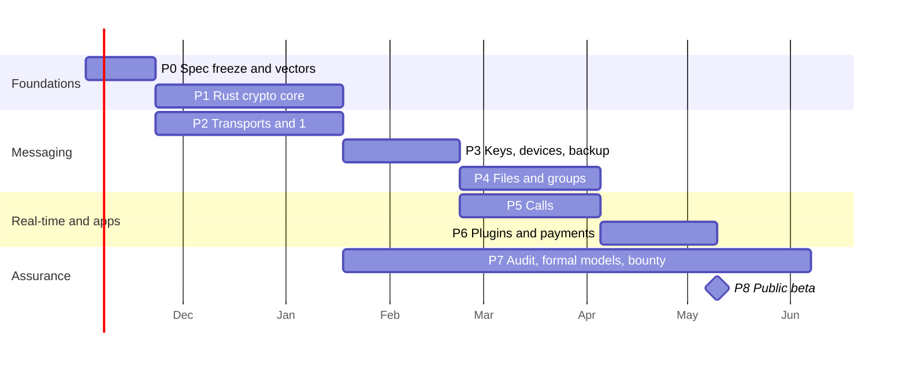

# Implementation Roadmap

Durations are engineering estimates for a team of 3–4 (one cryptography and protocol engineer, two client engineers, one shared for transport/infra), not commitments. Phases overlap where dependencies allow.

---

## 1. Technology choices

| Layer | Recommendation | Why |
|-------|----------------|-----|
| Crypto and protocol core | **Rust** crate `sma-core`: RustCrypto / libcrux for ML-KEM, ML-DSA, X-Wing; `aes-gcm`, `chacha20poly1305`, `hkdf`, `argon2`; `zeroize` | Constant-time implementations, memory safety, one codebase for every platform |
| Bindings | `uniffi` (Swift, Kotlin), `wasm-bindgen` (web), C ABI (desktop) | No protocol logic duplicated per platform |
| Executable spec | The TypeScript reference in this repo | Every Rust change must pass vectors generated from it, and vice versa |
| iOS / macOS UI | SwiftUI + CryptoKit for Secure Enclave wrapping (and SE ML-KEM/ML-DSA on iOS 26+) | |
| Android UI | Jetpack Compose + Android Keystore/StrongBox | |
| Desktop / Web | Tauri (desktop) and a PWA sharing a TypeScript UI; core via WASM | Desktop builds can also run peer TURN relays (04 §4.2) |
| Transports | Nostr (`nostr-tools` / `rust-nostr`), TDLib for MTProto, Bot API over HTTPS, Blossom over HTTPS | |

---

## 2. Phases

| Phase | Deliverables | Exit criteria |
|-------|--------------|---------------|
| **P0 Spec freeze** (3 wk) | Freeze docs 02–05 as `SMA/v1`; make the TS reference RNG-injectable and emit deterministic **test vectors** (handshake, ratchet sequences incl. out-of-order, frames, HPKE); threat-model review with an external cryptographer | Vectors published in the repo; open questions in this doc resolved |
| **P1 Rust core** (8 wk) | `sma-core`: X-Wing, composite signatures, HPKE, handshake, hybrid KEM ratchet, padding, tags, vault; uniffi/WASM bindings | Passes all P0 vectors both ways; `cargo-fuzz` on every parser for 72 h without findings; constant-time checks (dudect-style) on secret-dependent paths |
| **P2 Transports + 1:1 MVP** (8 wk, parallel with P1 on the TS core) | TAL with persistent outbox; Nostr adapter (ephemeral keys, ≥ 2 relays, bucket tags); Telegram Bot blob store; TDLib MTProto adapter; failover; contact exchange by QR capsule; 1:1 text on desktop/web | Two users chat across a relay outage and a Telegram 429 storm with no lost or duplicated messages |
| **P3 Keys, devices, backup** (5 wk) | Recovery phrase onboarding; Argon2id vault with calibration; Secure Enclave / Keystore / WebAuthn-PRF KEKs; device linking with SAS; revocation; encrypted backups; Shamir social recovery | Restore on a wiped device from the phrase alone; revoked device can no longer decrypt new traffic |
| **P4 Files and groups** (6 wk) | Chunked media over Blossom/IPFS/Telegram; sender-key groups with hash-chained `GroupControl`; key-history gossip | 50-member group with member removal; a 1 GB file transferred and verified across two blob hosts |
| **P5 Calls** (6 wk) | `CallSignal` flow, half-trickle ICE, SFrame (browser Encoded Transform + native FrameEncryptor), relay-only privacy mode, peer TURN relays, BYO/Cloudflare TURN | 1:1 video across symmetric NATs via a peer relay; SFrame verified by recording at the TURN hop and failing to decode |
| **P6 Plugins and payments** (5 wk) | Plugin manifest and signature checks, WASM/iframe sandbox, capability RPC, host-drawn payment sheet, NWC (NIP-47) connector; reference plugins (polls, split-bill, secret notes) | A third-party plugin works without network or key access; permission prompts cannot be spoofed |
| **P7 Assurance** (from P1, ongoing) | Tamarin/ProVerif models of the handshake and KEM ratchet (adapting published Signal/PQXDH models); external audit of `sma-core` and the protocol; reproducible builds, SBOM, signed releases, pinned dependencies; bug bounty | Audit findings closed; formal models prove secrecy, authentication, FS and PCS under stated assumptions |
| **P8 Public beta** | Store releases, docs, relay and blob-host defaults, transparency report | |

---

## 3. Security programme

- **Known-answer tests**: RFC 9106 (Argon2id), BIP-39, X-Wing draft vectors, FIPS 203/204 ACVP vectors for ML-KEM/ML-DSA, RFC 9180-style vectors for the X-Wing HPKE suite, plus SMA's own protocol vectors from P0.
- **Differential testing**: the Rust core vs the TS reference vs hpke-js on random inputs in CI.
- **Fuzzing**: frame, header, sealed-init, protobuf and transport-response parsers.
- **Formal verification**: Tamarin models of the handshake (identity hiding, KCI, replay) and of the ratchet (FS, PCS), with the X-Wing KEM modelled as an IND-CCA KEM.
- **Supply chain**: exact version pins and lockfiles, `npm ci` / `cargo --locked`, reproducible builds, dependency review on every bump, no post-install scripts.
- **Operational**: no telemetry; crash reports are opt-in and scrubbed; release signing keys in hardware.

---

## 4. Risk register

| Risk | Likelihood | Impact | Mitigation |
|------|:----------:|:------:|------------|
| Telegram bans accounts or bots used as a backend (ToS) | Medium | Medium | Telegram is never the only transport; per-user bots and accounts, never a shared one; respect FLOOD_WAIT; fail over (01 §6) |
| Free Nostr relays drop or censor events | Medium | Low | ≥ 2 relays per mailbox, read-back verification, paid-relay option |
| TURN costs grow | Medium | Low | Peer relays, BYO TURN, relay only when ICE fails |
| Inbox spam (no server-side filtering) | High | Medium | Proof-of-work gate before decapsulation, message-request UI, inbox-tag rotation, invite-only mode (02 §3.4) |
| Side channels in JS crypto | Medium | High | Native/WASM Rust core for production; JS is the spec only |
| Implementation bug in a young PQ library | Low | High | Hybrid design (X25519/Ed25519 still protect); differential testing across implementations; audits |
| Users lose the recovery phrase | High | High | Mandatory confirmation, social recovery, multiple devices; clear "no one can recover this for you" UX |
| Traffic analysis (timing, volume) | High | Medium | Bucket padding, tag rotation, optional cover traffic and Tor; documented as residual risk (00 §2) |
| Fan-out cost with many devices or large groups | Medium | Medium | Device caps (e.g. 5), sender keys, MLS when an ordering channel exists (02 §6.3) |
| Cryptanalytic advance against ML-KEM-768 / ML-DSA-65 | Low | High | Hybrid keeps classical security; versioned labels allow moving to ML-KEM-1024 / ML-DSA-87 (03 §7) |
| App-store and export-control requirements for encryption | Certain | Low | File the required encryption declarations (e.g. US EAR self-classification, store questionnaires) before release |

---

## 5. Open questions to resolve in P0

1. Default **deniability mode**: signature-authenticated handshake (current) or KEM-authenticated 1.5-RTT handshake (02 §3.5)?
2. **Bucket tag width** `b` for Nostr subscriptions (01 §5.3): fixed, or adaptive to network size?
3. **Device model** default: per-device sessions with fan-out (current) versus Sesame-style device lists in every session.
4. Whether to ship **MLS** for large groups in P4, or keep sender keys until a total-order channel is common.
5. Default **epoch length** for routing tags (1 h): shorter improves unlinkability, longer reduces the subscription churn.
