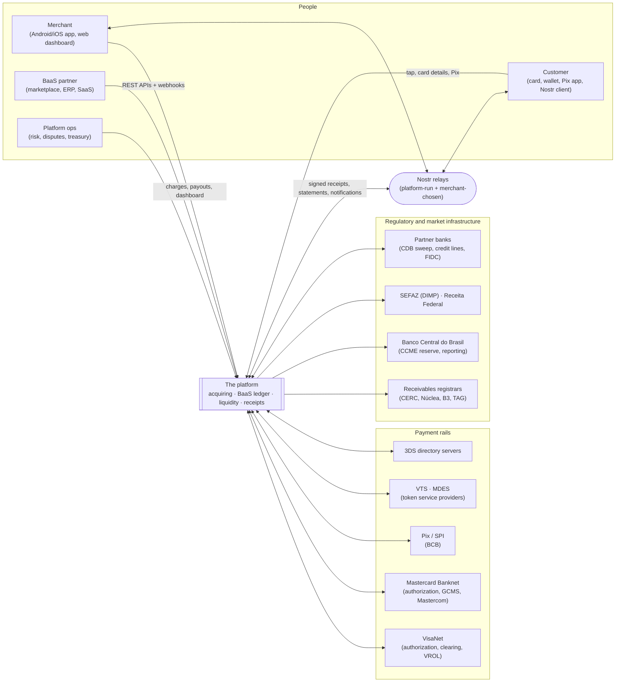
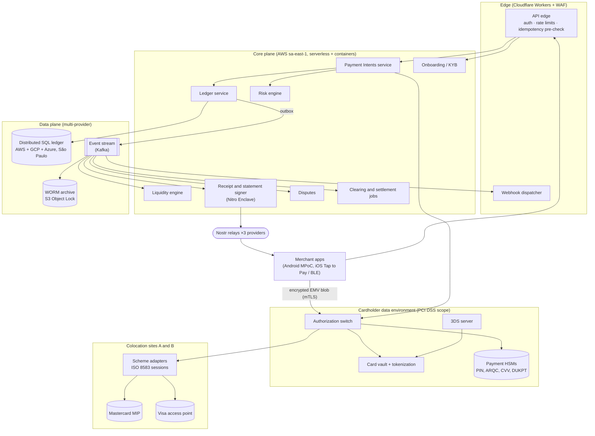
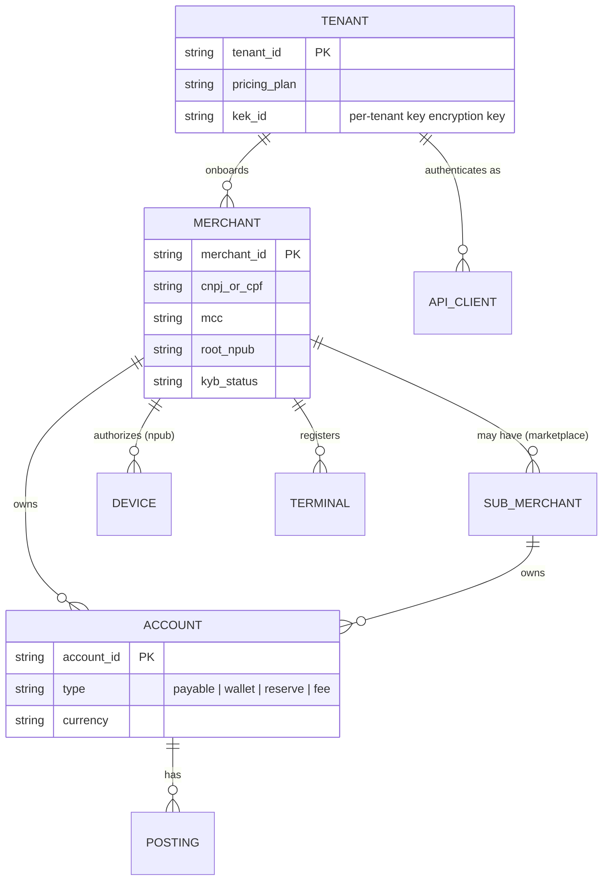

# Module 1: Executive Summary and BaaS Ecosystem Architecture

> **Working title.** "InfinityPay+" is the brief's name for this platform. It is close to *InfinitePay*, a CloudWalk brand in Brazil, so pick a distinct name before any public use. The documents say "the platform".

---

## 1. System vision

The platform is a merchant acquiring and Banking-as-a-Service (BaaS) system for Brazil, built for later expansion. A merchant downloads an app, passes KYB in minutes, and accepts Visa and Mastercard (tap-to-phone, mPOS, e-commerce, payment links) and Pix. Funds land in a sub-ledger account that settles instantly when the merchant's risk profile allows. BaaS partners (marketplaces, ERPs, vertical SaaS) get the same capabilities through APIs, so they can embed acquiring, accounts, split payments and payouts under their own brand.

Five tenets shape every module:

| # | Tenet | Consequence |
|---|-------|-------------|
| T1 | **The ledger is the truth.** | Every money movement is a balanced, immutable double-entry journal in a strongly consistent database. Nostr, caches, read models and webhooks are *projections* of it and are never authoritative ([04 §3](04-serverless-backend.md#3-ledger)). |
| T2 | **Serverless where it helps, stateful where protocols require it.** | Merchant APIs, webhooks, receipts, onboarding and batch jobs run event-driven on Lambda and Workers. The ISO 8583 scheme sessions, the payment HSMs and the authorization switch are long-lived processes, because card networks speak persistent TCP over private circuits ([04 §1](04-serverless-backend.md#1-topology)). |
| T3 | **No single provider is a single point of failure.** | The ledger replicates across three cloud providers in the São Paulo metro, scheme circuits terminate in two colocation sites, and Nostr relays run on three providers. Losing any one provider loses no committed data and keeps authorizations flowing ([04 §5](04-serverless-backend.md#5-multi-region-multi-provider-resilience)). |
| T4 | **Verifiable, not just trusted.** | Receipts and settlement statements are signed Nostr events. A daily Merkle root over all settlements is published and timestamped, so a merchant can prove their statement is the one the platform committed to ([03 §6](03-nostr-layer.md#6-verifiable-settlement-transparency-log)). |
| T5 | **Price risk, don't ration it.** | Instant settlement, routing and fraud controls are priced per merchant and per transaction from measured risk, instead of a single premium tier ([07](07-enhancements.md)). |

---

## 2. What this specification changes from the brief

A principal architect's first job is to separate what is achievable from what only sounds good. The brief is directionally right, but seven of its premises would fail certification, regulation or physics as written. Each is kept in spirit and re-scoped:

| # | Brief says | Problem | This spec does instead |
|---|-----------|---------|------------------------|
| C1 | Nostr eliminates "central point server bottlenecks" for transactions | Card authorization is a synchronous, online exchange with the issuer through VisaNet and Banknet. No relay network can carry it, and the platform's tap-to-phone authorizes online, with no offline floor limits. | Nostr carries **what happens around the payment**: payment requests, signed receipts, statements, notifications, device journals, transparency roots. Authorization stays on scheme rails ([03 §1](03-nostr-layer.md#1-what-nostr-is-and-is-not-for)). |
| C2 | "Zero single points of failure via serverless edge computing" | Scheme connectivity needs dedicated circuits to scheme equipment (Mastercard MIP, Visa access points) and sticky ISO 8583 sessions. Edge functions cannot hold them, and one cloud provider is itself a single point of failure. | A hybrid topology: edge and serverless for the merchant-facing and async planes, active-active containers in two colocation sites for scheme sessions, and a ledger spread across three providers ([04 §1](04-serverless-backend.md#1-topology)). |
| C3 | "Yield-generation on settled funds via decentralized short-term liquidity pools" | Brazilian payment institutions that issue electronic money must hold client balances **only** in cash at the BCB (the CCME account) or in federal government securities registered in Selic (Res. BCB 80/2021). Client money cannot go into DeFi. | Yield comes from the regulated reserve and an opt-in sweep into an FGC-covered partner-bank CDB. "Instant liquidity" means a **funding engine** that fronts scheme settlement (D+30 for domestic credit) from equity, bank lines and a receivables fund (FIDC), backed by registered receivables ([07 §1](07-enhancements.md#1-instant-liquidity-engine)). |
| C4 | Zero-knowledge "tax reporting without exposing volume" | As acquirer and payment institution the platform must report merchant transactions to state tax authorities (DIMP, Convênio ICMS 134/2016) and to Receita Federal. ZK cannot hide data from a regulator entitled to it. | Zero-knowledge **selective disclosure to third parties** (lenders, marketplaces, landlords, franchisors): a merchant proves "12-month volume ≥ R$ X, chargeback ratio < Y" without revealing figures. Regulators keep full access ([07 §2](07-enhancements.md#2-zero-knowledge-compliance-zkc)). |
| C5 | Android tap-to-phone under "CPoC" | The PCI SSC sunset period for SPoC and CPoC ends on **31 October 2026**. No new CPoC submissions are accepted after that. MPoC is the successor and also covers PIN on glass. | The Android terminal is specified against **PCI MPoC** ([05 §2](05-mobile.md#2-android-terminal-production-spec)). |
| C6 | Least-cost routing across Visa and Mastercard | A Visa card cannot be routed over Mastercard. Interchange is set by the card, issuer, MCC and channel, not by the acquirer's choice. In Brazil, debit interchange is already capped at 0.5% (Res. BCB 246/2022). | Routing optimizes **expected margin**, not just cost: approval probability × (MDR − interchange − scheme fees − processor fees) across the choices that really exist (acquiring connection, network token vs PAN, co-badged networks where present, retry and cascade within scheme reattempt rules) ([01 §6](01-acquiring-engine.md#6-smart-transaction-routing)). |
| C7 | Merchant identity by Nostr keypairs "instead of" accounts | A regulated platform must bind every account to a KYB-verified legal entity and must be able to freeze, recover and rebind it. Nostr has no key rotation or recovery. Phone Secure Enclaves and StrongBox cannot hold secp256k1 keys. | Nostr keys are a **phishing-resistant credential** bound to the KYB'd account: an offline root key authorizes per-device keys, which are wrapped by hardware. Recovery is re-KYB plus rebinding ([03 §4](03-nostr-layer.md#4-merchant-identity-and-authentication)). |

---

## 3. Market baseline and positioning

The reference product, InfinitePay (CloudWalk), sets a strong baseline in Brazil. It was Apple's launch partner for Tap to Pay on iPhone in Brazil (September 2023), runs tap-to-phone on Android 11+ and iPhone XS+, offers instant settlement as a pricier plan, pays yield on account balances and does not charge for Pix. These figures come from third-party comparisons as of October 2026, so verify them before using them commercially.

Being better than that baseline means changing the structure, not adding features. Four differences are structural:

| Dimension | Typical acquirer / baseline | This platform |
|-----------|-----------------------------|---------------|
| Instant settlement | One flat premium MDR tier for everyone | **Risk-priced per merchant and transaction**: a low-risk merchant pays close to the real funding cost (days to scheme settlement × cost of funds) plus expected loss ([07 §1](07-enhancements.md#1-instant-liquidity-engine)) |
| Receipts and statements | PDF or SMS from a central server, unverifiable | **Signed Nostr events** the customer and merchant can verify offline, plus a public **Merkle transparency log** over daily settlements ([03](03-nostr-layer.md)) |
| Embedding | Closed app, limited partner APIs | **Modular BaaS APIs** for acquiring, sub-ledger accounts, split payments, payouts and receipts, multi-tenant from day one ([02](02-api-reference.md)) |
| Merchant data sharing | All or nothing (export statements) | **Zero-knowledge proofs** of business metrics for credit, rentals and partnerships ([07 §2](07-enhancements.md#2-zero-knowledge-compliance-zkc)) |
| Fraud at the point of interaction | Server-side scoring only | **On-device risk scoring** during the tap (relay-attack timing, device posture, behavioural signals) fused with the server model ([07 §3](07-enhancements.md#3-autonomous-fraud-shield)) |
| Resilience | One cloud, one region | **Three providers** for the ledger and relays, **two colocation sites** for scheme circuits ([04 §5](04-serverless-backend.md#5-multi-region-multi-provider-resilience)) |

---

## 4. Core value propositions

| Audience | Value | Measurable target |
|----------|-------|-------------------|
| **Micro and small merchants** | Charge in two taps, get paid instantly at a fair price, see one number ("available now") | Onboarding to first sale ≤ 10 min (p50); tap-to-result ≤ 2.0 s (p95); instant payout via Pix ≤ 10 s after capture (p95) |
| **BaaS partners** | Embed acquiring, accounts and payouts under their brand, with sub-ledgers per end customer | Sandbox to production ≤ 2 weeks; 99.99% API availability; webhooks ≤ 5 s (p99) |
| **Customers (cardholders)** | A receipt they own and can verify, delivered without handing over a phone number or e-mail | Receipt claimable from QR in ≤ 3 s (p95) |
| **The platform** | Higher margin per transaction from expected-margin routing and risk-priced liquidity; lower fraud and dispute losses | +1.0 to 2.0 pp authorization rate vs a single route (target, to be measured); VAMP ratio held below the "above standard" threshold |

---

## 5. Ecosystem architecture

### 5.1 Context (C4 level 1)

### 5.2 Containers (C4 level 2)

### 5.3 Four planes

Separating the system into planes keeps regulatory scope, latency budgets and failure modes from bleeding into each other.

| Plane | Carries | Latency budget | Consistency | PCI scope | Runtime |
|-------|---------|----------------|-------------|-----------|---------|
| **Card plane** | Authorizations, reversals, 3DS, tokenization, PIN, EMV cryptograms | ≤ 120 ms internal p99 (excluding scheme and issuer) | Synchronous; idempotent by STAN/RRN | **In scope** (CDE) | Long-lived containers, payment HSMs, colocation |
| **Money plane** | Ledger postings, settlement, payouts, liquidity, reserves | ≤ 50 ms per posting p99 | Strict serializable | Out of scope (tokens only) | Containers + distributed SQL |
| **Control plane** | Onboarding, KYB, configuration, pricing, merchant APIs, dashboards | ≤ 300 ms p99 | Strong per entity | Out of scope | Lambda, Workers, Step Functions |
| **Trust plane** | Signed receipts, statements, notifications, device journals, transparency roots | Seconds | Eventually consistent projection of the ledger | Out of scope (never PAN) | Workers + Nostr relays + Nitro Enclave signer |

---

## 6. BaaS product surface and multi-tenancy

### 6.1 Products

| Product | What a partner gets | Spec |
|---------|---------------------|------|
| **Acquiring** | Payment intents for card-present (tap, mPOS) and card-not-present (3DS, network tokens), Pix QR, payment links, refunds, disputes | [01](01-acquiring-engine.md), [02 §4](02-api-reference.md#4-payments) |
| **Accounts and sub-ledgers** | A ledger account per merchant or end customer, holds, internal transfers, statements | [02 §6](02-api-reference.md#6-accounts-sub-ledgers-and-transfers), [04 §3](04-serverless-backend.md#3-ledger) |
| **Split payments** | Marketplace split rules applied at capture, each recipient a sub-account | [02 §6.4](02-api-reference.md#64-split-payments) |
| **Payouts** | Instant Pix out, scheduled payouts, risk-priced instant settlement | [02 §7](02-api-reference.md#7-payouts-and-instant-settlement), [07 §1](07-enhancements.md#1-instant-liquidity-engine) |
| **Receipts** | Signed, encrypted receipts and statements over Nostr; verification endpoints | [03](03-nostr-layer.md) |
| **Risk** | Pre-authorization risk score and decision reasons, device posture attestations | [07 §3](07-enhancements.md#3-autonomous-fraud-shield) |
| **Merchant credentials (ZKC)** | Verifiable credentials and zero-knowledge proofs about a merchant's metrics | [07 §2](07-enhancements.md#2-zero-knowledge-compliance-zkc) |

### 6.2 Tenancy model

Isolation rules:

1. **Every row carries `tenant_id`**, every query is scoped by it, and the database enforces row-level security as a second line of defence behind service code.
2. **Every tenant has its own key encryption key (KEK)** in the HSM. Off-boarding a tenant is crypto-shredding its KEK, after the legal retention period.
3. **Per-tenant quotas** for request rate, concurrent authorizations and webhook throughput, enforced at the edge, so one partner's spike cannot starve another.
4. **The platform is the regulated entity.** Partners never hold client funds. Their end customers' balances are sub-ledger accounts inside the platform's segregated e-money liability.

---

## 7. Regulatory posture (Brazil first)

This is engineering's reading of the obligations that shape the architecture. It is **not legal advice**, and each item needs confirmation by counsel against the current consolidated text on normativos.bcb.gov.br.

| Area | Instrument | Architectural consequence |
|------|-----------|---------------------------|
| Licensing | Lei 12.865/2013; Res. BCB 80/2021 (payment institutions: *credenciador*, *emissor de moeda eletrônica*) | **Phase 1** as a sub-acquirer (*subcredenciador*) under a sponsor acquirer; **Phase 2** as an authorized acquirer and e-money issuer with direct scheme membership ([08](08-roadmap-risks.md)) |
| Client funds | Res. BCB 80/2021; Res. BCB 237/2022 and IN BCB 317/2022 (CCME) | E-money balances held only in cash at the BCB (CCME) or federal securities in Selic. The ledger keeps an always-on **safeguarding reconciliation** (liability ≤ reserve) ([04 §3.6](04-serverless-backend.md#36-safeguarding-reconciliation)) |
| Card receivables | Res. BCB 264/2022 (replaced Circular 3.952/2019), as amended | Every receivable unit (UR) registered at a registrar. Anticipation and liens go through registrar APIs. The liquidity engine uses registered URs as collateral ([07 §1](07-enhancements.md#1-instant-liquidity-engine)) |
| Interchange | Res. BCB 246/2022 | Debit interchange capped at 0.5%, domestic prepaid at 0.7%. Credit is uncapped. Fee tables in the routing engine encode the caps ([01 §6](01-acquiring-engine.md#6-smart-transaction-routing)) |
| Cyber and cloud | Res. BCB 85/2021, as amended | A cyber-security policy, an incident plan, a responsible director, and notifying the BCB of relevant cloud contracts. This shapes the provider choices in [04 §5](04-serverless-backend.md#5-multi-region-multi-provider-resilience) |
| Tax reporting | Convênio ICMS 134/2016 (DIMP) and federal obligations | A monthly per-state file of merchant transactions, including Pix. A reporting pipeline reads from the ledger ([04 §2.4](04-serverless-backend.md#24-regulatory-reporting)) |
| Data protection | LGPD (Lei 13.709/2018) | Data minimization on Nostr (no PII in clear, gift-wrapped events), data subject rights, a DPO, a RIPD (DPIA) for the risk models |
| Card security | PCI DSS v4.0.1, PCI PIN, PCI 3DS Core, **PCI MPoC** | A segmented CDE, payment HSMs, an MPoC-validated tap-to-phone solution, an EMVCo-approved 3DS server |
| Scheme rules | Visa Core Rules, Mastercard Rules, VAMP, Mastercard ECM/EFM | Dispute and fraud monitoring dashboards, reattempt limits in routing, compelling-evidence automation ([01 §7](01-acquiring-engine.md#7-disputes-and-chargebacks)) |

---

## 8. Non-functional targets

| Metric | Target | Notes |
|--------|--------|-------|
| Authorization path availability | 99.99% monthly (≤ 4.4 min) | Measured at the scheme adapter, excluding issuer downtime |
| Internal authorization latency | p99 ≤ 120 ms | Ingress to scheme adapter and back, excluding the network and issuer |
| Tap to result (card-present) | p95 ≤ 2.0 s on 4G | Includes the issuer. Card-in-field ≤ 500 ms, set by the EMV kernel |
| Ledger durability | RPO = 0 on loss of any one provider; RPO ≤ 5 min on loss of the metro | Raft quorum across providers, plus continuous backups to another geography |
| Ledger recovery | RTO ≤ 1 min (provider loss), ≤ 4 h (metro loss) | |
| Webhook delivery | p99 ≤ 5 s; at-least-once with ordering per object | |
| Receipt published to relays | p95 ≤ 3 s after authorization | |
| Instant Pix payout | p95 ≤ 10 s after capture | When the merchant is eligible for instant settlement |
| Security | Zero clear PAN outside the vault; all keys in HSMs or attested enclaves | Proven by data-discovery scans and quarterly ASV scans |

---

## 9. Key architecture decisions

| ADR | Decision | Alternatives rejected | Module |
|-----|----------|-----------------------|--------|
| ADR-01 | Double-entry ledger on distributed SQL (CockroachDB) spread across AWS, GCP and Azure in São Paulo | Single-provider Aurora (provider SPOF); TigerBeetle (excellent ledger, but single-cluster and not yet multi-provider active-active) | 04 |
| ADR-02 | Long-lived containers for the authorization switch and scheme adapters; Lambda and Workers everywhere else | Lambda on the auth path (cold starts, no persistent ISO 8583 sockets) | 04 |
| ADR-03 | Phase 1 tap-to-phone with a licensed MPoC SDK and its attestation-and-monitoring backend; build in-house only if volume justifies certification cost | Building EMV L2 kernels in-house from day one (12–18 months of certification) | 05 |
| ADR-04 | Nostr for receipts, statements, notifications and transparency; never for authorization or clear PII | Nostr as the transaction bus (C1) | 03 |
| ADR-05 | Expected-margin routing with scheme-rule constraints | Pure least-cost routing (ignores approval rate) | 01 |
| ADR-06 | Merchant Nostr device keys wrapped by hardware keys, with an offline root key | secp256k1 in the Secure Enclave (unsupported); a custodial nsec on the server (defeats the purpose) | 03 |
| ADR-07 | Instant liquidity funded by equity, bank lines and a FIDC over registered receivables; yield from the regulated reserve and a CDB sweep | DeFi pools for client funds (C3) | 07 |
| ADR-08 | Brand action colour `#10B981` with **dark** text, and `#047857` for green text on light backgrounds | White text on `#10B981` (2.54:1, fails WCAG AA) | 06 |

---

## 10. Assumptions and open questions

| # | Assumption or question | Owner | Default if unanswered |
|---|------------------------|-------|-----------------------|
| A1 | The launch market is Brazil (BRL, BCB regulation, Pix). Other LatAm markets reuse the architecture with new rail adapters. | Product | As stated |
| A2 | The sponsor acquirer for Phase 1 exposes a REST or ISO 8583 interface and supports the platform as sub-acquirer with its own merchant IDs. | BD | Pick a sponsor that does |
| A3 | Tap to Pay on iPhone needs Apple's entitlement and a PSP partnership. Until then, iOS uses BLE mPOS readers. | Partnerships | BLE readers at iOS launch |
| A4 | Is AWS Payment Cryptography available in sa-east-1, with the PCI PIN scope needed? | Security | Thales payShield 10K in the colocation sites |
| A5 | Which registrar(s)? Integrate one, design for several. | Treasury | CERC first |
| A6 | Do the custom Nostr kinds become a public NIP? | Protocol | Propose after 6 months in production; the kinds sit in a block that was unused on 2026-10-29 |
