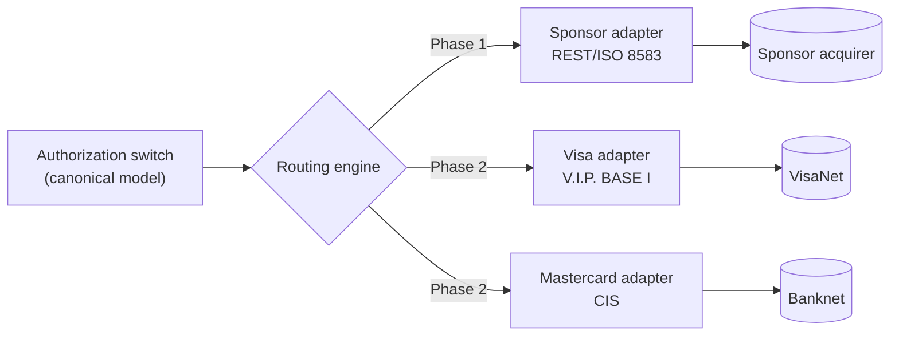
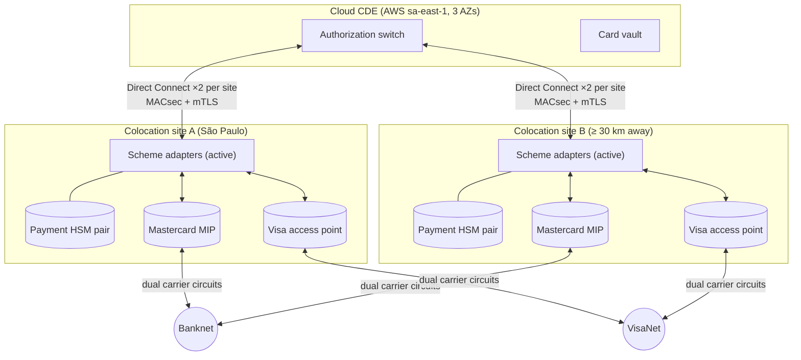
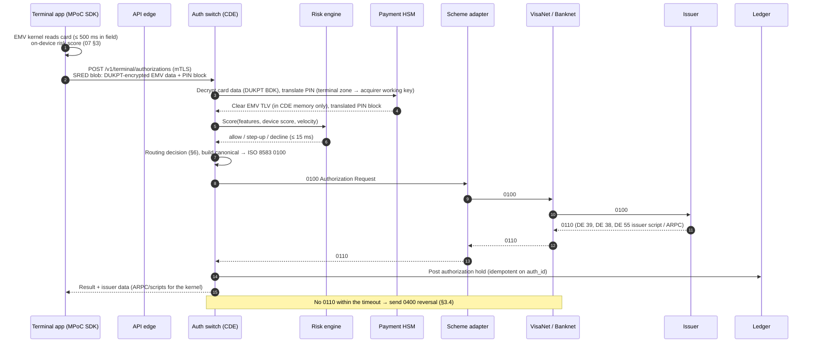
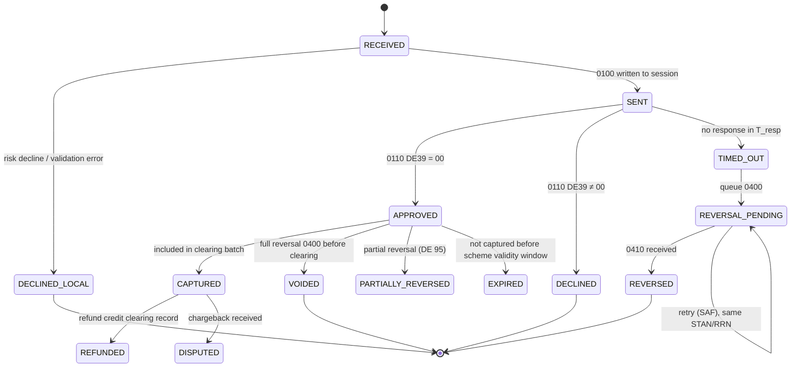
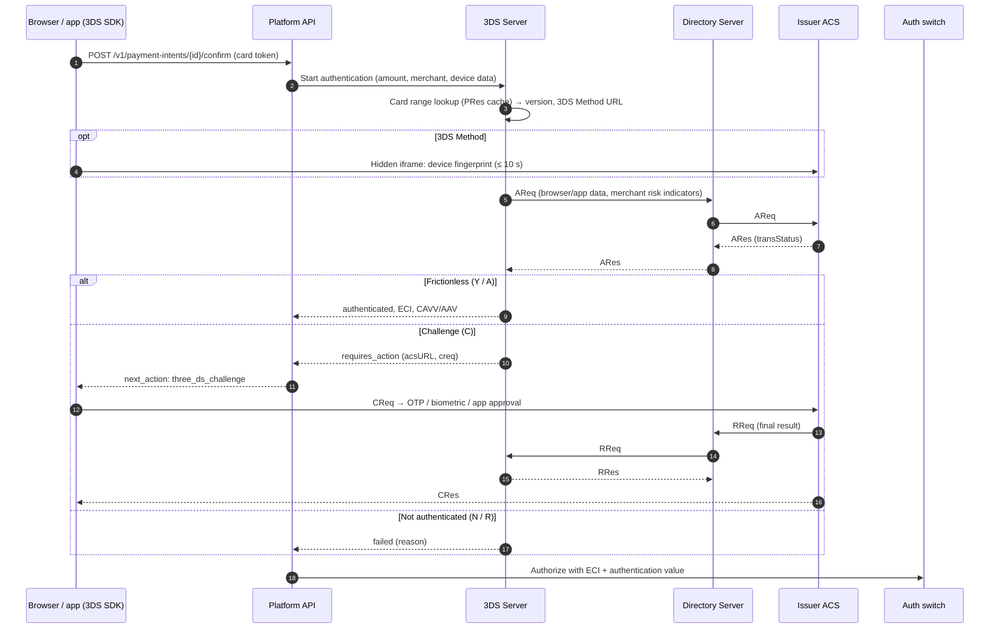
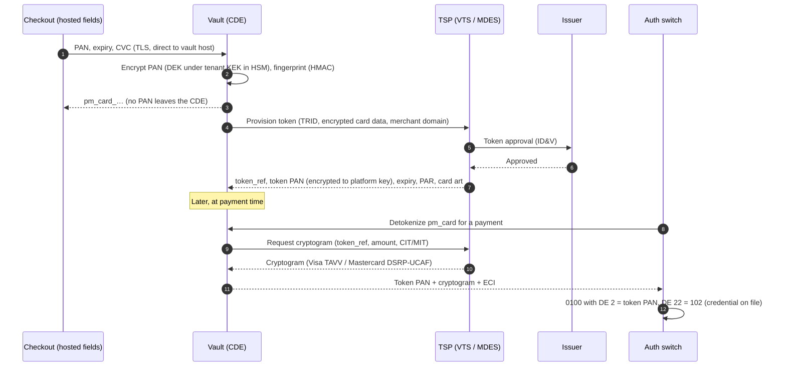
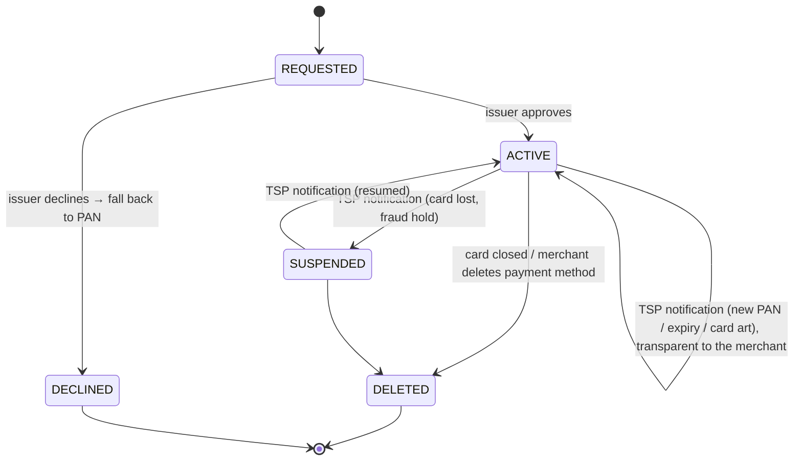
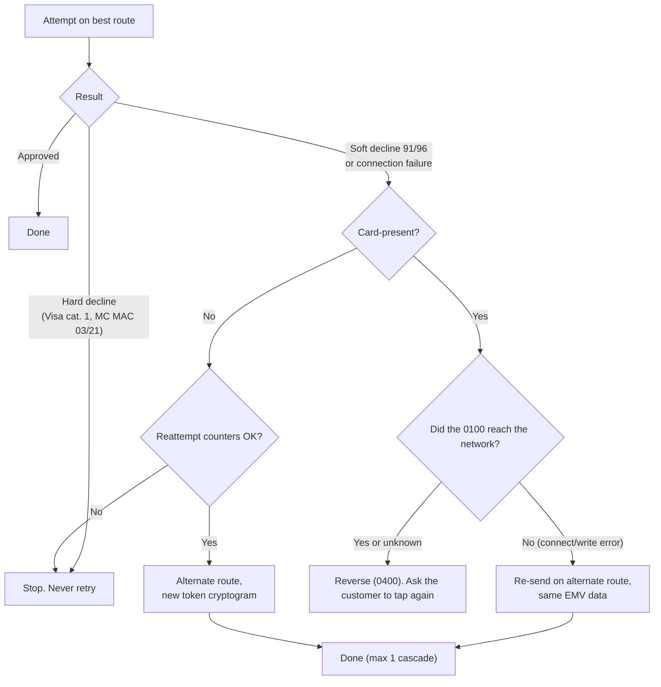
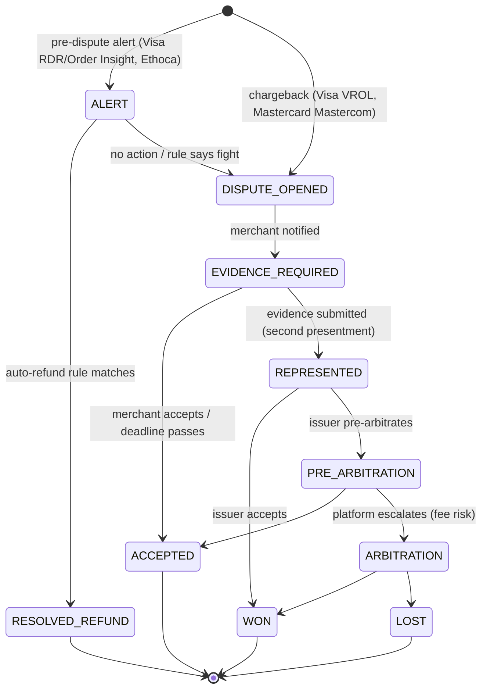
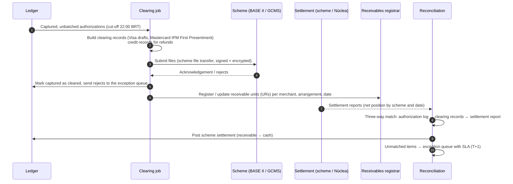

# Module 2a: Acquiring Engine and Visa / Mastercard Integration

This module specifies how the platform connects to Visa and Mastercard, how an authorization moves through the system, and how 3DS, tokenization, routing, disputes and settlement work. The merchant-facing REST API, the mTLS profile and webhooks are in [02-api-reference.md](02-api-reference.md).

Field numbers, message types and codes below are the widely used ISO 8583:1987 conventions. Each scheme's interface specification (Visa V.I.P./BASE I and BASE II; Mastercard Customer Interface Specification and IPM Clearing Formats) is authoritative and overrides this document wherever they differ. Scheme-private fields are marked **(scheme)**.

---

## 1. Integration models

| | **Indirect: sub-acquirer (Phase 1)** | **Direct: principal acquirer (Phase 2)** |
|---|---|---|
| Who holds scheme membership | Sponsor acquirer | The platform (own Visa BIN / Mastercard ICA) |
| Connectivity | Sponsor's REST or ISO 8583 API over mTLS | Own circuits to Mastercard MIP and Visa access points |
| Regulatory status (Brazil) | *Subcredenciador* under arrangement rules | Authorized *credenciador* (Res. BCB 80/2021) |
| Time to market | 3 to 6 months | 18 to 30 months (membership, certification, licence) |
| Economics | Sponsor markup on every transaction | Interchange + scheme fees only |
| Control over routing, tokens, 3DS | Limited to what the sponsor exposes | Full |
| Certification burden | Sponsor certifies; the platform passes its integration tests | Scheme host certification, EMV terminal integration, 3DS, tokens |

**Decision.** Launch indirect, build the switch with a *scheme adapter* abstraction from the first day, and add direct adapters later without touching the payment-intent API. After Phase 2 the sponsor stays connected as a **secondary route**, so the routing engine ([§6](#6-smart-transaction-routing)) always has at least two independent paths.



---

## 2. Connectivity blueprint (direct model)

### 2.1 Physical and network topology



Rules:

1. **Two sites, both active.** Each site holds live sessions to both schemes. The switch spreads traffic by consistent hash on `STAN mod N` and fails over in under 1 s on a missed echo.
2. **Two carriers per site**, with diverse physical paths, as the schemes' connectivity guides require.
3. **Scheme equipment stays in colocation.** MIP units and Visa access equipment are scheme-managed appliances. Nothing tries to "lift" them into a serverless runtime.
4. **Encryption on every hop**: MACsec on cross-connects, TLS 1.3 mTLS between switch and adapters ([02 §2](02-api-reference.md#2-transport-security-tls-13-with-mutual-authentication)), and the scheme's own link encryption on circuits.

### 2.2 Session management

Each adapter keeps a pool of persistent TCP sessions per scheme endpoint. Framing (length prefix, scheme header) follows the scheme specification.

| Function | MTI | DE 70 (network management code) | Cadence |
|----------|-----|-------------------------------|---------|
| Sign-on | 0800 → 0810 | 001 | On connect |
| Sign-off | 0800 → 0810 | 002 | Planned drain |
| Echo test | 0800 → 0810 | 301 | Every 30 s idle; 3 misses → session down |
| Working-key exchange | 0800 → 0810 | (scheme) | Per scheme schedule; keys travel under the zone master key and are loaded into the HSM, never into adapter memory |

Every session is a small state machine (`DISCONNECTED → CONNECTED → SIGNED_ON → DRAINING`). Only `SIGNED_ON` sessions receive traffic. **Store-and-forward (SAF)**: advices (0120, 0420) that cannot be delivered are kept in a durable per-site queue and replayed in order when a session signs on. Duplicates carry the same STAN and RRN, so the scheme deduplicates them.

---

## 3. Authorization switch and ISO 8583

### 3.1 Card-present tap-to-phone authorization



The acquirer does **not** verify the ARQC. The issuer does, or the scheme's stand-in processing does when the issuer is unavailable. The acquirer's HSM work is decrypting terminal data, translating PIN blocks, and verifying or generating MACs.

### 3.2 Authorization state machine



### 3.3 Message types

| MTI | Name | Used for | API operation |
|-----|------|----------|---------------|
| 0100 / 0110 | Authorization request / response | Card-present and card-not-present purchases, pre-authorizations, refund authorizations (DE 3 = `20xxxx`), account verification (zero amount) | `POST /v1/payment-intents/{id}/confirm`, `POST /v1/terminal/authorizations` |
| 0120 / 0130 | Authorization advice | Telling the issuer about a stand-in or offline decision | Internal |
| 0200 / 0210 | Financial request | Single-message systems (PIN debit), where the authorization is also the capture | Same as 0100, flagged single-message by the routing engine |
| 0400 / 0410 | Reversal request / response | Void before clearing, timeout reversal, partial reversal | `POST /v1/payment-intents/{id}/cancel`, automatic on timeout |
| 0420 / 0430 | Reversal advice | Store-and-forward reversal when 0400 cannot be confirmed | Internal (SAF) |
| 0800 / 0810 | Network management | Sign-on, echo, key exchange | Internal |

**Capture and refunds are clearing records, not online messages** in dual-message systems. A capture adds the authorization to the next clearing file (Visa BASE II draft records; Mastercard IPM First Presentment). A refund becomes a credit clearing record. Both schemes now also require refunds to be **authorized online** first (0100 with processing code `20`). Confirm the effective dates for each region.

### 3.4 Timeouts, reversals and idempotency

| Timer | Value | Behaviour |
|-------|-------|-----------|
| `T_resp` (switch waits for 0110) | 10 s for card-present, 15 s for card-not-present (configurable per scheme) | On expiry, mark `TIMED_OUT`, answer the terminal "declined, try again", and queue a 0400 |
| Late 0110 after timeout | — | Ignored for the terminal, and the reversal is still sent. Logged for reconciliation |
| Reversal retry | Exponential, 1 s → 5 min, for up to 24 h, then 0420 advice | The same STAN, RRN and DE 90 on every retry, so duplicates are idempotent at the scheme |

Idempotency keys at three layers:

1. **API**: `Idempotency-Key` header. A replay returns the stored response ([02 §1.4](02-api-reference.md#14-idempotency)).
2. **Switch**: `(terminal_id, stan, transmission_datetime)` is unique. A duplicate 0100 from a retrying terminal returns the original result and is never sent to the scheme twice.
3. **Ledger**: every posting carries `idempotency_key = auth_id + event` ([04 §3.3](04-serverless-backend.md#33-posting-rules-and-invariants)).

### 3.5 Data elements

| DE | Name | Format | Populated from |
|----|------|--------|----------------|
| 2 | Primary account number | n..19 LLVAR | Vault detokenization inside the CDE, or the network token ([§5](#5-tokenization-vts-and-mdes)) |
| 3 | Processing code | n6 | `000000` purchase; `003000` purchase from a credit account; `002000` from a checking (debit) account; `200000` refund |
| 4 | Amount, transaction | n12 | `amount` in minor units, zero-padded |
| 7 | Transmission date and time | n10 MMDDhhmmss UTC | Switch clock (NTP, ≤ 10 ms skew) |
| 11 | System trace audit number (STAN) | n6 | Per-terminal counter, unique per day |
| 12 / 13 | Local time / date | n6 / n4 | Terminal local time |
| 14 | Expiration date | n4 YYMM | Card or token |
| 18 | Merchant category code | n4 | Merchant profile |
| 19 | Acquiring institution country | n3 | `076` (Brazil) |
| 22 | POS entry mode | n3 | Positions 1–2 entry mode, position 3 PIN capability: `071` contactless chip, PIN capable; `051` contact chip, PIN capable; `102` credential on file; `812` e-commerce (Mastercard; Visa sends `01x` plus an e-commerce indicator) |
| 23 | Card sequence number | n3 | EMV tag `5F34` |
| 25 | POS condition code | n2 **(scheme)** | Card-present `00`, e-commerce `59` (Visa) |
| 32 | Acquiring institution ID | n..11 LLVAR | Platform BIN / ICA |
| 35 | Track 2 equivalent data | z..37 LLVAR | EMV tag `57` (chip and contactless) |
| 37 | Retrieval reference number (RRN) | an12 | `YDDDhh` + 6-digit sequence |
| 38 | Authorization ID response | an6 | From issuer (0110) |
| 39 | Response code | an2 | From issuer (0110), [§3.7](#37-response-codes-and-retry-policy) |
| 41 | Card acceptor terminal ID | ans8 | Terminal registration |
| 42 | Card acceptor ID | ans15 | Merchant ID at the scheme |
| 43 | Card acceptor name / location | ans40 | `merchant.descriptor` + city + `BR` |
| 48 | Additional data | ans..999 LLLVAR **(scheme)** | Mastercard sub-elements, including SE 42 (e-commerce security level), SE 43 (UCAF / AAV), SE 84 (merchant advice code, in responses) |
| 49 | Currency code, transaction | n3 | `986` (BRL) |
| 52 | PIN data | b64 | Translated PIN block (ISO 9564 format agreed with the scheme) |
| 55 | ICC system-related data | b..255 LLLVAR | EMV TLV ([§3.6](#36-emv-data-de-55)) |
| 61 | POS data | **(scheme)** | Mastercard POS data (attendance, terminal location, cardholder presence, card presence, capability) |
| 62 / 63 / 126 | Private use | **(scheme)** | Visa transaction ID (stored for MIT linkage), network data, 3DS CAVV / token cryptogram |
| 90 | Original data elements | n42 | Reversals: original MTI, STAN, DE 7, DE 32 |
| 95 | Replacement amounts | an42 | Partial reversals |

### 3.6 EMV data (DE 55)

The terminal kernel produces these tags. The switch forwards them unchanged, except for re-encoding the TLV.

| Tag | Name | Why it matters |
|-----|------|----------------|
| `9F26` | Application cryptogram (ARQC) | Issuer verifies card authenticity |
| `9F27` | Cryptogram information data | ARQC vs TC vs AAC |
| `9F10` | Issuer application data | Issuer-proprietary, includes CVR |
| `9F37` | Unpredictable number | Terminal-generated freshness, part of the ARQC input |
| `9F36` | Application transaction counter (ATC) | Replay and clone detection (jumps are a fraud signal, [07 §3](07-enhancements.md#3-autonomous-fraud-shield)) |
| `95` | Terminal verification results | Kernel's view of what failed |
| `9A` / `9C` | Transaction date / type | Part of the ARQC input |
| `9F02` / `9F03` | Amount authorized / other | Must equal DE 4 |
| `5F2A` / `9F1A` | Transaction currency / terminal country | `0986` / `0076` |
| `82` | Application interchange profile | Card capabilities |
| `84` | Dedicated file name (AID) | Credit vs debit application on Brazilian combo cards |
| `9F33` / `9F35` | Terminal capabilities / type | Declared COTS capabilities |
| `9F34` | CVM results | No CVM / online PIN / consumer device CVM |
| `9F6E` | Form factor indicator (Visa) / third-party data (Mastercard) | Card vs phone vs wearable |

**Brazilian combo cards** (*cartão múltiplo*) carry separate credit and debit EMV applications. The merchant's "Crédito / Débito" choice in the app ([06 §5](06-design-system.md#5-the-two-tap-checkout)) selects the AID during application selection. It is not decided after the fact.

### 3.7 Response codes and retry policy

The API exposes a normalized `decline_code`. The customer-facing message stays generic ("Pagamento recusado. Tente outro cartão.") whatever the code, so the UI never discloses "lost" or "stolen".

| DE 39 | Meaning | `decline_code` | Visa reattempt category | Platform policy |
|-------|---------|----------------|-------------------------|-----------------|
| `00` | Approved | — | — | — |
| `04`, `07` | Pick up card | `do_not_honor` | 1 (never approve) | Never retry; risk signal |
| `05` | Do not honor | `do_not_honor` | Generic | No automatic retry; the customer may use another card |
| `14` | Invalid account number | `invalid_number` | 1 | Never retry |
| `41`, `43` | Lost / stolen card | `do_not_honor` | 1 | Never retry; risk case opened |
| `51` | Insufficient funds | `insufficient_funds` | 2 (retry later) | MIT only: retry after ≥ 24 h, at most 4 times in 16 days |
| `54` | Expired card | `expired_card` | 3 (correct data) | Do not retry with the same data; request a token update |
| `55` | Incorrect PIN | `incorrect_pin` | 3 | Re-prompt PIN once (MPoC PIN on glass) |
| `57` | Transaction not permitted to cardholder | `not_permitted` | 1 | Never retry |
| `59` | Suspected fraud | `do_not_honor` | 2 | No automatic retry |
| `61` | Exceeds amount limit | `limit_exceeded` | 2 | Customer action |
| `65` (Mastercard) / `1A` (Visa) | Additional authentication required | `authentication_required` | — | Contactless: re-present with online PIN. Card-not-present: 3DS challenge |
| `91` | Issuer unavailable | `issuer_unavailable` | 2 | Cascade once to an alternate route (§6.5) |
| `96` | System malfunction | `processing_error` | 2 | Cascade once |
| `N7` (Visa) | CVV2 mismatch | `incorrect_cvc` | 3 | Ask the customer to correct |
| `R0`, `R1` (Visa) | Stop recurring payment | `stop_recurring` | 1 | Cancel the mandate; stop all MITs |

Mastercard returns a **merchant advice code** in DE 48 SE 84. The platform obeys it before its own policy: `01` (updated account information available) → request a token update; `02` (try again later) → back off; `03` (do not try again) → stop permanently; `21` (payment cancellation) → cancel the recurring mandate; `24`–`30` (retry after a stated interval) → schedule exactly that interval.

**Reattempt ceiling.** Visa limits reattempts of a declined transaction to 15 in 30 days, and any reattempt after a category 1 decline counts as excessive. The routing engine keeps a per-`(PAN fingerprint, merchant)` counter in the velocity store and refuses to send attempts beyond a stricter internal cap (5 in 30 days), so the platform is never charged excessive-reattempt fees.

### 3.8 Canonical authorization (internal)

Adapters translate the switch's canonical model to and from each scheme's ISO 8583 dialect. Clear card data exists only inside the CDE, in this form:

```json
{
  "auth_id": "auth_01JBK3V9Q4M6Z8XWAT5R2N7C1D",
  "mti": "0100",
  "scheme": "visa",
  "route": "visa_direct",
  "processing_code": "003000",
  "amount": { "value": 12990, "currency": "BRL", "exponent": 2 },
  "transmission_at": "2026-10-29T17:42:08.120Z",
  "stan": "004211",
  "rrn": "630217004211",
  "card": {
    "pan_ref": "vault:pan_7f3a9c2e",
    "expiry": "2911",
    "sequence_number": "001",
    "entry_mode": "071",
    "aid": "A0000000031010"
  },
  "emv_tlv_hex": "9F2608A1B2C3D4E5F607089F2701809F3704C0FFEE119F360200429A032610299C0100",
  "pin_block_ref": "hsm:pinblk_2c91",
  "merchant": {
    "scheme_mid": "000000004127731",
    "mcc": "5812",
    "descriptor": "CAFE AURORA",
    "city": "SAO PAULO",
    "country": "BR"
  },
  "terminal": { "tid": "TP000418", "type": "mpoc_cots", "attestation_verdict": "pass" },
  "installments": { "count": 1, "type": "none" },
  "risk": { "score": 0.07, "device_score": 0.04, "decision": "allow", "model": "fs-2026-10-a" }
}
```

---

## 4. EMV 3-D Secure (card-not-present)

### 4.1 Components

| Component | Who runs it | Certification |
|-----------|-------------|---------------|
| 3DS Requestor (web SDK, mobile SDK) | Merchant checkout, embedded from the platform's JS/mobile SDK | EMVCo SDK approval for the mobile SDK |
| **3DS Server** | **The platform** (in the CDE; licensed from a certified vendor in Phase 1) | EMVCo 3DS Server approval + PCI 3DS Core |
| Directory Server (DS) | Visa (Visa Secure), Mastercard (Identity Check) | Scheme |
| Access Control Server (ACS) | Issuer or its processor | Scheme |

Protocol versions: 2.2.0 and 2.3.1, negotiated per card range from the DS's PReq/PRes cache, which is refreshed every 24 h.

### 4.2 Flow



### 4.3 Results and liability

| `transStatus` | Meaning | Visa ECI | Mastercard ECI | Authorize? | Fraud liability |
|---------------|---------|----------|----------------|-----------|-----------------|
| `Y` | Authenticated | `05` | `02` | Yes | Shifts to issuer |
| `A` | Attempted (issuer or ACS not participating) | `06` | `01` | Yes | Usually shifts (scheme rules) |
| `C` | Challenge required | — | — | After the challenge | — |
| `D` | Decoupled challenge | — | — | After the result | — |
| `N` | Not authenticated | — | — | No | — |
| `R` | Rejected by issuer | — | — | No (must not authorize) | — |
| `U` | Technical problem | `07` | `00` | Merchant risk decision | Stays with merchant |
| `I` | Informational only (data-only flows) | `07` | `00` (scheme-specific) | Yes | Stays with merchant |

The authentication value travels in the scheme-specific field: Visa's CAVV field, or Mastercard's UCAF field (DE 48 SE 43) with the security level indicator in SE 42. Recurring and merchant-initiated charges use **3RI** (3DS Requestor Initiated) to refresh authentication without the cardholder, where the issuer supports it.

---

## 5. Tokenization: VTS and MDES

### 5.1 Two token layers

| Layer | Token example | Purpose | Scope |
|-------|---------------|---------|-------|
| **Platform vault token** | `pm_card_01JBK2Q7N4M1V8C6X3Z9B5M2K0` | Lets merchants and partners store a card without holding a PAN (SAQ A) | Valid only inside the platform |
| **Network token** (Visa Token Service, Mastercard Digital Enablement Service) | 16-digit token PAN in a token BIN range | Replaces the PAN on the network, refreshes automatically when the card is reissued, binds to a token requestor and domain, and carries a per-transaction cryptogram | Valid on the scheme network, restricted to the platform's token requestor ID (TRID) |

The vault maps `pm_card → {encrypted PAN, network_token_id per scheme, PAR}`. The Payment Account Reference (PAR, carried in DE 56) links the PAN and every token for the same account without revealing the PAN. Fraud and loyalty features key on PAR.

### 5.2 Provisioning and use



### 5.3 Token lifecycle



TSP lifecycle notifications arrive at a dedicated CDE webhook endpoint. The vault applies them and emits `payment_method.updated` to the merchant, so a merchant's stored card keeps working after reissue with no customer action.

### 5.4 Stored credentials (CIT and MIT)

The first customer-initiated transaction (CIT) that stores a card is flagged as such, and the scheme's transaction identifier from the response (Visa transaction ID; Mastercard trace ID) is stored with the mandate. Every later merchant-initiated transaction (MIT: recurring, installment, unscheduled) carries that identifier and the correct stored-credential indicator. That link is what lets issuers approve MITs without a cryptogram from the cardholder, and what lets the platform win "not authorized" disputes on them.

---

## 6. Smart transaction routing

### 6.1 What can actually be routed

Interchange is fixed by the card (issuer, product, MCC, channel), so the routing engine cannot "choose cheaper interchange". It chooses among the options that really exist for a given transaction:

| Lever | Exists when | Effect |
|-------|-------------|--------|
| **Acquiring connection** (direct scheme adapter vs sponsor) | Always, after Phase 2 | Scheme fees vs sponsor markup; independent failure domains |
| **Network token vs PAN** | Card-not-present with a provisioned token | Usually a higher approval rate and lifecycle updates; a small token fee |
| **Network for co-badged cards** | Cards with two networks and merchant choice permitted by local rules | Scheme fee differences |
| **Single- vs dual-message** | Debit with PIN where a single-message network exists | Fees and settlement timing |
| **Retry and cascade** | Soft declines and technical failures | Recovers approvals, within reattempt rules |
| **Data enrichment** | Always | Full descriptor, MCC accuracy, CIT/MIT linkage and 3DS data raise approval rates |

### 6.2 Objective

For a transaction *t* and an eligible route *r*, the engine maximizes **expected margin**:

```text
E[margin(t, r)] = p(t, r) · ( MDR(t) − IC(t) − SF(t, r) − PF(r) − TF(t, r) )
                − (1 − p(t, r)) · F_decline(r)
                − λ · latency_penalty(r)
                − μ · health_penalty(r)

p(t, r)        approval probability (calibrated model, §6.4)
MDR(t)         merchant discount revenue for t
IC(t)          interchange (same for every route of the same card)
SF(t, r)       scheme fees on route r (assessment, processing, cross-border)
PF(r)          processor or sponsor fees on route r
TF(t, r)       token or cryptogram fees
F_decline(r)   fees charged even when declined (per-attempt fees)
λ, μ           weights for p99 latency and recent error rate (circuit-breaker input)
```

Subject to hard constraints, evaluated first:

1. The route supports the card's scheme, the transaction type and the currency.
2. The route is healthy (circuit breaker closed: error rate < 2% and p99 < 1.5 s over the last 60 s).
3. Merchant contract and regulatory constraints hold (for example, debit routing rights where they apply).
4. Reattempt counters allow another attempt ([§3.7](#37-response-codes-and-retry-policy)).
5. The route's 3DS and token capabilities match what the transaction already used.

### 6.3 Worked example

A R$ 200.00 card-not-present Visa credit purchase. The merchant's MDR is 3.19% (R$ 6.38). Illustrative interchange is 1.60% (R$ 3.20), the same on every route.

| Route | Approval p | Scheme / sponsor fees | Token fee | Per-attempt fee | Margin if approved | **E[margin]** |
|-------|-----------|-----------------------|-----------|-----------------|--------------------|---------------|
| R1a direct, network token | 0.930 | 0.10% + R$ 0.03 = R$ 0.23 | R$ 0.02 | R$ 0.03 | R$ 2.93 | **R$ 2.7228** |
| R1b direct, PAN | 0.900 | 0.10% + R$ 0.03 = R$ 0.23 | — | R$ 0.03 | R$ 2.95 | R$ 2.6520 |
| R2 sponsor, PAN | 0.910 | 0.35% + R$ 0.05 = R$ 0.75 | — | R$ 0.05 | R$ 2.43 | R$ 2.2068 |

"Margin if approved" is R$ 6.38 − R$ 3.20 − fees − token fee. The per-attempt fee is already inside the fees column and is the only cost of a decline, so E[margin] = p × margin − (1 − p) × per-attempt fee.

R1b is the cheapest route per approval, yet R1a wins by R$ 0.07 per attempt because it approves 3 pp more often. A pure least-cost router would choose R1b and lose money. The merchant also gets R$ 600 more approved volume per 100 attempts. At 1 million card-not-present transactions a month of this profile, the gap is about R$ 70,000 a month of platform margin. The probabilities in this example are illustrative. Production values come from the model in §6.4.

### 6.4 Approval model and exploration

- **Features**: BIN range (from the schemes' account-range tables), issuer, card product, channel, entry mode, amount band, MCC, hour, 3DS result, token present, route, and recent issuer response mix.
- **Model**: gradient-boosted classifier, calibrated with isotonic regression (calibration matters more than ranking here, because *p* multiplies money). Retrained daily, shadow-scored for 7 days before promotion.
- **Exploration**: Thompson sampling on a Beta posterior per `(BIN range × route × channel)` cell, used only among routes whose expected margin is within 2% of the best. Exploration traffic is capped at 3% and disabled for amounts above R$ 2,000.
- **Explainability**: every decision logs eligible routes, scores, constraints hit and the winner to the event stream (`routing.decided`), so disputes about routing are answerable from data.

### 6.5 Cascade



A card-present cryptogram is never re-sent once it may have reached an issuer: a second ARQC with the same ATC looks like a replay and gets declined, or worse, approved twice.

### 6.6 Latency budget

| Step | p99 budget |
|------|-----------|
| Load fee tables and model (in memory, refreshed every 5 min) | 0 ms on the hot path |
| Constraint filtering | 0.2 ms |
| Model inference (≤ 4 routes) | 1.0 ms |
| Decision log (async append) | 0 ms on the hot path |
| **Total routing decision** | **≤ 2 ms** |

---

## 7. Disputes and chargebacks

### 7.1 Lifecycle



Response deadlines and evidence requirements are loaded from per-scheme, per-reason-code rule tables, never hard-coded. The dispute service keeps the clock and escalates to operations at 50% and 80% of the window.

### 7.2 Automated evidence

The platform holds evidence most acquirers lack, so it pre-assembles a case for every dispute:

| Evidence | Source | Strongest against |
|----------|--------|-------------------|
| EMV chip/contactless read with ARQC, ATC and CVM results | Authorization log (DE 55) | Counterfeit and card-present fraud reasons, where the EMV liability shift protects a chip-read acquirer |
| Device attestation verdict and on-device risk score at the tap | MPoC attestation ([05 §2.4](05-mobile.md#24-attestation-and-device-integrity)) | "Not me" claims on card-present |
| Signed receipt delivered to the customer, and whether it was claimed | Nostr receipt event and claim log ([03 §3](03-nostr-layer.md#3-receipts)) | "Not recognized", processing errors |
| 3DS authentication result (ECI, CAVV) | 3DS server | Card-not-present fraud (liability shift) |
| Prior undisputed transactions with matching device or IP (Visa Compelling Evidence 3.0) | Risk store, keyed by PAR | Card-not-present fraud on returning customers |
| Delivery proof, order details | Merchant upload via API | Merchandise not received |

### 7.3 Monitoring programmes

The risk service computes each merchant's **Visa VAMP ratio** (fraud plus disputes over settled transactions, with its separate enumeration measure) and the Mastercard excessive chargeback / excessive fraud metrics every day. Thresholds are configuration, refreshed when the schemes publish changes. Merchants crossing 60% of a threshold get alerts and stricter controls (lower instant-settlement limits, higher reserves, 3DS everywhere) long before the platform reaches a scheme programme.

---

## 8. Clearing, settlement and receivables

### 8.1 Daily cycle



### 8.2 Settlement terms that drive liquidity

| Product (domestic, Brazil) | Issuer pays acquirer | Contract term to merchant | Liquidity gap the platform funds for instant settlement |
|----------------------------|---------------------|---------------------------|----------------------------------------------------------|
| Credit, single payment | D+30 | D+30 standard, or instant | Up to 30 days |
| Credit, merchant installments (*parcelado lojista*) | Each installment D+30·*n* | Per installment, or instant | Up to 30·*n* days |
| Debit and prepaid | Short term (the maximum is set by Res. BCB 246/2022) | D+1 or instant | 1 to 2 business days |
| Pix | Instant | Instant | None |

This table is the input to the instant liquidity engine ([07 §1](07-enhancements.md#1-instant-liquidity-engine)). The cost of "receive now" is mostly *time value over the gap*, which is why a flat premium price over-charges low-risk debit merchants and under-charges risky installment credit.

### 8.3 Reconciliation invariants

Checked continuously, with alerts on any violation:

1. Every approved authorization is captured, voided, reversed or expired within the scheme validity window. Nothing is left in limbo.
2. Every clearing record matches exactly one approved authorization (amount ≤ authorized, plus the permitted tolerance for tips and MCC-specific tolerances).
3. The scheme settlement amount for a date equals the sum of cleared records minus interchange and fees for that date, within rounding of R$ 0.01 per file.
4. The ledger's `scheme_receivable` balance for a settled date returns to zero after the settlement posting.
5. Registered UR amounts equal the ledger's merchant payables per settlement date.
