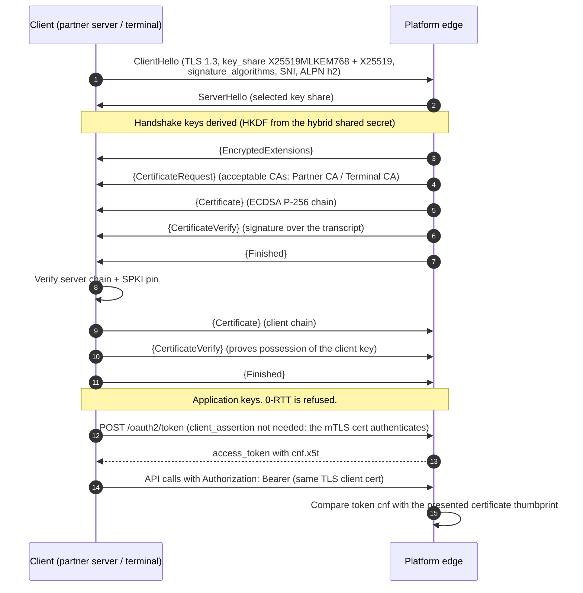
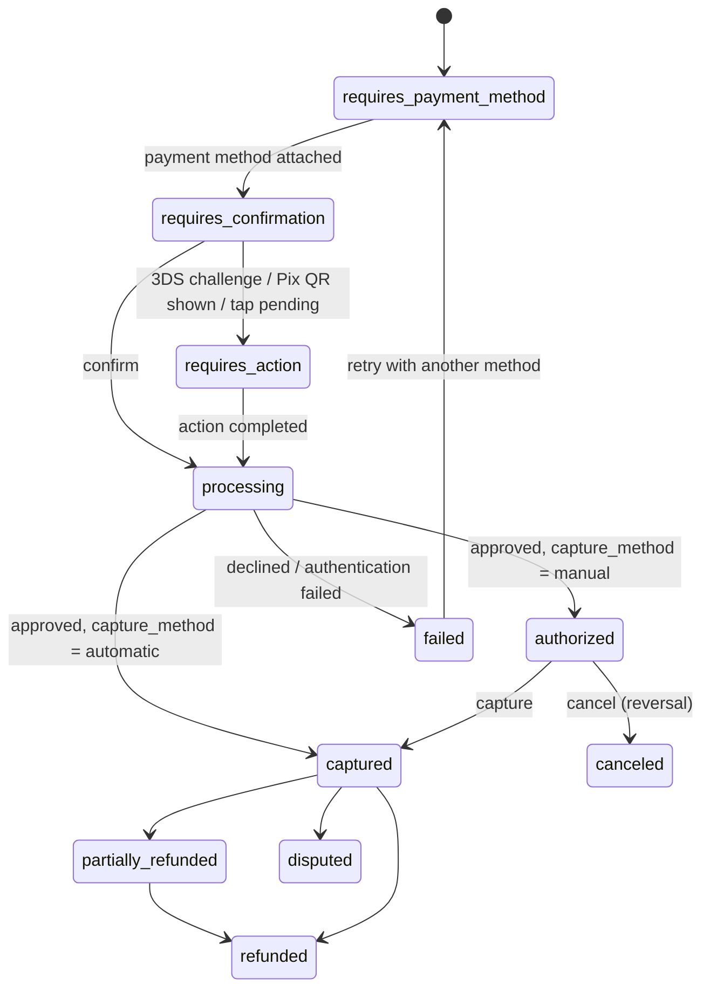

# Module 2b: Merchant and BaaS REST API, mTLS and Webhooks

The REST API is how merchants' apps, BaaS partners and the platform's own clients reach the acquiring engine ([01](01-acquiring-engine.md)) and the ledger ([04 §3](04-serverless-backend.md#3-ledger)). The machine-readable contract is [`api/openapi.yaml`](../api/openapi.yaml) (OpenAPI 3.1). This document explains it and shows full request and response payloads.

---

## 1. Conventions

### 1.1 Hosts

| Host | Purpose | PCI scope | Client authentication |
|------|---------|-----------|-----------------------|
| `api.goonerspay.example` | Every non-card endpoint | Out of scope | OAuth 2.0 access token bound to an mTLS certificate (partners), or a DPoP-bound session from Nostr login (merchant apps) |
| `vault.goonerspay.example` | Accepts PANs (hosted fields, server-to-server tokenization) | **CDE** | Publishable key (browser) or mTLS + token (PCI-compliant partners) |
| `terminal.goonerspay.example` | Card-present authorizations from terminals (MPoC apps, BLE reader bridges) | **CDE** | Terminal mTLS certificate + attestation token |
| `*.sandbox.goonerspay.example` | Sandbox with scheme simulators, test cards and simulated relays | None | Same as production, with sandbox credentials |

The PAN never transits `api.` hosts. Hosted fields and SDKs post card data straight to `vault.`, so a merchant integrating through them stays in SAQ A scope.

### 1.2 Authentication

| Client | Mechanism | Standard |
|--------|-----------|----------|
| BaaS partner servers | `client_credentials` grant with mTLS client authentication. The access token (5 min) is bound to the certificate thumbprint (`cnf.x5t#S256`). | RFC 8705, aligned with the FAPI 2.0 security profile |
| Merchant apps and the web dashboard | A Nostr HTTP Auth event (NIP-98, kind 27235) signed by an authorized device key is exchanged for a 15-minute session token bound to a DPoP key | NIP-98, RFC 9449 ([03 §4](03-nostr-layer.md#4-merchant-identity-and-authentication)) |
| Terminals | Device certificate issued after attestation + per-request attestation token | [05 §2.4](05-mobile.md#24-attestation-and-device-integrity) |
| High-value calls (payouts, bank account changes, API key changes) | Additionally signed with HTTP Message Signatures over method, path, `content-digest` and `idempotency-key` | RFC 9421, RFC 9530 |

### 1.3 Versioning

Every request sends `Api-Version: 2026-10-01`. Breaking changes ship as a new date. Each version is supported for at least 24 months after its successor ships.

### 1.4 Idempotency

Every `POST` takes an `Idempotency-Key` header (a UUID or ULID). The edge stores `(tenant, key) → (request hash, response)` for 24 hours:

| Situation | Response |
|-----------|----------|
| First request | Processed normally; the response is stored |
| Same key, same body, request finished | The stored response, with `Idempotent-Replayed: true` |
| Same key, same body, request still running | `409 Conflict`, `type: .../idempotency-in-progress`, `Retry-After: 1` |
| Same key, different body | `422`, `type: .../idempotency-key-reused` |

### 1.5 Errors

Errors use Problem Details (RFC 9457) with a stable `code`:

```json
{
  "type": "https://docs.goonerspay.example/errors/card-declined",
  "title": "The card was declined",
  "status": 402,
  "code": "card_declined",
  "decline_code": "insufficient_funds",
  "detail": "The issuer declined the authorization.",
  "instance": "/v1/payment-intents/pi_01JBK3T2W8C9M4N5P6Q7R8S9TA/confirm",
  "request_id": "req_01JBK3V0B7Q2C3D4E5F6G7H8J9",
  "retryable": false,
  "customer_message": "Pagamento recusado. Tente outro cartão."
}
```

### 1.6 Common formats

- **Money** is always an integer in minor units plus an ISO 4217 code: `"amount": 12990, "currency": "BRL"` is R$ 129,90. Floats never appear.
- **IDs** are prefixed ULIDs (`pi_`, `pm_`, `acc_`, `po_`, `dp_`, `mer_`, `dev_`, `st_`), sortable by creation time.
- **Times** are RFC 3339 UTC.
- **Lists** use cursor pagination: `?limit=50&starting_after=pi_…`, returning `{ "data": [...], "has_more": true, "next_cursor": "…" }`.
- **Rate limits** are sent as `RateLimit-Policy` and `RateLimit` headers. `429` comes with `Retry-After`.

---

## 2. Transport security: TLS 1.3 with mutual authentication

### 2.1 Handshake



### 2.2 Profile

| Parameter | Value | Rationale |
|-----------|-------|-----------|
| Protocol | TLS 1.3 only on mTLS hosts. TLS 1.2 (ECDHE + AEAD) accepted on the public `api.` host for browsers until 2027-06-30. | 1.3 removes static RSA, renegotiation and weak suites |
| Cipher suites | `TLS_AES_128_GCM_SHA256`, `TLS_AES_256_GCM_SHA384`, `TLS_CHACHA20_POLY1305_SHA256` | All AEAD. ChaCha20 for phones without AES acceleration |
| Key exchange groups | `X25519MLKEM768` (preferred), `X25519`, `secp256r1` | Hybrid post-quantum key agreement against harvest-now-decrypt-later, with a classical fallback. The same stance as the SMA messenger ([`messenger/docs/02-crypto-protocol.md`](../../messenger/docs/02-crypto-protocol.md)) |
| Certificates | ECDSA P-256. Partner client certificates last 90 days; terminal certificates 30 days; internal workload certificates (SPIFFE) 24 hours | Short lifetimes make revocation mostly unnecessary |
| Issuance | Partner CA per tenant (intermediate under an offline root kept in an HSM). Terminal CA issues only after attestation ([05 §2.4](05-mobile.md#24-attestation-and-device-integrity)) | Compromising one tenant's CA cannot reach another |
| Revocation | CRL for partner certificates, propagated to the edge in ≤ 5 min. Terminals: deny-list by serial number | |
| Resumption | PSK with (EC)DHE (`psk_dhe_ke`) only. **0-RTT disabled.** | 0-RTT data can be replayed, which is unacceptable for payment requests |
| Pinning | Apps pin the SPKI of two intermediates (current + next). Partners are advised to pin the root | Survives a rotation without an app update |
| Token binding | Access tokens carry `cnf.x5t#S256` and are rejected over any other certificate | A stolen token is useless without the private key |

### 2.3 Edge enforcement

The edge (Cloudflare API Shield with the platform's own CA) validates the client chain. A Worker then reads the verified certificate fingerprint from the request metadata and compares it with the token's `cnf` before forwarding over an authenticated origin tunnel to the core. A request whose certificate is unverified, revoked, or does not match its token is rejected with `401` and never reaches the origin.

---

## 3. Authentication endpoints

### 3.1 `POST /oauth2/token` (partners)

```http
POST /oauth2/token HTTP/2
Host: api.goonerspay.example
Content-Type: application/x-www-form-urlencoded

grant_type=client_credentials&client_id=cli_01JB7Y3Q&scope=payments%3Awrite%20accounts%3Aread
```

```json
{
  "access_token": "eyJhbGciOiJFUzI1NiIsImtpZCI6ImF0LTIwMjYtMTAifQ.eyJzdWIiOiJjbGlfMDFKQjdZM1EiLCJ0ZW4iOiJ0ZW5fMDFKQjdYIiwic2NvcGUiOiJwYXltZW50czp3cml0ZSBhY2NvdW50czpyZWFkIiwiY25mIjp7Ing1dCNTMjU2IjoiYk9wVnN1c19wUmRSUHVaRUNCbXFaNkJENWh0cEtCUWdBVkdNeUktUnRRayJ9fQ.sig",
  "token_type": "Bearer",
  "expires_in": 300,
  "scope": "payments:write accounts:read"
}
```

Scopes: `payments:read`, `payments:write`, `refunds:write`, `disputes:write`, `accounts:read`, `accounts:write`, `payouts:write`, `merchants:write`, `webhooks:write`, `settlements:read`.

### 3.2 `POST /v1/auth/nostr` (merchant apps)

The app signs a NIP-98 event for this exact URL and method, with the SHA-256 of the body in a `payload` tag. The body carries the DPoP public key that the session will be bound to.

```http
POST /v1/auth/nostr HTTP/2
Host: api.goonerspay.example
Authorization: Nostr eyJpZCI6ImE5Y2JmMmY4NGNmMThjMWJjMGM4Y2E2NGY1NDU0MWZjNzBiYTczOWFlOTBjNmU1NzJhZTRlM2UzNzVmZDEwZTgiLCJwdWJrZXkiOiI2YTIyZTQzY2M5YmRiZWZhZDdmNDdjZmEzMWQyYjRkYWE0YTE3NjI0NDViNjQ0MzA1YjhkOWE5MGZiN2VkZmUyIiwiY3JlYXRlZF9hdCI6MTc5MzI5NTEzMCwia2luZCI6MjcyMzUsInRhZ3MiOltbInUiLCJodHRwczovL2FwaS5nb29uZXJzcGF5LmV4YW1wbGUvdjEvYXV0aC9ub3N0ciJdLFsibWV0aG9kIiwiUE9TVCJdLFsicGF5bG9hZCIsImY2YzhhZTQ2YWM0NTYyNWJkMTE1NDE5Y2UwOTIyYTVmNzQwMGNjYjJjN2M1ZmVkZDhlZTIzODNiOGQ5MWZiZDUiXV0sImNvbnRlbnQiOiIiLCJzaWciOiJlMmQ3ZTc2NTMyZDkzZDhhMmNiMzg4ZjZjYTA4N2FiNTVkMjU3MDk4YzFhZWMzN2UxNmJhNTk0ZTg5ZTczMjk3YWJhMzMxYzQ4ZmU2NDIwNzQ0MTJiMTYwNjQwNmE5MjBlYzc2MjA3MmUxOGNiOGNkNjFkNWIxMjcwMzE0NDJiYyJ9
Content-Type: application/json
```

```json
{
  "dpop_jwk": { "kty": "EC", "crv": "P-256", "x": "f83OJ3D2xF1Bg8vub9tLe1gHMzV76e8Tus9uPHvRVEU", "y": "x_FEzRu9m36HLN_tue659LNpXW6pCyStikYjKIWI5a0" },
  "device_id": "dev_01JB9A2B3C4D5E6F7G8H9J0K1M"
}
```

The body goes on the wire in compact form, and the event's `payload` tag is the SHA-256 of exactly those bytes. The full signed event, the compact body and the complete header are in [`nostr/examples/27235-nip98-login.json`](../nostr/examples/27235-nip98-login.json). The header above is truncated for width.

```json
{
  "session_token": "sess_live_9QzH2gYb6wN4dK1pX7vR3mT8cL5sJ0aE",
  "token_type": "DPoP",
  "expires_in": 900,
  "merchant_id": "mer_01JB8Z2K5D6F7G8H9J0K1M2N3P",
  "device_id": "dev_01JB9A2B3C4D5E6F7G8H9J0K1M",
  "scopes": ["payments:write", "payments:read", "accounts:read", "settlements:read", "payouts:write"]
}
```

When the platform verifies attestation and the device has not attested yet (a phone the owner added by its npub), the login is refused with `attestation_required`: the app logs in again with its evidence in an `attestation` member next to `dpop_jwk` (App Attest on iOS; the Keystore attestation of the DPoP key, generated with a challenge bound to the device key, on Android). An Android device's sessions are then pinned to its attested DPoP key.

Every later request carries `Authorization: DPoP <session_token>` and a `DPoP` header: a proof JWT (RFC 9449) signed by the key of `dpop_jwk`, for the request's method and URL, with `ath` = SHA-256 of the token and a `jti` used once. The DPoP key is generated in the phone's secure hardware (Android Keystore, Secure Enclave) and never leaves it, so a stolen token is useless on its own. A session can call only the app routes (payment intents, terminal authorizations from its own terminal, its balance and entries, payouts, its devices and enrollment codes), and only for its own merchant. Removing the device from the device list ends its sessions at once.

The server checks, in order: the event signature; `kind == 27235`; `created_at` within ±60 s; the `u` and `method` tags against the request; the `payload` hash against the body; that the event ID has not been seen before (a 120 s replay cache); and that the signing key is in the merchant's current device authorization list ([03 §4.2](03-nostr-layer.md#42-device-authorization)).

---

## 4. Payments

### 4.1 Payment intent lifecycle



### 4.2 `POST /v1/payment-intents`

```http
POST /v1/payment-intents HTTP/2
Host: api.goonerspay.example
Authorization: Bearer eyJ…
Api-Version: 2026-10-01
Idempotency-Key: 01JBK3T2W8C9M4N5P6Q7R8S9TB
Content-Type: application/json
```

```json
{
  "amount": 12990,
  "currency": "BRL",
  "merchant_id": "mer_01JB8Z2K5D6F7G8H9J0K1M2N3P",
  "channel": "ecommerce",
  "payment_method_types": ["card", "pix"],
  "capture_method": "automatic",
  "installments": { "count": 3, "type": "merchant" },
  "statement_descriptor": "CAFE AURORA",
  "description": "Pedido #8812",
  "customer": { "email": "cliente@example.com", "document": { "type": "cpf", "number": "12345678909" } },
  "splits": [
    { "account_id": "acc_01JB9SE77ER000000000000001", "amount": 10990, "bears_fees": true },
    { "account_id": "acc_01JB9MKTP00000000000000001", "amount": 2000, "bears_fees": false }
  ],
  "receipt": { "nostr": true, "recipient_npub": null },
  "metadata": { "order_id": "8812" }
}
```

Response `201 Created`:

```json
{
  "id": "pi_01JBK3T2W8C9M4N5P6Q7R8S9TA",
  "object": "payment_intent",
  "status": "requires_payment_method",
  "amount": 12990,
  "amount_capturable": 0,
  "amount_captured": 0,
  "amount_refunded": 0,
  "currency": "BRL",
  "merchant_id": "mer_01JB8Z2K5D6F7G8H9J0K1M2N3P",
  "channel": "ecommerce",
  "payment_method_types": ["card", "pix"],
  "capture_method": "automatic",
  "installments": { "count": 3, "type": "merchant" },
  "client_secret": "pi_01JBK3T2W8C9M4N5P6Q7R8S9TA_secret_x7Gm2QpLw9",
  "splits": [
    { "account_id": "acc_01JB9SE77ER000000000000001", "amount": 10990, "bears_fees": true },
    { "account_id": "acc_01JB9MKTP00000000000000001", "amount": 2000, "bears_fees": false }
  ],
  "latest_attempt": null,
  "receipt": null,
  "created_at": "2026-10-29T17:41:52Z",
  "updated_at": "2026-10-29T17:41:52Z",
  "metadata": { "order_id": "8812" }
}
```

`installments.type` is `none`, `merchant` (*parcelado lojista*: the merchant receives per installment and the customer pays no interest), or `issuer` (*parcelado emissor*: the issuer finances the customer and the merchant receives as a single payment).

### 4.3 `POST /v1/payment-intents/{id}/confirm` (card, card-not-present)

```json
{
  "payment_method": "pm_card_01JBK2Q7N4M1V8C6X3Z9B5M2K0",
  "three_ds": {
    "mode": "automatic",
    "return_url": "https://loja.example/checkout/return",
    "browser": {
      "accept_header": "text/html,application/xhtml+xml",
      "user_agent": "Mozilla/5.0 (Linux; Android 15) AppleWebKit/537.36 Chrome/141.0 Mobile Safari/537.36",
      "language": "pt-BR",
      "color_depth": 24,
      "screen_height": 915,
      "screen_width": 412,
      "time_zone_offset_minutes": 180,
      "java_enabled": false,
      "javascript_enabled": true,
      "ip": "203.0.113.24"
    }
  }
}
```

When the issuer wants a challenge, the response is `200` with `status: requires_action`:

```json
{
  "id": "pi_01JBK3T2W8C9M4N5P6Q7R8S9TA",
  "object": "payment_intent",
  "status": "requires_action",
  "amount": 12990,
  "currency": "BRL",
  "next_action": {
    "type": "three_ds_challenge",
    "three_ds_session": "3ds_01JBK3VW1X2Y3Z4A5B6C7D8E9F",
    "acs_url": "https://acs.issuer.example/challenge",
    "creq": "eyJ0aHJlZURTU2VydmVyVHJhbnNJRCI6IjhhODgwZGMwLWQyZDItNDA2Ny1iY2IxLWIwOGQxNjkwYjI2ZSIsIm1lc3NhZ2VUeXBlIjoiQ1JlcSIsIm1lc3NhZ2VWZXJzaW9uIjoiMi4yLjAiLCJjaGFsbGVuZ2VXaW5kb3dTaXplIjoiMDUifQ",
    "message_version": "2.2.0",
    "expires_at": "2026-10-29T17:52:08Z"
  },
  "latest_attempt": {
    "type": "card",
    "three_ds": { "status": "challenge_required", "trans_status": "C" }
  }
}
```

After the challenge the SDK calls `GET /v1/payment-intents/{id}`. The platform has already received the RReq from the directory server and authorized:

```json
{
  "id": "pi_01JBK3T2W8C9M4N5P6Q7R8S9TA",
  "object": "payment_intent",
  "status": "captured",
  "amount": 12990,
  "amount_captured": 12990,
  "currency": "BRL",
  "latest_attempt": {
    "type": "card",
    "card": { "brand": "visa", "last4": "1111", "funding": "credit", "network_token_used": true, "issuer_country": "BR" },
    "three_ds": { "status": "authenticated", "trans_status": "Y", "eci": "05", "version": "2.2.0" },
    "authorization": {
      "code": "A1B2C3",
      "response_code": "00",
      "rrn": "630217004211",
      "network_transaction_id": "386302175513210",
      "route": "visa_direct",
      "approved_at": "2026-10-29T17:42:10Z"
    }
  },
  "receipt": {
    "claim_url": "https://r.goonerspay.example/c#k=5f0c3e9a17b2d4c86e1f7a9b0c2d4e6f8a1b3c5d7e9f0a2b4c6d8e0f1a3b5c7d"
  }
}
```

### 4.4 Pix

Confirming with `"payment_method_type": "pix"` returns a dynamic BR Code. Its payload URL resolves to the signed charge (JWS) defined by the Pix rules:

```json
{
  "id": "pi_01JBK4A1B2C3D4E5F6G7H8J9K0",
  "object": "payment_intent",
  "status": "requires_action",
  "amount": 12990,
  "currency": "BRL",
  "next_action": {
    "type": "pix_qr",
    "txid": "9d36b84fc70b478fb95c12729b90ca25",
    "br_code": "00020101021226830014br.gov.bcb.pix2561pix.goonerspay.example/qr/v2/9d36b84fc70b478fb95c12729b90ca255204000053039865406129.905802BR5911CAFE AURORA6009SAO PAULO62070503***6304EC1C",
    "expires_at": "2026-10-29T18:11:52Z"
  }
}
```

The `br_code` above has a valid CRC16 (checked by `npm run check`, §12). Payment arrives as a Pix settlement notification and moves the intent to `captured`.

### 4.5 `POST /v1/terminal/authorizations` (card-present, CDE)

Sent by the MPoC SDK inside the merchant app to `terminal.goonerspay.example` over the terminal's mTLS certificate. Card data and PIN are encrypted on the device under DUKPT keys and are opaque to the app itself.

```json
{
  "payment_intent_id": "pi_01JBK3Z9Y8X7W6V5T4S3R2Q1P0",
  "terminal_id": "TP000418",
  "stan": "004211",
  "local_time": "2026-10-29T14:42:08-03:00",
  "emv_application": "credit",
  "sred": {
    "format": "mpoc-sdk-v2",
    "ksn": "FFFF9876543210E00011",
    "ciphertext": "q83vEjRWeJq83vEjRWeJq83vEjRWeJq83vEjRWeJq83vEjRWeJ"
  },
  "pin": null,
  "device_risk": {
    "score": 0.1,
    "model": "gp-device-1",
    "signals": ["developer_options"]
  },
  "attestation": {
    "verdict_token": "eyJhbGciOiJFUzI1NiJ9.eyJ2ZXJkaWN0IjoicGFzcyJ9.sig",
    "obtained_at": "2026-10-29T17:40:01Z"
  },
  "journal_event_id": "a14d60ce8cf49c2c466a55a184869f29ef6954e6383144abe702bbec4c74e02b"
}
```

```json
{
  "status": "approved",
  "payment_intent_id": "pi_01JBK3Z9Y8X7W6V5T4S3R2Q1P0",
  "response_code": "00",
  "authorization_code": "B7K2Q9",
  "rrn": "630217004211",
  "card": { "brand": "visa", "last4": "0119", "application_label": "VISA CREDITO", "aid": "A0000000031010" },
  "cvm": "no_cvm",
  "issuer_response": { "arpc_and_scripts": "910A1A2B3C4D5E6F70800000" },
  "receipt": {
    "nostr_event_id": "ff03851857ec49e831e63ce49a5b0ccb445983b0353c74e2a9a0f1df7ec68ee2",
    "claim_qr": "https://r.goonerspay.example/c#k=ada9e69e2445b65e0739afcfe36455f0f2157c9c6edf9fbd3250f48f5408d163"
  },
  "settlement": { "mode": "instant", "merchant_discount": 414, "advance_fee": 0, "net_available": 12576, "settles_on": "2026-11-28" }
}
```

`status` is `approved`, `declined` (with `decline_code`), `pin_required` (re-present with PIN on glass), or `timeout` (the platform has already queued a reversal; the app asks for another tap).

**Fraud shield** ([07 §3](07-enhancements.md#3-autonomous-fraud-shield)). Before the issuer sees a tap, the platform scores it from its own history and weighs `device_risk`, the phone's score from model `gp-device-1` with at most five signal codes ([07 §3.9](07-enhancements.md#39-what-the-reference-implementation-builds)); unknown codes are dropped and the score is recomputed from the codes. The decision can be `declined` with `decline_code: "risk_declined"` (nothing reached the issuer), `pin_required` with `decline_code: "authentication_required"` (the card needs its PIN), or `approved` with `settlement.held: true`: the sale stands, but its money waits for a review (§5.1) instead of being released or advanced. A frozen terminal answers `409` until its review is resolved.

### 4.6 Capture, cancel, refund

| Endpoint | Body | Effect |
|----------|------|--------|
| `POST /v1/payment-intents/{id}/capture` | `{ "amount": 11990 }` (≤ authorized; optional) | Queues the clearing record. The uncaptured remainder is released by a partial reversal |
| `POST /v1/payment-intents/{id}/cancel` | `{ "reason": "requested_by_customer" }` | Before clearing: full reversal (0400). After clearing: rejected, use a refund |
| `POST /v1/refunds` | below | Online refund authorization + credit clearing record (card) or a Pix return (*devolução*) |

```json
{
  "payment_intent_id": "pi_01JBK3T2W8C9M4N5P6Q7R8S9TA",
  "amount": 4990,
  "reason": "requested_by_customer",
  "metadata": { "rma": "RMA-2231" }
}
```

```json
{
  "id": "re_01JBK5C3D4E5F6G7H8J9K0M1M2",
  "object": "refund",
  "payment_intent_id": "pi_01JBK3T2W8C9M4N5P6Q7R8S9TA",
  "amount": 4990,
  "currency": "BRL",
  "status": "pending",
  "method": "card_credit",
  "funding": { "account_id": "acc_01JB9SE77ER000000000000001", "held": 4990 },
  "created_at": "2026-10-29T18:03:44Z"
}
```

A refund is funded from the merchant's available balance. When the balance is short, the refund waits in `requires_funding` (or is debited from the merchant's reserve, by contract) and is never fronted by the platform without a risk decision.

### 4.7 Payment methods (vault, CDE)

`POST https://vault.goonerspay.example/v1/payment-methods` (from hosted fields or a PCI-compliant partner):

```json
{
  "type": "card",
  "card": { "number": "4111111111111111", "exp_month": 11, "exp_year": 2029, "cvc": "123", "holder_name": "MARIA SILVA" },
  "customer_reference": "cus_8812",
  "network_token": "request"
}
```

```json
{
  "id": "pm_card_01JBK2Q7N4M1V8C6X3Z9B5M2K0",
  "object": "payment_method",
  "type": "card",
  "card": {
    "brand": "visa",
    "last4": "1111",
    "exp_month": 11,
    "exp_year": 2029,
    "funding": "credit",
    "issuer_country": "BR",
    "fingerprint": "fp_Zq9Lw2Hx7Tc4",
    "par": "V0010013026302917746820117931",
    "network_token": { "status": "active", "updated_at": "2026-10-29T17:40:13Z" }
  },
  "created_at": "2026-10-29T17:40:12Z"
}
```

The CVC is used for one verification and never stored (PCI DSS v4.0.1 requirement 3.3.1.2).

---

## 5. Disputes

`GET /v1/disputes/{id}`:

```json
{
  "id": "dp_01JBP7D8E9F0G1H2J3K4M5M6N7",
  "object": "dispute",
  "payment_intent_id": "pi_01JBK3T2W8C9M4N5P6Q7R8S9TA",
  "scheme": "visa",
  "network_case_id": "VCR-2026-11-0458812",
  "reason_code": "10.4",
  "category": "fraud",
  "amount": 12990,
  "currency": "BRL",
  "status": "evidence_required",
  "evidence_due_at": "2026-11-18T23:59:59Z",
  "ledger": { "held_from_account": "acc_01JB9SE77ER000000000000001", "amount": 12990 },
  "auto_evidence": {
    "three_ds": { "trans_status": "Y", "eci": "05", "liability_shift": true },
    "nostr_receipt": { "delivered": true, "claimed_by_customer": true },
    "compelling_evidence_3": { "eligible": true, "prior_transactions": 2 }
  },
  "recommendation": "represent"
}
```

`POST /v1/disputes/{id}/evidence`:

```json
{
  "files": ["file_01JBP8A1B2C300000000000000", "file_01JBP8A1B2C400000000000000"],
  "explanation": "Compra autenticada com 3DS (ECI 05). Cliente reclamou o recibo assinado.",
  "use_auto_evidence": true,
  "submit": true
}
```

`POST /v1/disputes/{id}/accept` accepts liability. The held amount is debited for good ([04 §3.4](04-serverless-backend.md#34-posting-catalogue)).

The amount is taken from the merchant when the chargeback arrives, because the scheme debits the acquirer at once. If the available balance is short, the difference is booked as owed by the merchant (`ledger.owed_by_merchant`) and recovered from its next credits. While a dispute is open, refunds on the payment are refused with `409`: the cardholder already has the money back. `GET /v1/disputes` filters by `status` and `merchant_id`. A dispute still in `evidence_required` at `evidence_due_at` is accepted automatically, after a `dispute.evidence_due_soon` warning 48 hours before. Operations files representments with the sponsor and imports the outcomes ([operations runbook §4.6](../integration/operations-runbook.md#46-chargebacks)).

### 5.1 Fraud shield reviews

A sale the fraud shield approved but held, and a terminal it froze, open a review and send `risk.review_opened`. `GET /v1/risk/reviews?status=open` lists them oldest first (scope `risk:read`); each shows both halves of the decision, never the raw device observations:

```json
{
  "id": "rsk_01M67JBQ41BTCSJYAW2DYFM1TB",
  "object": "risk_review",
  "status": "open",
  "action": "allow_hold",
  "merchant_id": "mer_01JB8Z2K5D6F7G8H9J0K1M2N3P",
  "terminal_id": "TP000418",
  "payment_intent_id": "pi_01JBK3Z9Y8X7W6V5T4S3R2Q1P0",
  "amount": 150000,
  "outcome": "approved",
  "device": { "level": "low", "score": 0, "model": "gp-device-1", "signals": [] },
  "server": { "level": "medium", "score": 0.3, "signals": ["new_merchant_large_amount"] },
  "created_at": "2026-10-29T17:42:08Z"
}
```

`POST /v1/risk/reviews/{id}/resolve` with `{"resolution": "release", "note": "…"}` (scope `risk:write`) lets the held money settle on its schedule and a terminal frozen by the review sell again; `"fraud"` keeps the money held for the chargeback and revokes a frozen terminal. A note is required, the call is audited and sends `risk.review_resolved`. `GET /v1/accounts/{id}/balance` shows held money apart from `pending`, as `held`.

---

## 6. Accounts, sub-ledgers and transfers

### 6.1 `POST /v1/accounts`

```json
{
  "holder": { "type": "sub_merchant", "id": "mer_01JB9SE77ER000000000000001" },
  "type": "wallet",
  "currency": "BRL",
  "nickname": "Loja da Ana",
  "metadata": { "partner_ref": "seller-4431" }
}
```

```json
{
  "id": "acc_01JB9SE77ER000000000000001",
  "object": "account",
  "type": "wallet",
  "currency": "BRL",
  "holder": { "type": "sub_merchant", "id": "mer_01JB9SE77ER000000000000001" },
  "status": "active",
  "safeguarded": true,
  "created_at": "2026-10-29T12:00:00Z"
}
```

### 6.2 `GET /v1/accounts/{id}/balance`

```json
{
  "account_id": "acc_01JB9SE77ER000000000000001",
  "currency": "BRL",
  "available": 184220,
  "pending": 512340,
  "reserved": 25000,
  "in_transit": 0,
  "instant_eligible": 498100,
  "pending_by_date": [
    { "date": "2026-10-30", "amount": 61200, "source": "debit" },
    { "date": "2026-11-28", "amount": 431140, "source": "credit" },
    { "date": "2026-12-28", "amount": 20000, "source": "credit_installment" }
  ],
  "as_of": "2026-10-29T17:45:00Z",
  "ledger_version": 99812231
}
```

`available` can be paid out now. `pending` is receivable from the schemes by date. `instant_eligible` is the part of `pending` the liquidity engine will advance now, at the price a quote returns ([§7](#7-payouts-and-instant-settlement)).

### 6.3 `GET /v1/accounts/{id}/entries`

Returns immutable ledger postings: `{ "id", "journal_id", "direction": "credit", "amount", "balance_after", "type": "card_capture", "reference": "pi_…", "posted_at" }`. Corrections are new reversing journals, never edits.

### 6.4 Split payments

Splits on a payment intent ([§4.2](#42-post-v1payment-intents)) are applied atomically at capture in one journal. The `bears_fees: true` recipient pays the MDR. The sum of splits must equal `amount`, or the request fails with `422 split_mismatch`. Refunds and chargebacks reverse splits pro rata unless the intent sets `split_reversal: "primary_only"`.

### 6.5 `POST /v1/transfers`

```json
{
  "from_account": "acc_01JB9MKTP00000000000000001",
  "to_account": "acc_01JB9SE77ER000000000000001",
  "amount": 5000,
  "description": "Bônus de frete outubro"
}
```

```json
{
  "id": "tr_01JBK6E5F6G7H8J9K0M1M2N3P4",
  "object": "transfer",
  "status": "posted",
  "amount": 5000,
  "currency": "BRL",
  "journal_id": "jr_01JBK6E5F6G7H8J9K0M1M2N3P5",
  "posted_at": "2026-10-29T18:10:02Z"
}
```

Transfers stay inside one tenant. They are synchronous because they are a single ledger transaction.

---

## 7. Payouts and instant settlement

### 7.1 `POST /v1/payouts/quotes`

```json
{
  "account_id": "acc_01JB9SE77ER000000000000001",
  "amount": 400000,
  "speed": "instant",
  "destination": { "type": "pix", "key_type": "cnpj", "key": "12345678000195" }
}
```

```json
{
  "id": "pq_01JBK7F6G7H8J9K0M1M2N3P4Q5",
  "object": "payout_quote",
  "amount": 400000,
  "currency": "BRL",
  "funding": {
    "from_available": 184220,
    "advanced": 215780,
    "advance_detail": [
      { "receivable_date": "2026-10-30", "amount": 61200, "business_days": 1, "fee": 40 },
      { "receivable_date": "2026-11-28", "amount": 154580, "business_days": 21, "fee": 2147 }
    ]
  },
  "fee_total": 2187,
  "net_to_destination": 397813,
  "effective_monthly_rate_bps": 139,
  "risk_tier": "B",
  "expires_at": "2026-10-29T18:15:00Z"
}
```

The fee is priced per receivable from time value and risk: `amount × ((1 + r)^(business_days/252) − 1)`, where `r` is the funding cost plus the merchant's risk-tier spread (here tier B, 18% a year, about 1.39% a month) ([07 §1.3](07-enhancements.md#13-pricing-an-advance)). `npm run check` recomputes these fees. Advanced receivables are recorded against the registered receivable units, so the same receivable can never be advanced or pledged twice.

The destination key is checked and stored as DICT holds it: CPF and CNPJ as digits with valid check digits, e-mail in lowercase, phone in E.164, EVP as a UUID. A key that cannot exist gets `422` here, before anything reaches the PSP.

### 7.2 `POST /v1/payouts`

Requires an HTTP Message Signature (§1.2).

```json
{ "quote_id": "pq_01JBK7F6G7H8J9K0M1M2N3P4Q5" }
```

```json
{
  "id": "po_01JBK7H8J9K0M1M2N3P4Q5R6S7",
  "object": "payout",
  "status": "paid",
  "amount": 397813,
  "currency": "BRL",
  "rail": "pix",
  "end_to_end_id": "E12345678202610291742k3Q9xZ2mT8a",
  "destination": { "type": "pix", "key_type": "cnpj", "key_masked": "12.***.***/0001-95", "bank_ispb": "00000000" },
  "quote_id": "pq_01JBK7F6G7H8J9K0M1M2N3P4Q5",
  "paid_at": "2026-10-29T17:46:09Z"
}
```

---

## 8. Merchants, devices and terminals

### 8.1 `POST /v1/merchants` (onboarding)

```json
{
  "legal": {
    "document": { "type": "cnpj", "number": "12345678000195" },
    "legal_name": "Cafe Aurora Ltda",
    "trade_name": "Café Aurora",
    "mcc": "5812",
    "address": { "street": "Rua Augusta", "number": "1500", "city": "São Paulo", "state": "SP", "postal_code": "01304-001", "country": "BR" },
    "representatives": [ { "cpf": "12345678909", "name": "Ana Souza", "birth_date": "1990-04-12", "role": "partner" } ]
  },
  "root_npub": "npub1lzswc94kw43a25ekcwqm2upevrhckduurcdx455zfm7jduw0h7cq5yqyz9",
  "contact": { "email": "ana@cafeaurora.example", "phone": "+5511999990000" },
  "settlement": { "default_speed": "instant", "pix_key": { "type": "cnpj", "key": "12345678000195" } }
}
```

```json
{
  "id": "mer_01JB8Z2K5D6F7G8H9J0K1M2N3P",
  "object": "merchant",
  "status": "kyb_in_review",
  "kyb": {
    "checks": [
      { "type": "cnpj_registry", "status": "passed" },
      { "type": "representative_identity", "status": "pending_liveness" },
      { "type": "sanctions_pep", "status": "passed" },
      { "type": "mcc_risk", "status": "passed" }
    ],
    "next_action": { "type": "liveness", "url": "https://kyb.goonerspay.example/l/4cQ2" }
  },
  "root_npub": "npub1lzswc94kw43a25ekcwqm2upevrhckduurcdx455zfm7jduw0h7cq5yqyz9",
  "created_at": "2026-10-29T12:00:00Z"
}
```

### 8.2 Enrolling a phone

A phone never holds an API key. The partner (or the owner's app, through its session) creates a single-use code with `POST /v1/merchants/{id}/enrollment-codes`, valid for 15 minutes:

```json
{ "code": "K7QM-4XDA-P2ZR", "merchant_id": "mer_01JB8Z2K5D6F7G8H9J0K1M2N3P", "expires_at": "2026-10-29T12:35:00Z" }
```

The owner types it into the app. `GET /v1/enrollment` with `Authorization: Enrollment K7QM-4XDA-P2ZR` says which merchant it is for and whether the merchant has a root key yet. On the first phone, the app creates the root key (the owner backs it up), signs a kind 17710 listing the phone, and sends the body below to `POST /v1/enrollment` with the same header. The code is spent, the signer becomes the merchant's root key, and the phone gets a terminal ID. Later phones are added by the root key: the owner's app signs a new list and posts it to `POST /v1/merchants/{id}/devices`, and the new phone logs in with its own key.

### 8.3 `POST /v1/merchants/{id}/devices`

Binds a device key. The request carries a device-authorization event (kind 17710) signed by the merchant's **root** key and listing the new device's npub ([03 §4.2](03-nostr-layer.md#42-device-authorization)), plus the platform's attestation evidence.

```json
{
  "device_npub": "npub1dg3wg0xfhkl044l50narr545m2j2za3ygkmygvzm3kdfp7m7ml3q22cfxr",
  "platform": "android",
  "model": "Pixel 9",
  "attestation": {
    "type": "android_key_attestation",
    "certificate_chain": ["MIICyjCCAm+gAwIBAgIBATAKBggqhkjOPQQDAjA5MQwwCgYDVQQMDANURUUxKTAnBgNVBAUTIGQ0Y2Q2…"],
    "play_integrity_token": "eyJhbGciOiJBMjU2S1ciLCJlbmMiOiJBMjU2R0NNIn0…"
  },
  "authorization_event": {
    "id": "eeb8fda719fa5813d637989236a770842af723e978911f8c8506f14f4923e8bf",
    "pubkey": "f8a0ec16b67563d55336c381b5703960ef8b379c1e1a6ad2824efd26f1cfbfb0",
    "created_at": 1793275930,
    "kind": 17710,
    "tags": [
      ["v", "1"],
      ["merchant", "mer_01JB8Z2K5D6F7G8H9J0K1M2N3P"],
      ["device", "6a22e43cc9bdbefad7f47cfa31d2b4daa4a1762445b644305b8d9a90fb7edfe2", "android", "Caixa 1", "1793275930"],
      ["device", "68c56c9650ef52109ce0b18e95f24b0082da5fcb8bb7aed70728b086960a0510", "ios", "iPad balcão", "1793275930"]
    ],
    "content": "",
    "sig": "b19a1314953b8b64b8bc51bdac2ef1d9350d64e6b8818d28bd23d394a51c35239dadfdcc491ac62379d86587af0123317ce08f81ad6fb8dd244911abbef222ad"
  }
}
```

```json
{
  "id": "dev_01JB9A2B3C4D5E6F7G8H9J0K1M",
  "object": "device",
  "merchant_id": "mer_01JB8Z2K5D6F7G8H9J0K1M2N3P",
  "device_npub": "npub1dg3wg0xfhkl044l50narr545m2j2za3ygkmygvzm3kdfp7m7ml3q22cfxr",
  "status": "active",
  "integrity": { "verdict": "strong", "security_level": "strongbox", "os_patch": "2026-10-05" },
  "capabilities": ["tap_to_phone", "pin_on_glass"],
  "terminal_id": "TP000418",
  "created_at": "2026-10-29T12:20:00Z"
}
```

### 8.4 `POST /v1/terminals`

Registers a device as a terminal (its DE 41 terminal ID) and binds the terminal's mutual-TLS certificate. The terminal PKI issues that certificate after attestation, and its key must be the attested hardware key ([05 §2.4](05-mobile.md#24-attestation-and-device-integrity)). The request carries the certificate's SHA-256, and requests on `terminal.goonerspay.example` are then authenticated by that certificate.

```json
{ "merchant_id": "mer_01JB8Z2K5D6F7G8H9J0K1M2N3P", "device_id": "dev_01JB9A2B3C4D5E6F7G8H9J0K1M", "type": "mpoc_cots", "certificate_sha256": "d1584e3831c2e9ee819f8f538d2b49bb70875c842070b678a35724243498ec24" }
```

```json
{ "terminal_id": "TP000418", "object": "terminal", "merchant_id": "mer_01JB8Z2K5D6F7G8H9J0K1M2N3P", "type": "mpoc_cots", "status": "active" }
```

Having the platform sign a CSR (`"csr": "MIIBNjCB…"`) is reserved for when the terminal PKI runs inside the platform. Until then that variant returns `501`.

`POST /v1/terminals/{terminal_id}/revoke` with `{ "reason": "device lost" }` revokes a terminal for good: its certificate stops authenticating and its terminal ID takes no further authorizations. The call is recorded in the audit trail and sends `terminal.revoked`.

A merchant takes payments and receives payouts only while `active`. Risk can make it `restricted` (new payments and payouts refused with `409 merchant_not_active`, balance held) and lift it again; `closed` is final. The status and its reason are on `GET /v1/merchants/{id}` ([operations runbook §4.2](../integration/operations-runbook.md#42-restricting-and-reactivating-a-merchant)).

---

## 9. Settlements and proofs

`GET /v1/settlements/{id}`:

```json
{
  "id": "st_01JBMB0C1D2E3F4G5H6J7K8M9M",
  "object": "settlement",
  "merchant_id": "mer_01JB8Z2K5D6F7G8H9J0K1M2N3P",
  "date": "2026-10-29",
  "currency": "BRL",
  "gross": 50880,
  "fees": 2023,
  "refunds": 0,
  "chargebacks": 0,
  "net": 48857,
  "transaction_count": 4,
  "statement": {
    "nostr_event_id": "5d42a2272879566eb1f918d738b223cdc5ac7135ae65aea020357110d69d809d",
    "merkle_root": "463dc56ba1bc78981866a4d2547a795344fd12098e0183df733f040034fa3b7f",
    "leaf_count": 4
  },
  "transparency": { "log_date": "2026-10-29", "root_event_id": "be8254533179aec1f63b4adacbc3211997fdbe22c3d4f0dec36dbc87aef64f8d" }
}
```

A merchant's day is closed after 01:00 in Brasília: the platform builds every merchant's statement, commits all of them to that day's padded transparency log, signs the day's root (chained to the previous day's) and gift-wraps each statement to the merchant's root key and devices. `GET /v1/settlements?merchant_id=` lists statements newest day first, and `GET /v1/settlements/{id}/statement` returns the signed kind 7713 event itself. A day's root is public: `GET /v1/transparency/{date}` serves it without credentials, so anyone holding a proof can check it.

`GET /v1/settlements/{id}/proofs/{receipt_event_id}` returns the RFC 6962-style inclusion proof of one receipt in the statement, and of the statement in the public transparency root ([03 §6](03-nostr-layer.md#6-verifiable-settlement-transparency-log)):

```json
{
  "receipt_event_id": "ff03851857ec49e831e63ce49a5b0ccb445983b0353c74e2a9a0f1df7ec68ee2",
  "statement_inclusion": {
    "leaf_index": 0,
    "tree_size": 4,
    "audit_path": [
      "308c2b57d5ff75c8bf1849d919e89ba1a46f7132d3c243a0c12d1f7db3cbbd82",
      "01ed95bad1f07050998fd6ea8d45305e67c432ff94d9903de11f9db7679aa681"
    ],
    "root": "463dc56ba1bc78981866a4d2547a795344fd12098e0183df733f040034fa3b7f"
  },
  "transparency_inclusion": {
    "leaf_index": 6,
    "tree_size": 8,
    "audit_path": [
      "05a70f10e2a8fc6603244b649ed4214cc67323627cfb38a33ec92f24afc067fc",
      "3d43f25db17bbdffff91fc6933da03edb86e89dc5a7ddaea3d29c40daf2ec330",
      "b03715f2093cc2a4ecec42a18e7e15dbbbe21949878595988274dc429800d022"
    ],
    "root": "dd0bc1db86a3358f397bc33ab9506387e1c65ed8240063cc361b2fb6bd203dd8"
  }
}
```

---

## 10. Webhooks

### 10.1 Delivery format

Webhooks follow the Standard Webhooks specification. Three headers are signed with HMAC-SHA256 over `webhook-id.webhook-timestamp.body`:

```http
POST /hooks/goonerspay HTTP/1.1
Host: loja.example
Content-Type: application/json
webhook-id: msg_01JBK40ZQ8P7Y6X5W4V3U2T1S0
webhook-timestamp: 1793295731
webhook-signature: v1,AJC7y+Vo6KPncZvxSaIyjKWow3yceaSP8LoJqQbbhUQ=

{"type":"payment_intent.captured","timestamp":"2026-10-29T17:42:11Z","data":{"id":"pi_01JBK3T2W8C9M4N5P6Q7R8S9TA","object":"payment_intent","status":"captured","amount":12990,"currency":"BRL","merchant_id":"mer_01JB8Z2K5D6F7G8H9J0K1M2N3P"}}
```

This is a real signature. The test vector below lets integrators check their verifier; `npm run check` verifies it too:

```json
{
  "webhook_test_vector": {
    "secret": "whsec_MfKQ9r8GKYqrTwjUPD8ILPZIo2LaLaSw",
    "webhook_id": "msg_01JBK40ZQ8P7Y6X5W4V3U2T1S0",
    "timestamp": "1793295731",
    "body": "{\"type\":\"payment_intent.captured\",\"timestamp\":\"2026-10-29T17:42:11Z\",\"data\":{\"id\":\"pi_01JBK3T2W8C9M4N5P6Q7R8S9TA\",\"object\":\"payment_intent\",\"status\":\"captured\",\"amount\":12990,\"currency\":\"BRL\",\"merchant_id\":\"mer_01JB8Z2K5D6F7G8H9J0K1M2N3P\"}}",
    "signature": "v1,AJC7y+Vo6KPncZvxSaIyjKWow3yceaSP8LoJqQbbhUQ="
  }
}
```

Receivers must reject timestamps more than 5 minutes old, compare signatures in constant time, and accept any of several space-separated signatures during secret rotation. Partners who prefer asymmetric verification can choose `v1a` (Ed25519) signatures per endpoint.

### 10.2 Semantics

- **At least once.** Receivers deduplicate on `webhook-id`.
- **Ordered per object.** Events for one object (say one payment intent) are delivered in sequence. A failed delivery blocks later events *for that object only*.
- **Retries**: 5 s, 30 s, 2 min, 10 min, 1 h, then every 3 h for 3 days. After that the endpoint is disabled and the partner is alerted. `POST /v1/webhook-endpoints/{id}/replay` replays a time range.
- **Thin by default.** Payloads carry the object's current state. Sensitive objects (disputes, KYB) carry only the ID and are fetched with an authenticated `GET`.
- **Nostr mirror.** Merchants can also receive the same events as NIP-17 encrypted messages on their relays ([03 §5](03-nostr-layer.md#5-merchant-notifications)), which needs no public HTTPS endpoint.

### 10.3 Event catalogue

| Event | When |
|-------|------|
| `payment_intent.requires_action` | 3DS challenge, Pix QR shown |
| `payment_intent.authorized` / `.captured` / `.failed` / `.canceled` | State transitions (§4.1) |
| `refund.succeeded` / `.failed` | Refund outcome |
| `dispute.opened` / `.evidence_due_soon` / `.won` / `.lost` | Dispute lifecycle ([01 §7](01-acquiring-engine.md#7-disputes-and-chargebacks)) |
| `payout.paid` / `.failed` / `.returned` | Payout outcome |
| `settlement.published` | Daily statement signed and published to Nostr |
| `payment_method.updated` | Network token lifecycle update (new expiry, reissued card) |
| `merchant.kyb.approved` / `.rejected` / `.action_required` | Onboarding |
| `merchant.status_changed` | Restricted, reactivated or closed by risk or operations |
| `terminal.revoked` | A terminal was revoked (lost device, merchant closed, fraud confirmed) |
| `terminal.frozen` | The fraud shield froze a terminal pending a review (§5.1) |
| `risk.review_opened` / `.review_resolved` | A sale was held or a terminal frozen; a review released it or confirmed fraud (§5.1) |
| `payment_intent.med_returned` | A Pix was returned to the payer under the MED; the merchant was debited |
| `device.revoked` | A device key was removed from the authorization list |
| `account.reserve.changed` | Risk changed the merchant's reserve |

---

## 11. ISO 8583 mapping summary

| API field | ISO 8583 | Notes |
|-----------|----------|-------|
| `amount` | DE 4 | n12, minor units |
| `currency` | DE 49 | `986` |
| `emv_application` (`credit`/`debit`) | DE 3 positions 3–4, plus the AID selected in DE 55 tag `84` | Brazilian combo cards |
| `channel` + entry method | DE 22, DE 25 / DE 61 | [01 §3.5](01-acquiring-engine.md#35-data-elements) |
| `merchant.mcc` / `statement_descriptor` | DE 18 / DE 43 | |
| `terminal_id` / scheme merchant ID | DE 41 / DE 42 | |
| `three_ds.eci`, authentication value | Scheme fields (Visa CAVV field; Mastercard DE 48 SE 42/43) | |
| `installments` | Scheme-specific installment fields (Visa and Mastercard Brazil domestic specifications) | |
| `stan` / `rrn` | DE 11 / DE 37 | Idempotency at the switch |
| Response `authorization_code` / `response_code` | DE 38 / DE 39 | |
| `network_transaction_id` | Visa transaction ID / Mastercard trace ID | Stored for MIT linkage |

---

## 12. Endpoint index

| Method | Path | Host | Scope | Idempotent | Notes |
|--------|------|------|-------|-----------|-------|
| POST | `/oauth2/token` | api | — | — | mTLS client auth |
| POST | `/v1/auth/nostr` | api | — | — | NIP-98 + DPoP |
| POST | `/v1/payment-intents` | api | `payments:write` | Key | |
| GET | `/v1/payment-intents/{id}` | api | `payments:read` | Yes | |
| POST | `/v1/payment-intents/{id}/confirm` | api | `payments:write` | Key | 3DS, Pix |
| POST | `/v1/payment-intents/{id}/capture` | api | `payments:write` | Key | |
| POST | `/v1/payment-intents/{id}/cancel` | api | `payments:write` | Key | Reversal |
| POST | `/v1/terminal/authorizations` | terminal | terminal cert | STAN | CDE |
| POST | `/v1/refunds` | api | `refunds:write` | Key | |
| GET | `/v1/refunds/{id}` | api | `payments:read` | Yes | |
| POST | `/v1/payment-methods` | vault | publishable key / mTLS | Key | CDE |
| DELETE | `/v1/payment-methods/{id}` | vault | `payments:write` | Yes | Deletes network tokens too |
| GET | `/v1/disputes` · `/v1/disputes/{id}` | api | `disputes:write` | Yes | |
| POST | `/v1/disputes/{id}/evidence` · `/accept` | api | `disputes:write` | Key | |
| GET | `/v1/risk/reviews` · `/{id}` | api | `risk:read` | Yes | Held sales and frozen terminals |
| POST | `/v1/risk/reviews/{id}/resolve` | api | `risk:write` | Key | Audited |
| POST | `/v1/accounts` | api | `accounts:write` | Key | |
| GET | `/v1/accounts/{id}/balance` · `/entries` | api | `accounts:read` | Yes | |
| POST | `/v1/transfers` | api | `accounts:write` | Key | |
| POST | `/v1/payouts/quotes` | api | `payouts:write` | Key | |
| POST | `/v1/payouts` | api | `payouts:write` | Key | RFC 9421 signature |
| POST | `/v1/merchants` | api | `merchants:write` | Key | |
| POST | `/v1/merchants/{id}/devices` | api | `merchants:write` or the owner's session | Key | Root-signed kind 17710 |
| POST | `/v1/merchants/{id}/enrollment-codes` | api | `merchants:write` or the owner's session | Key | Single use, 15 minutes |
| GET · POST | `/v1/enrollment` | api | enrollment code | — | The phone enrolls itself |
| POST | `/v1/terminals` | api | `merchants:write` | Key | Issues the mTLS certificate |
| POST | `/v1/terminals/{terminal_id}/revoke` | api | `merchants:write` | Key | Audited |
| GET | `/v1/settlements` · `/{id}` · `/{id}/statement` · `/{id}/proofs/{receipt_event_id}` | api | `settlements:read` | Yes | App sessions see their own merchant |
| GET | `/v1/transparency/{date}` | api | none (public) | Yes | The day's kind 7715 root |
| POST · GET | `/v1/terminal/journal` | api | app session | Yes | The device's kind 7714 journal; answers `missing` ranges and forks |
| GET | `/v1/payment-intents/{id}/journal` | api | `payments:read` | Yes | The devices' signed entries about a payment |
| POST | `/v1/webhook-endpoints` · `/{id}/replay` | api | `webhooks:write` | Key | |
