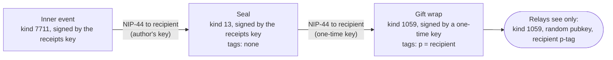
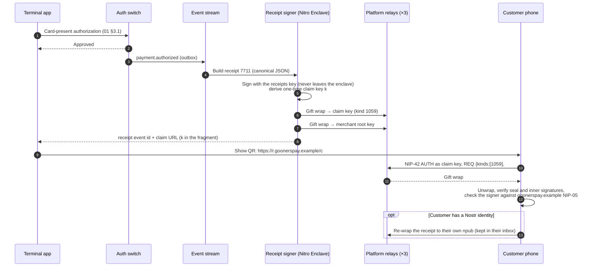
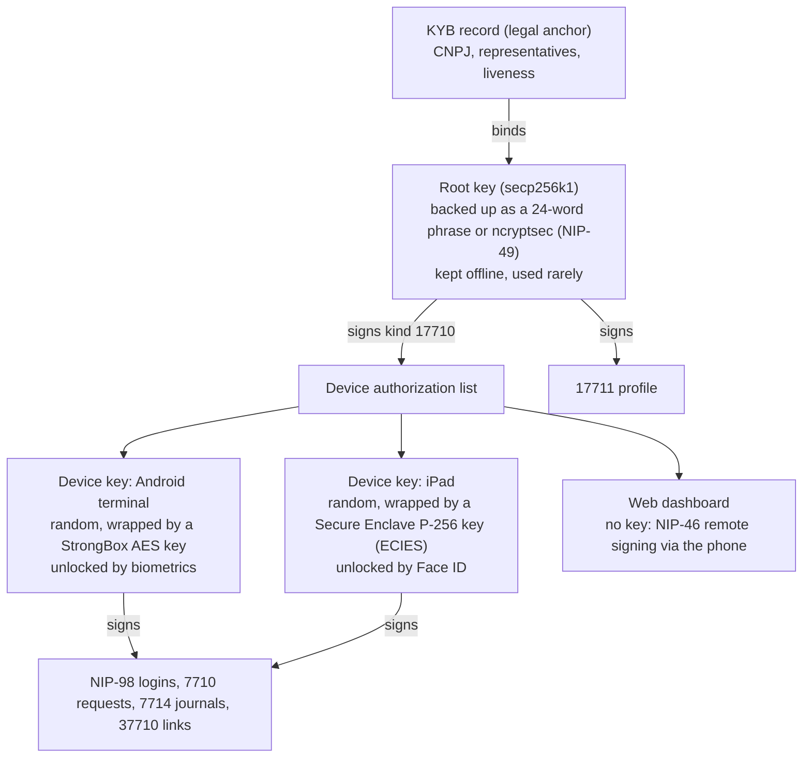
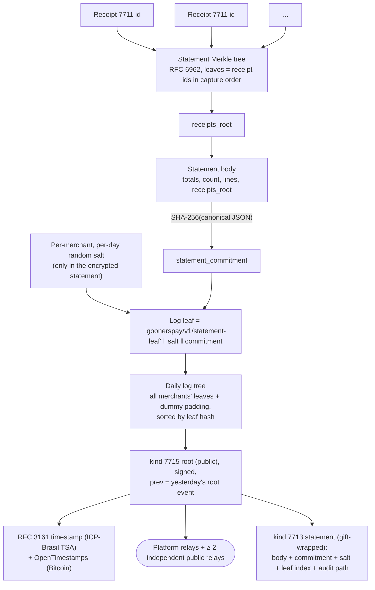
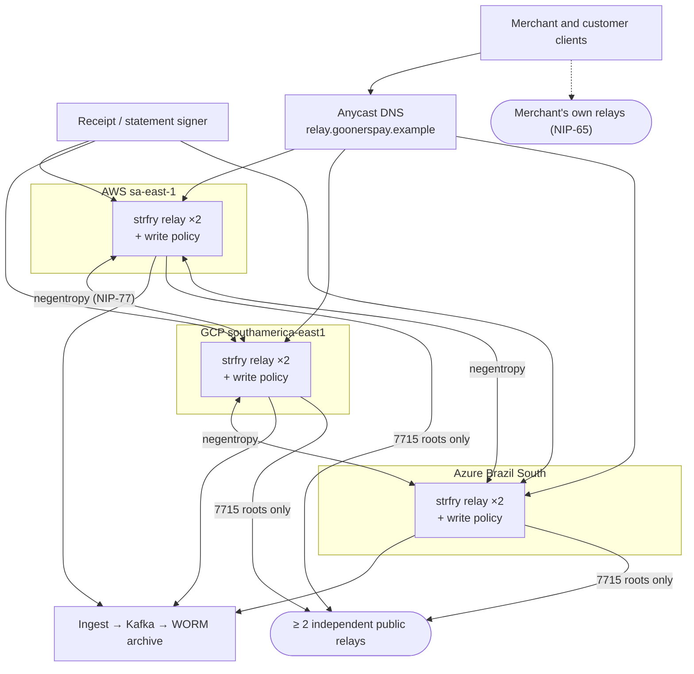
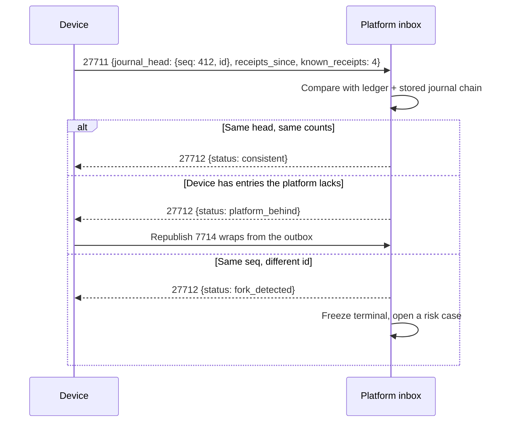

# Module 3: Decentralized Infrastructure and the Nostr Protocol

Nostr (*Notes and Other Stuff Transmitted by Relays*) is a simple protocol: clients sign JSON events with secp256k1 Schnorr keys (BIP-340) and publish them to relays, which store and forward them without being trusted. The platform uses it as a **trust plane**: a signed, portable, multi-relay channel for everything that happens *around* a payment.

Every event example in this module is real. They are produced by `payments/tools/gen-nostr-examples.mjs` from public test keys and verified by `npm run check` ([§11](#11-verification)).

---

## 1. What Nostr is and is not for

| Use it for | Why it fits | Never use it for | Why not |
|------------|-------------|------------------|---------|
| Receipts the customer owns | A signed event verifies anywhere, offline, without the platform | Card authorization | Synchronous, online, issuer-bound; must go over VisaNet/Banknet ([01](01-acquiring-engine.md)) |
| Settlement statements and the transparency log | Signatures plus Merkle roots make statements tamper-evident and publicly anchored | The ledger of record | Relays may drop data. The ledger is strongly consistent and authoritative ([04 §3](04-serverless-backend.md#3-ledger)) |
| Device-signed terminal journals | A hash chain signed on the device survives offline periods and proves ordering | Clear PII or card data | Relays are untrusted hosts. Everything sensitive is NIP-44 encrypted and gift-wrapped, and PAN never appears even encrypted |
| Merchant notifications and device-to-device messages | No public HTTPS endpoint or push vendor needed. Works across the merchant's own devices | Anything needing guaranteed delivery deadlines | Delivery is best-effort. Webhooks and in-app sync stay the guaranteed channel |
| Passwordless, phishing-resistant login (NIP-98, NIP-46) | Signature over the exact URL, method and body | The legal identity of the merchant | That is the KYB record, which the platform must be able to freeze and rebind ([§4.4](#44-recovery-compromise-and-rebinding)) |

The platform treats every relay the way the SMA messenger does ([`messenger/docs/00-overview.md`](../../messenger/docs/00-overview.md) §2): an adversary that can read, drop, reorder, replay and forge anything it carries. Signatures defeat forgery. Encryption and gift wrapping defeat reading. Multiple relays plus the ledger defeat dropping. Event IDs plus sequence numbers defeat replay and reordering.

---

## 2. Event kinds

### 2.1 Registry

| Kind | Class (NIP-01) | Name | Signed by | Visibility | Delivered to |
|------|----------------|------|-----------|-----------|--------------|
| **7710** | regular | Payment request | Authorized merchant device | Public, or gift-wrapped to one customer | Customer (QR, link, DM) |
| **7711** | regular | Payment receipt | Platform receipts key | Gift-wrapped (kind 1059) | One-time claim key; merchant root key; customer npub if known |
| **7712** | regular | Payment adjustment (refund, reversal, chargeback outcome) | Platform receipts key | Gift-wrapped | Same as the receipt it references |
| **7713** | regular | Daily settlement statement | Platform receipts key | Gift-wrapped | Merchant root key and each device |
| **7714** | regular | Terminal journal entry (hash-chained) | Merchant device | Gift-wrapped | Platform inbox key and merchant root key |
| **7715** | regular | Settlement transparency root | Platform transparency key | **Public** | Platform relays + at least two independent public relays |
| **17710** | replaceable | Device authorization list | Merchant **root** key | Public | Platform relays |
| **17711** | replaceable | Merchant payment profile | Merchant root key | Public | Platform relays, merchant's NIP-65 relays |
| **27710** | ephemeral | Remote charge / checkout status | Merchant device | Gift-wrapped as kind **21059** | Another device of the same merchant |
| **27711** | ephemeral | Reconciliation request | Merchant device | Gift-wrapped as 21059 | Platform inbox key |
| **27712** | ephemeral | Reconciliation response | Platform inbox key | Gift-wrapped as 21059 | Requesting device |
| **37710** | addressable (`d` tag) | Payment link | Authorized merchant device | Public | Platform relays |

**Collision check.** On 2026-10-29 the NIPs repository's kind table had no entries at 7710–7715, 17710–17711, 27710–27712 or 37710. The nearest neighbours are NIP-60 (7374–7376) and NIP-CC (7516–7517, 37516–37517). These kinds are **provisional**. The plan is to propose them as a NIP after six months in production (assumption A6 in [00](00-executive-summary.md#10-assumptions-and-open-questions)), and to re-check the table before each release.

**Standard NIPs used**: NIP-01 (events), NIP-05 (`cafeaurora@goonerspay.example`), NIP-17 (DMs), NIP-19 (bech32), NIP-40 (expiration), NIP-42 (relay auth), NIP-44 v2 (encryption), NIP-46 (remote signing), NIP-49 (encrypted key export), NIP-59 (gift wrap), NIP-65 (relay lists), NIP-77 (negentropy sync) and NIP-98 (HTTP auth). **Avoided**: NIP-04 (deprecated), NIP-26 delegation (marked unrecommended), NIP-03 (marked unrecommended; §6.5 uses RFC 3161 and OpenTimestamps directly).

### 2.2 Conventions

1. **`content` is canonical JSON** (sorted keys, no whitespace, integers only), so any implementation reproduces the bytes. Every payload has `"v": 1`.
2. **Money is an object**: `{ "value": 12990, "currency": "BRL", "exponent": 2 }`.
3. **Public events carry no personal data in tags or content**, beyond what the merchant publishes about itself (trade name, CNPJ, city). CNPJ data is public in Brazil. CPF data never appears.
4. **The `merchant` tag** names the merchant's root pubkey on every merchant-scoped event, so a client can resolve the device authorization list (§4.2).
5. **Schemas**: one JSON Schema per kind in [`nostr/schemas/`](../nostr/schemas). For kinds with JSON content, the parsed content is checked against `$defs/content`. The receipt schema explicitly rejects any `pan`, `number` or `track2` field.

### 2.3 Why inner events are signed

NIP-59 normally wraps an unsigned "rumor", so that the sender can deny authorship. Receipts, statements and journals need the opposite: **non-repudiation**. The platform must not be able to deny a receipt it issued, and a device must not be able to deny a journal entry. So the innermost event is a fully signed event. The seal and the wrap still hide the author, recipient, kind and timing from relays. Standard NIP-59 clients unwrap it unchanged and simply see an extra `sig` field.



---

## 3. Receipts

### 3.1 Flow



### 3.2 Claim by QR

The customer does not need an app, an account, a phone number or an e-mail address:

1. For each receipt the enclave derives a **one-time claim key** `k` (32 random bytes) and wraps the receipt to `P_k = k·G`.
2. The terminal shows `https://r.goonerspay.example/c#k=<hex>`. The secret is in the **URL fragment**, which browsers never send to the server.
3. The page is static. It runs the relay query and decryption in the browser, verifies both signatures, and renders the receipt. It offers "save to my Nostr inbox", "download PDF" and "share".
4. When the customer's client authenticates to the relay as `P_k` (NIP-42), the relay records that the receipt was **claimed**. This is useful evidence in "not recognized" disputes ([01 §7.2](01-acquiring-engine.md#72-automated-evidence)). The claim page discloses this.
5. Unclaimed claim wraps expire from relays after 90 days (NIP-40 `expiration` on the wrap). The merchant's copy and the archive keep the receipt.

### 3.3 Example receipt (kind 7711, inner event)

```json
{
  "id": "ff03851857ec49e831e63ce49a5b0ccb445983b0353c74e2a9a0f1df7ec68ee2",
  "pubkey": "efdc9ee499d020d1fd772e619bf637377a9384624aaf4830e3b2740f84ff15f6",
  "created_at": 1793295730,
  "kind": 7711,
  "tags": [
    ["merchant", "f8a0ec16b67563d55336c381b5703960ef8b379c1e1a6ad2824efd26f1cfbfb0"],
    ["e", "a14d60ce8cf49c2c466a55a184869f29ef6954e6383144abe702bbec4c74e02b", "wss://relay.goonerspay.example", "journal"]
  ],
  "content": "{\"amount\":{\"currency\":\"BRL\",\"exponent\":2,\"value\":12990},\"authorization\":{\"approved_at\":\"2026-10-29T17:42:10Z\",\"code\":\"B7K2Q9\",\"rrn\":\"630217004211\",\"stan\":\"004211\",\"terminal_id\":\"TP000418\"},\"fiscal_note\":\"Comprovante de pagamento. Não é documento fiscal.\",\"installments\":{\"count\":1,\"type\":\"none\"},\"merchant\":{\"address\":\"Rua Augusta 1500, São Paulo - SP\",\"cnpj\":\"12.345.678/0001-95\",\"id\":\"mer_01JB8Z2K5D6F7G8H9J0K1M2N3P\",\"name\":\"Café Aurora\",\"nip05\":\"cafeaurora@goonerspay.example\"},\"method\":{\"aid\":\"A0000000031010\",\"application_label\":\"VISA CREDITO\",\"brand\":\"visa\",\"cvm\":\"no_cvm\",\"entry_mode\":\"contactless\",\"funding\":\"credit\",\"last4\":\"0119\",\"type\":\"card\"},\"payment_intent_id\":\"pi_01JBK3Z9Y8X7W6V5T4S3R2Q1P0\",\"receipt_id\":\"rcpt_01JBK3Z9Y8X7W6V5T4S3R2Q1P0\",\"settlement_date\":\"2026-10-29\",\"v\":1}",
  "sig": "a805775146ef636f5783b6b32d8ba89a2c82d9ec9563ac5329e76fc2499672782ebccbf08c0cec7d3333786420cb9aaa9bcbc6ea1a47c72544761e061792a845"
}
```

The second tag links the receipt to the **device-signed journal entry** for the same tap ([§7](#7-terminal-journal-and-offline-first-logging)). Two independent parties, the platform and the merchant's device, have signed the same event.

The sealed and wrapped forms are in [`nostr/examples/1059-receipt-giftwrap.json`](../nostr/examples/1059-receipt-giftwrap.json), together with the claim URL for the test claim key.

**Verifying a receipt** (any client, offline once fetched):

1. Unwrap the 1059 with the claim key and check the wrap's signature. Decrypt the seal and check that its signature is by `pubkey` P.
2. Decrypt the inner event. Check that its `pubkey` equals the seal's (anti-impersonation), and check its `id` and `sig`.
3. Check that P is the platform receipts key published at `https://goonerspay.example/.well-known/nostr.json?name=_receipts`, cached and pinned in the merchant app.
4. Validate the content against [`kind-7711.receipt.schema.json`](../nostr/schemas/kind-7711.receipt.schema.json).
5. Optionally, fetch the inclusion proof ([§6.5](#65-verification)) once the day's statement is published.

### 3.4 Data minimization

A receipt carries what an EMV receipt must show (merchant, amount, date, last four digits, application label, AID, authorization code, terminal ID). It never carries the PAN, the track data, the cardholder name or the customer's CPF, unless the customer asks for a CPF on the receipt for tax purposes, in which case the CPF goes only in the copy wrapped to the customer's own key. These rules come from LGPD data minimization and PCI DSS v4.0.1 requirement 3.4 (PAN display masking).

The receipt is a **payment voucher** (*comprovante de pagamento*), not a fiscal document. The merchant's NFC-e (consumer electronic invoice) remains the merchant's obligation. When the merchant's ERP issues it, its access key can be attached in a later 7712 adjustment of type `fiscal_link` (reserved).

---

## 4. Merchant identity and authentication

### 4.1 Key hierarchy



**Why device keys are wrapped rather than hardware-resident.** StrongBox and the Secure Enclave support NIST P-256, not secp256k1. A phone cannot hold a Nostr key in hardware directly. Each device therefore generates a random secp256k1 key, encrypts it under a hardware-resident key that requires user presence, and decrypts it into memory only for the moment of signing. An attacker with the app's storage gets ciphertext. An attacker with code execution on an unlocked phone can sign while the device is unlocked, which is the same limit as every software key and is why the platform also attests the device ([05 §2.4](05-mobile.md#24-attestation-and-device-integrity)).

**Why not a custodial key on the server.** That would recreate the password database the brief wants to remove. The platform holds only public keys.

### 4.2 Device authorization

The merchant root key publishes a replaceable kind 17710 event listing the devices it authorizes:

```json
{
  "id": "eeb8fda719fa5813d637989236a770842af723e978911f8c8506f14f4923e8bf",
  "pubkey": "f8a0ec16b67563d55336c381b5703960ef8b379c1e1a6ad2824efd26f1cfbfb0",
  "created_at": 1793275930,
  "kind": 17710,
  "tags": [
    ["v", "1"],
    ["merchant", "mer_01JB8Z2K5D6F7G8H9J0K1M2N3P"],
    ["device", "6a22e43cc9bdbefad7f47cfa31d2b4daa4a1762445b644305b8d9a90fb7edfe2", "android", "Caixa 1", "1793275930"],
    ["device", "68c56c9650ef52109ce0b18e95f24b0082da5fcb8bb7aed70728b086960a0510", "ios", "iPad balcão", "1793275930"]
  ],
  "content": "",
  "sig": "b19a1314953b8b64b8bc51bdac2ef1d9350d64e6b8818d28bd23d394a51c35239dadfdcc491ac62379d86587af0123317ce08f81ad6fb8dd244911abbef222ad"
}
```

Rules:

1. **The newest `created_at` wins** (NIP-01 replaceable semantics). The platform rejects a 17710 whose `created_at` is older than the one it holds, and rejects one more than 10 minutes in the future.
2. **The server-side binding is authoritative for API access.** `POST /v1/merchants/{id}/devices` ([02 §8.3](02-api-reference.md#83-post-v1merchantsiddevices)) stores the device record with its attestation. Revoking a device takes effect in the platform immediately. The new 17710 then tells everyone else.
3. Adding a device needs the root key, so a stolen phone cannot enrol a second attacker device. Revoking a device can also be done from another authorized device with a step-up (biometrics plus OTP to the representative's phone). The platform then marks it revoked server-side and asks the root key to republish at the next opportunity.
4. At most 20 devices per merchant. Larger merchants use sub-merchants.

### 4.3 Logins

- **App to API**: NIP-98 (kind 27235) over the exact URL, method and body hash, exchanged for a 15-minute DPoP-bound session ([02 §3.2](02-api-reference.md#32-post-v1authnostr-merchant-apps)). A real signed login event and its `Authorization` header are in [`nostr/examples/27235-nip98-login.json`](../nostr/examples/27235-nip98-login.json).
- **Web dashboard**: the browser shows a `nostrconnect://` QR. The merchant scans it with the phone app, which acts as a NIP-46 remote signer and approves each signature with biometrics. The dashboard never holds a key, and phishing a password becomes impossible because there is none.
- **Step-up**: payouts, bank-account changes and device enrolment require a fresh signature with user presence, plus RFC 9421 request signatures for API clients ([02 §1.2](02-api-reference.md#12-authentication)).

### 4.4 Recovery, compromise and rebinding

| Event | Procedure | Who signs |
|-------|-----------|-----------|
| Device lost | Revoke from another device or with the root key. Server-side revocation is immediate | Another device + step-up, or the root key |
| Root key lost (phrase lost) | Re-KYB: liveness of a legal representative + document check + OTP. The platform **rebinds** the merchant to a new root npub, moves the NIP-05 name, and ignores events from the old root dated after the rebind time | Platform (operational decision, four-eyes) |
| Root key compromised | Freeze payouts at once (the platform can, by design). Re-KYB, rebind, re-enrol devices. Receipts are unaffected: the platform signs them | Platform + merchant |
| Platform receipts key rotated | New key published at `/.well-known/nostr.json` and in 17711 profiles. The old key stays valid for verifying events dated before the rotation | Platform (HSM-sealed key ceremony) |

This is the honest limit of "sovereign identity" in a regulated business. The merchant controls its credentials and can carry its signed history anywhere. The legal relationship stays with a KYB'd entity, which the platform must be able to freeze, recover and rebind.

---

## 5. Merchant notifications

Operational notifications (sale approved on another device, payout paid, dispute opened, KYB action needed) go from the platform inbox key to each authorized device as **NIP-17 private messages** (kind 14 rumors, sealed and gift-wrapped), sent to the inbox relays the device lists in kind 10050. The message body has a human sentence plus a machine-readable payload that mirrors the webhook event ([02 §10.3](02-api-reference.md#103-event-catalogue)):

```json
{
  "text": "Pix recebido: R$ 23,90 · Mesa 2",
  "event": { "type": "payment_intent.captured", "id": "pi_01JBK5HZ3D2F1G0H9J8K7M6N5P", "amount": 2390, "currency": "BRL" }
}
```

Two channels, on purpose: the in-app sync and webhooks remain the guaranteed path, and Nostr is the path that works with no HTTPS endpoint, no push vendor and no account at a third party. A merchant can read them in any NIP-17 client with their device key, which is a real portability gain.

---

## 6. Verifiable settlement transparency log

### 6.1 Construction



### 6.2 Formulas

```text
receipts_root        = MTH( [receipt_event_id_1, …, receipt_event_id_n] )              (RFC 6962, SHA-256)
statement_commitment = SHA-256( canonical_json(statement_body) )
log_leaf             = "goonerspay/v1/statement-leaf" ‖ salt(32 B) ‖ statement_commitment(32 B)
log_root(date)       = MTH( sort_by_leaf_hash( leaves(date) ∪ dummy_padding(date) ) )
```

`MTH` uses RFC 6962 domain separation (`0x00` for leaves, `0x01` for nodes), so a leaf can never be confused with an internal node.

### 6.3 What it proves and what it does not

| Proves | Does not prove |
|--------|----------------|
| On that date the platform committed to exactly this statement for this merchant. It cannot later present a different statement without either forking the signed root chain (detectable: roots are timestamped and mirrored by third parties) or breaking SHA-256 | That fees are correct. That is the contract, checked by the merchant app against the pricing in force |
| Every receipt in the statement is the one the platform signed | That the statement is complete. The merchant's device journal and reconciliation ([§7](#7-terminal-journal-and-offline-first-logging), [§9](#9-cross-node-reconciliation)) catch omissions |
| The history of roots is append-only (each root names its predecessor) | Anything about other merchants |

### 6.4 Privacy

The public sees one root per day, a tree size rounded up to a multiple of 4,096 with dummy leaves, and leaves sorted by hash. A leaf is a salted commitment: without the salt, which exists only inside the merchant's encrypted statement, nobody can test whether a guessed statement is in the tree. Neither the number of merchants (beyond the rounding) nor any merchant's volume can be read from the log. This matters for [07 §2](07-enhancements.md#2-zero-knowledge-compliance-zkc): the log adds transparency without leaking the volume data the ZK features protect.

### 6.5 Verification

The example day has four receipts and a log padded to 8 leaves (production pads to 4,096). The day's root:

```json
{
  "id": "be8254533179aec1f63b4adacbc3211997fdbe22c3d4f0dec36dbc87aef64f8d",
  "pubkey": "34decc3681764daa5132ca5fac8052d0db91b4d9bef3b5dfa7fa001bcadf9f89",
  "created_at": 1793325600,
  "kind": 7715,
  "tags": [
    ["log", "goonerspay-settlement-v1"],
    ["date", "2026-10-29"],
    ["e", "6e6de4463518d8806d3787cbd89991db6c45d9eb26e4781600111e9f7c831f47", "wss://relay.goonerspay.example", "prev"]
  ],
  "content": "{\"date\":\"2026-10-29\",\"log\":\"goonerspay-settlement-v1\",\"padding\":\"dummy leaves to a multiple of 8 (production: 4096)\",\"prev\":\"6e6de4463518d8806d3787cbd89991db6c45d9eb26e4781600111e9f7c831f47\",\"root\":\"dd0bc1db86a3358f397bc33ab9506387e1c65ed8240063cc361b2fb6bd203dd8\",\"tree_size\":8,\"v\":1}",
  "sig": "3660739aa05ab0f1b4973fecc871c9ce2ed207b9186f0bc7787f1cda71c6a52178b75cacd808280c3d7b362ff730a007b73b7f434f7481e2443234bdd5ddcc13"
}
```

Proof that receipt `2b694e…ee42` is in the statement, and that the statement is in the public log (`GET /v1/settlements/{id}/proofs/{receipt_event_id}`, [02 §9](02-api-reference.md#9-settlements-and-proofs)):

```json
{
  "receipt_event_id": "ff03851857ec49e831e63ce49a5b0ccb445983b0353c74e2a9a0f1df7ec68ee2",
  "statement_inclusion": {
    "leaf_index": 0,
    "tree_size": 4,
    "audit_path": [
      "308c2b57d5ff75c8bf1849d919e89ba1a46f7132d3c243a0c12d1f7db3cbbd82",
      "01ed95bad1f07050998fd6ea8d45305e67c432ff94d9903de11f9db7679aa681"
    ],
    "root": "463dc56ba1bc78981866a4d2547a795344fd12098e0183df733f040034fa3b7f"
  },
  "transparency_inclusion": {
    "leaf_index": 6,
    "tree_size": 8,
    "audit_path": [
      "05a70f10e2a8fc6603244b649ed4214cc67323627cfb38a33ec92f24afc067fc",
      "3d43f25db17bbdffff91fc6933da03edb86e89dc5a7ddaea3d29c40daf2ec330",
      "b03715f2093cc2a4ecec42a18e7e15dbbbe21949878595988274dc429800d022"
    ],
    "root": "dd0bc1db86a3358f397bc33ab9506387e1c65ed8240063cc361b2fb6bd203dd8"
  }
}
```

Verifier steps (implemented in `tools/check.mjs`):

1. Verify the receipt's inclusion in `receipts_root` (RFC 9162 §2.1.3.2).
2. Recompute `statement_commitment` from the statement body and compare it with the value in the statement.
3. Build `log_leaf` from the salt and the commitment, and verify its inclusion in the 7715 root.
4. Verify the 7715 signature against the platform transparency key, and walk `prev` back to a root you have seen before, or to a timestamped one.

Daily totals in the example statement ([`7713-settlement-statement.json`](../nostr/examples/7713-settlement-statement.json)): gross R$ 508,80, fees R$ 20,23, net R$ 488,57. The checker recomputes those from the lines too.

### 6.6 Anchoring

Each root event ID is timestamped by an **RFC 3161 timestamp authority accredited under ICP-Brasil**, which gives it legal evidentiary value in Brazil, and by **OpenTimestamps**, which anchors it in Bitcoin for public verifiability without any trusted party. Both tokens are stored in the WORM archive and served at `GET /v1/transparency/{date}/timestamps`. The roots are mirrored to at least two public relays that the platform does not operate, so any later fork is visible to anyone.

---

## 7. Terminal journal and offline-first logging

### 7.1 Hash-chained journal

Every terminal keeps an append-only journal of security-relevant events (session start, tap started, authorization result, receipt shown, static Pix QR shown, cash sale recorded, configuration change, attestation refresh). Each entry is a kind 7714 event signed by the device key, with `seq` (monotonic) and `prev` (the previous entry's event ID) inside the encrypted content. Entries are gift-wrapped to the platform inbox key and to the merchant root key.

The example in [`nostr/examples/7714-terminal-journal.json`](../nostr/examples/7714-terminal-journal.json) is entry 412, the `auth_result` for the receipt in §3.3. The receipt's `e` tag points to it.

What this gives:

- **Tamper evidence**: removing or changing an entry breaks the chain at the next one. Two different entries with the same `seq` are a signed proof of a fork (a cloned app, or a manipulated device).
- **Offline ordering**: entries signed while offline are published later in order. The platform detects gaps (`seq` jumps) and asks for them via reconciliation (§9).
- **Dispute evidence**: the device's own signed view of a tap, independent of the platform's logs.

### 7.2 What works offline

| Action | Offline? | How |
|--------|----------|-----|
| Card authorization (tap) | **No** | Tap-to-phone authorizes online, and the platform offers no offline card acceptance (no floor limits, no deferred authorization). The app says so plainly and offers the alternatives below |
| Static Pix QR (merchant key, amount typed in by the payer, or a fixed amount) | Yes | The QR is generated on the device. Payment confirmation arrives when connectivity returns, and is matched to the journal entry |
| Cash sale recording | Yes | Journal entry. Not a ledger movement until synced, and never touches the e-money balance |
| Showing past receipts and statements | Yes | Local encrypted store |
| Publishing journals and queued receipts | Deferred | Room / SwiftData outbox, published in `seq` order on reconnect ([05 §2.5](05-mobile.md#25-offline-first-queue-and-nostr-sync)) |

---

## 8. Relay architecture

### 8.1 Topology



strfry is chosen because it is a mature C++ relay with LMDB storage, built-in negentropy sync and a pluggable write policy. The platform runs it on containers, not functions: relays hold long-lived WebSocket connections.

### 8.2 Relay policy

| Policy | Rule |
|--------|------|
| Accepted kinds | Top level: 1059, 21059, 10002, 10050, 7710, 7715, 17710, 17711, 37710. Kinds 13, 14 and 7711–7714 are accepted only *inside* gift wraps; published bare, they are rejected so private data cannot leak by mistake |
| Writes | Platform signers: any accepted kind. Authorized merchant devices: 7710, 37710, 17710/17711 (root), 1059/21059 addressed to platform or merchant keys. Anyone else: rejected |
| Reads of 1059 / 21059 | Only by a NIP-42-authenticated client whose pubkey equals the wrap's `p` tag. The claim page authenticates *as* the claim key |
| Public reads | 7715, 17710, 17711, 37710, 7710 (public requests) |
| Limits | 64 KiB per event; per-pubkey rate limits; per-IP connection limits; NIP-13 proof of work required for unauthenticated publishing to the public mirror |
| Retention on relays | 1059 receipt wraps: 13 months (claim wraps 90 days). Statements: 13 months. 7715 roots: forever. Archive: 10 years, which covers Brazilian financial-record retention with margin |

### 8.3 Durability model

Relays are a **cache with signatures**, not storage of record. Every event the platform signs is first written to the archive via the event stream, then published. If every relay lost its data, the platform could republish everything from the archive, and every signature would still verify. Conversely, data found only on a relay and not in the ledger has no financial effect. The ledger always wins.

### 8.4 Capacity

At 1 million card transactions a day: about 6 events per transaction (two receipt wraps, two journal wraps, one notification, and a share of statements), so about 6 million events a day, 70 per second on average and about 700 per second at a 10× peak. A single strfry instance handles thousands of writes per second, so six instances across three providers are sized for availability, not throughput.

---

## 9. Cross-node reconciliation

| Pair | Mechanism | Detects |
|------|-----------|---------|
| Relay ↔ relay | Negentropy set reconciliation (NIP-77), continuous | Events missing on one relay |
| Ledger ↔ relays | Every outbox event has an expected event ID. A sweeper checks that every expected ID is on at least two relays within 60 s | Lost publishes |
| Device ↔ platform | Ephemeral 27711 / 27712 exchange ([`nostr/examples/27711-reconciliation.json`](../nostr/examples/27711-reconciliation.json)): the device sends its journal head (`seq`, ID) and receipt count, and the platform answers `consistent`, `device_behind` (with missing receipt IDs), `platform_behind` (asks for journal entries) or `fork_detected` | Missing receipts, unpublished journals, cloned devices |
| Statement ↔ device journal | The merchant app compares each daily statement's lines with its own journal `auth_result` entries | Omitted or invented transactions |



---

## 10. Security considerations

| Threat | Mitigation |
|--------|------------|
| Relay reads receipts | NIP-44 v2 encryption, gift wrap (random author key, timing randomized by up to 2 days per NIP-59 for non-urgent events; receipts use real time because they must arrive in seconds) |
| Relay learns who pays whom | Claim keys are one-time. Merchant wraps go to the root key, which is public anyway. Customers' own npubs appear only if the customer opts in |
| Forged receipts or statements | BIP-340 signatures by keys pinned in the app and published via NIP-05. Signing keys live only inside an attested Nitro Enclave, sealed by KMS under an enclave-measurement policy ([04 §4.2](04-serverless-backend.md#42-key-management)) |
| Replay of payment requests | Unique IDs; NIP-40 `expiration`; the platform accepts each `request_id` once |
| Relay censorship or outage | Three providers plus merchant-chosen relays. The ledger and HTTPS APIs as fallback |
| Device clone | Fork detection in the journal chain (§7.1); attestation; one active session per device key |
| Quantum adversary | Schnorr over secp256k1 is not post-quantum. Confidentiality relies on NIP-44 (ECDH), so harvest-now-decrypt-later applies to gift-wrapped content. Mitigations: receipts hold little sensitive data by design (§3.4); the TLS hop is hybrid post-quantum ([02 §2.2](02-api-reference.md#22-profile)); roots are anchored with hash-based timestamps. When a post-quantum Nostr encryption NIP exists, wraps migrate to it, reusing the X-Wing and ML-DSA work in the SMA messenger |

---

## 11. Verification

`cd payments/tools && npm ci && npm run check` verifies, for every example in `nostr/examples/` and every event embedded in these documents:

- the NIP-01 event ID and the BIP-340 signature;
- gift wraps: decrypting with the test recipient key, the seal's signature, empty seal tags, and author equality between seal and inner event;
- the content against the kind's JSON Schema;
- both Merkle inclusion proofs and the statement commitment;
- the statement totals against its lines;
- that every event embedded in a document is byte-identical to the generated file.
