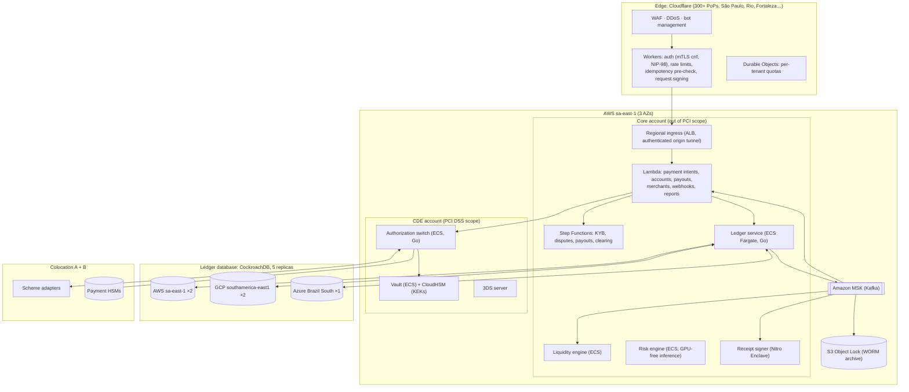
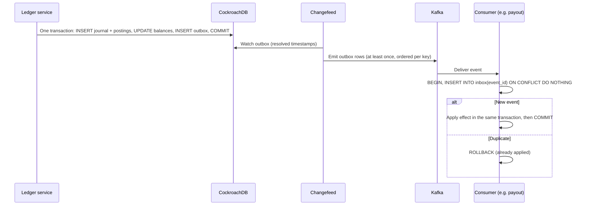
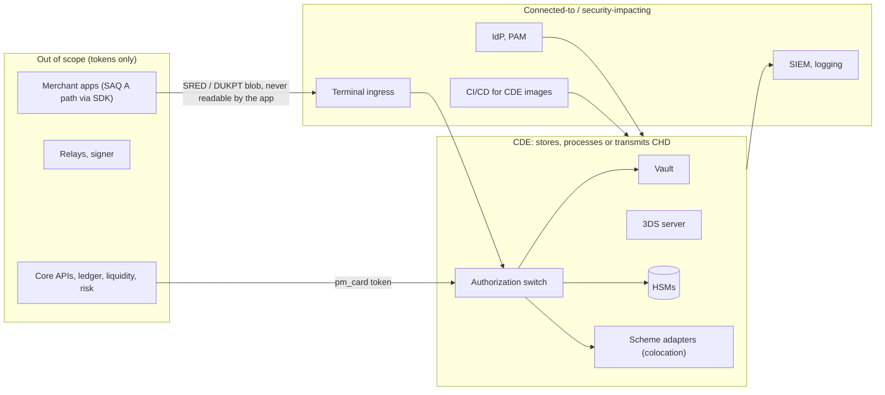

# Module 4: Serverless and Edge Computing Backend

The backend has one job that cannot fail (moving money correctly) and many jobs that must scale without anyone thinking about servers (APIs, webhooks, receipts, onboarding, reports). Each kind of work gets the runtime that fits it.

---

## 1. Topology

### 1.1 Deployment view



### 1.2 Runtime placement

| Component | Runtime | Why |
|-----------|---------|-----|
| API edge (authentication, quotas, idempotency pre-check) | Cloudflare Workers + Durable Objects | Runs close to the merchant, absorbs abuse before it reaches the origin, scales to zero and to millions with no capacity planning |
| Merchant and partner APIs (payment intents, accounts, payouts, merchants) | AWS Lambda (Node.js 22 / Go), provisioned concurrency on the hot functions | Spiky, stateless, request-scoped. Provisioned concurrency removes cold starts where latency matters |
| Webhooks, notifications, receipt orchestration, reports | Lambda consuming Kafka | Event-driven fan-out |
| Long workflows (KYB, disputes, payouts, daily clearing) | Step Functions | Durable state machines with timers, retries and human tasks, and nothing to keep running |
| **Ledger service** | ECS Fargate (Go), always on, ≥ 3 tasks per AZ | Holds a connection pool to the database. Predictable p99. Owns the posting invariants in one place |
| **Authorization switch, scheme adapters** | ECS in the CDE account; containers in the colocation sites | Persistent ISO 8583 sessions, HSM sessions and strict latency. Lambda cannot keep a socket to MIP |
| Card vault | ECS in the CDE + CloudHSM | Same reasons, plus a small, auditable PCI footprint |
| Receipt and statement signer | Nitro Enclave on EC2 | Keys are usable only by attested code ([§4.2](#42-key-management)) |
| Nostr relays | strfry on containers in three providers | Long-lived WebSockets ([03 §8](03-nostr-layer.md#8-relay-architecture)) |
| Ledger database | CockroachDB across three providers | Strict serializable, multi-provider survival ([§5](#5-multi-region-multi-provider-resilience)) |
| Event streaming | Amazon MSK (Kafka), tiered storage | Ordered, replayable, the backbone for outbox events |

This is what "infinite horizontal scaling" means in practice. The stateless 90% of the code scales without limit on Workers and Lambda. The stateful 10% (switch, ledger, relays) scales horizontally by sharding: switch by terminal, ledger by tenant and account range, relays by connection.

### 1.3 Authorization latency budget (card-present, internal)

| Step | p99 budget |
|------|-----------|
| Edge: TLS termination, attestation token check | 8 ms |
| Edge → switch (private tunnel, same metro) | 4 ms |
| HSM: DUKPT decryption + PIN translation | 6 ms |
| Risk engine score | 15 ms |
| Routing decision | 2 ms |
| Ledger: authorization hold (one serializable transaction across providers) | 25 ms |
| Switch → scheme adapter (Direct Connect) | 4 ms |
| Adapter ISO 8583 encode/decode | 1 ms |
| Response path and serialization | 10 ms |
| Headroom | 45 ms |
| **Total excluding the scheme network and issuer** | **≤ 120 ms** |

The ledger hold is written *in parallel* with the scheme round trip. If the hold fails (which should never happen for a valid merchant), the switch reverses the authorization.

### 1.4 Accounts and segmentation

| AWS account | Contents | PCI DSS |
|-------------|----------|---------|
| `edge-integration` | Cloudflare tunnels, regional ingress | Connected-to (no CHD) |
| `core-prod` | Lambdas, Step Functions, ledger service, liquidity, risk, signer | Out of scope (tokens only) |
| `cde-prod` | Switch, vault, 3DS server, CloudHSM | **In scope** |
| `data-prod` | MSK, S3 archive, CockroachDB nodes (AWS side) | Out of scope (no CHD in topics, enforced by schema registry rules) |
| `security` | GuardDuty, Security Hub, SIEM forwarders, KMS root keys | Connected-to |
| `log-archive` | Organization CloudTrail, VPC flow logs (Object Lock) | Connected-to |
| `sandbox` | Full stack with scheme simulators | Out of scope |

Service control policies forbid public S3 buckets, disabling CloudTrail, leaving `sa-east-1` (except the backup region) and creating IAM users.

---

## 2. Event-driven backbone

### 2.1 Topics

| Topic | Key | Partitions | Retention | Producers → consumers |
|-------|-----|-----------|-----------|-----------------------|
| `payments.v1` | `payment_intent_id` | 128 | 30 days hot, tiered forever | Payment intents → webhooks, receipts, risk features, analytics |
| `authorizations.v1` | `auth_id` | 128 | 30 d + tiered | Switch (tokens only, never PAN) → ledger, clearing, risk |
| `ledger.journals.v1` | `account_id` | 256 | 30 d + tiered | Ledger outbox → balances projection, statements, liquidity, reporting |
| `routing.decisions.v1` | `auth_id` | 64 | 400 days | Switch → routing analytics, model training |
| `disputes.v1` | `dispute_id` | 16 | 30 d + tiered | Dispute intake → dispute workflow, risk |
| `nostr.publish.v1` | `event_id` | 32 | 7 days | Signer → relay publishers, publish sweeper |
| `merchant.v1` | `merchant_id` | 32 | 30 d + tiered | Onboarding → risk, pricing, notifications |

### 2.2 Envelope

Every event is a CloudEvents 1.0 JSON envelope. The schema registry rejects any payload with a field matching a PAN pattern (Luhn-valid 13–19 digits), as a backstop to code review.

```json
{
  "specversion": "1.0",
  "id": "evt_01JBK3W8T6R4P2N0M8K6J4H2G0",
  "source": "goonerspay://ledger/sa-east-1",
  "type": "ledger.journal.posted",
  "subject": "jr_01JBK3W8T6R4P2N0M8K6J4H2G1",
  "time": "2026-10-29T17:42:10.348Z",
  "datacontenttype": "application/json",
  "dataschema": "https://schemas.goonerspay.example/ledger/journal.posted/1.json",
  "tenantid": "ten_01JB7X0000000000000000000A",
  "traceparent": "00-4bf92f3577b34da6a3ce929d0e0e4736-00f067aa0ba902b7-01",
  "data": {
    "journal_id": "jr_01JBK3W8T6R4P2N0M8K6J4H2G1",
    "type": "card_capture",
    "reference": "pi_01JBK3Z9Y8X7W6V5T4S3R2Q1P0",
    "postings": [
      { "account": "asset.scheme_receivable.visa", "direction": "debit", "amount": 12766 },
      { "account": "expense.interchange", "direction": "debit", "amount": 208 },
      { "account": "expense.scheme_fees", "direction": "debit", "amount": 16 },
      { "account": "liability.merchant_payable.mer_01JB8Z2K5D6F7G8H9J0K1M2N3P", "direction": "credit", "amount": 12576 },
      { "account": "revenue.mdr", "direction": "credit", "amount": 414 }
    ]
  }
}
```

### 2.3 Exactly-once effects

Kafka gives at-least-once delivery. Financial effects must happen exactly once. The platform gets there with a transactional outbox on the producer side and an inbox on the consumer side:



There is no dual write anywhere: a service never writes to the database *and* publishes to Kafka in separate steps.

### 2.4 Regulatory reporting

| Report | Destination | Cadence | Source |
|--------|-------------|---------|--------|
| DIMP (merchant transactions, including Pix) | State tax authorities (one file per state), Convênio ICMS 134/2016 layout | Monthly, by the last day of the following month | `ledger.journals.v1` + merchant registry |
| Receivable units and liens | Registrar(s) | Continuous (API) and daily | Clearing + liquidity engine ([01 §8](01-acquiring-engine.md#8-clearing-settlement-and-receivables)) |
| Suspicious activity (AML) | COAF (Lei 9.613/1998) | Event-driven, within the legal deadline | Risk engine AML rules + analyst case management |
| Prudential and payment statistics | BCB | Per BCB schedule | Ledger + data warehouse |
| Scheme monitoring (fraud, disputes) | Visa, Mastercard | Monthly / per programme | Disputes + risk |

### 2.5 Workflows

Step Functions state machines, each with explicit compensation steps:

- **KYB**: CNPJ registry → representatives → liveness → sanctions and PEP screening → MCC risk → pricing → device binding → active. Human review states for medium-risk results, with SLA timers.
- **Payout**: quote → risk check → ledger hold → Pix send → confirm or return → release or post.
- **Dispute**: intake → evidence assembly → merchant window → submission → outcome → ledger.
- **Daily clearing**: cut-off → build files → submit → acknowledgements → register receivables → reconcile.

---

## 3. Ledger

### 3.1 Model

The ledger is double-entry and append-only:

- An **account** has a code from the chart of accounts, a currency, a *normal side* (debit for assets and expenses, credit for liabilities and revenue), and a flag saying whether it may go negative.
- A **journal** is one atomic business event (a capture, a payout) with an idempotency key.
- A **posting** is one line of a journal: an account, a direction and a positive amount.
- **Balances** are a materialized projection, updated in the same transaction as the postings, with a version number for optimistic reads.

Chart of accounts (core subset):

| Code | Side | May go negative | Meaning |
|------|------|-----------------|---------|
| `asset.scheme_receivable.{visa,mastercard}` | debit | no | Owed by the scheme or issuers for cleared transactions |
| `asset.settlement_bank` | debit | no | Operating cash at the settlement bank |
| `asset.safeguarding_reserve` | debit | no | CCME balance at the BCB + federal securities in Selic, backing e-money |
| `asset.pix_settlement` | debit | no | Pix settlement account at the BCB |
| `asset.merchant_recoverable.{merchant}` | debit | no | Owed *by* a merchant (chargeback larger than its balance) |
| `liability.merchant_payable.{merchant}` | credit | no | Earned by the merchant, not yet available |
| `liability.merchant_wallet.{merchant}` | credit | no | Available e-money balance (safeguarded) |
| `liability.merchant_reserve.{merchant}` | credit | no | Rolling reserve held against risk |
| `liability.pix_in_transit` | credit | no | Payouts sent, not yet confirmed by SPI |
| `liability.scheme_payable.{visa,mastercard}` | credit | no | Refunds and chargebacks owed to the schemes |
| `liability.funding.{credit_line,fidc}` | credit | no | Funding used for instant settlement |
| `revenue.{mdr,advance_fees,payout_fees}` | credit | no | Platform revenue |
| `expense.{interchange,scheme_fees,processing,funding_cost,fraud_loss}` | debit | no | Platform costs |

### 3.2 Schema

PostgreSQL-compatible SQL that runs unchanged on CockroachDB. `npm run check` executes it against PostgreSQL 16 together with the posting test in §3.3.

```sql
CREATE TABLE ledger_accounts (
  tenant_id      UUID        NOT NULL,
  account_id     TEXT        NOT NULL,
  code           TEXT        NOT NULL,
  currency       CHAR(3)     NOT NULL,
  normal_side    TEXT        NOT NULL CHECK (normal_side IN ('debit', 'credit')),
  allow_negative BOOLEAN     NOT NULL DEFAULT false,
  shard_count    SMALLINT    NOT NULL DEFAULT 1 CHECK (shard_count BETWEEN 1 AND 256),
  status         TEXT        NOT NULL DEFAULT 'active' CHECK (status IN ('active', 'frozen', 'closed')),
  created_at     TIMESTAMPTZ NOT NULL DEFAULT now(),
  PRIMARY KEY (tenant_id, account_id)
);

CREATE TABLE journals (
  tenant_id       UUID        NOT NULL,
  journal_id      TEXT        NOT NULL,
  idempotency_key TEXT        NOT NULL,
  type            TEXT        NOT NULL,
  reference       TEXT,
  effective_date  DATE        NOT NULL,
  reverses        TEXT,
  posted_at       TIMESTAMPTZ NOT NULL DEFAULT now(),
  metadata        JSONB,
  PRIMARY KEY (tenant_id, journal_id),
  UNIQUE (tenant_id, idempotency_key)
);

CREATE TABLE postings (
  tenant_id  UUID     NOT NULL,
  journal_id TEXT     NOT NULL,
  seq        SMALLINT NOT NULL,
  account_id TEXT     NOT NULL,
  shard      SMALLINT NOT NULL DEFAULT 0,
  direction  TEXT     NOT NULL CHECK (direction IN ('debit', 'credit')),
  amount     BIGINT   NOT NULL CHECK (amount > 0),
  currency   CHAR(3)  NOT NULL,
  PRIMARY KEY (tenant_id, journal_id, seq),
  FOREIGN KEY (tenant_id, journal_id) REFERENCES journals (tenant_id, journal_id),
  FOREIGN KEY (tenant_id, account_id) REFERENCES ledger_accounts (tenant_id, account_id)
);
CREATE INDEX postings_by_account ON postings (tenant_id, account_id, journal_id);

CREATE TABLE balances (
  tenant_id  UUID        NOT NULL,
  account_id TEXT        NOT NULL,
  shard      SMALLINT    NOT NULL DEFAULT 0,
  balance    BIGINT      NOT NULL DEFAULT 0,
  version    BIGINT      NOT NULL DEFAULT 0,
  updated_at TIMESTAMPTZ NOT NULL DEFAULT now(),
  PRIMARY KEY (tenant_id, account_id, shard),
  FOREIGN KEY (tenant_id, account_id) REFERENCES ledger_accounts (tenant_id, account_id)
);

CREATE TABLE outbox (
  tenant_id  UUID        NOT NULL,
  event_id   UUID        NOT NULL DEFAULT gen_random_uuid(),
  topic      TEXT        NOT NULL,
  key        TEXT        NOT NULL,
  payload    JSONB       NOT NULL,
  created_at TIMESTAMPTZ NOT NULL DEFAULT now(),
  PRIMARY KEY (tenant_id, event_id)
);

-- The ledger role can only append. Corrections are reversing journals.
-- GRANT SELECT, INSERT ON journals, postings, outbox TO ledger_service;
-- GRANT SELECT, INSERT, UPDATE ON balances TO ledger_service;
-- (no UPDATE or DELETE on journals or postings for any application role)
```

On CockroachDB the outbox feeds Kafka through a changefeed (`CREATE CHANGEFEED FOR TABLE outbox INTO 'kafka://…' WITH resolved, diff`), and `tenant_id` leads every primary key so ranges split by tenant.

### 3.3 Posting rules and invariants

The ledger service posts a journal in **one serializable transaction**:

1. Insert the journal. A unique violation on `(tenant_id, idempotency_key)` means the journal was already posted, so return the original. This is what makes retries safe.
2. Validate in the service, before writing postings: at least two postings; every amount > 0; one currency per journal; **sum of debits = sum of credits**; every account exists, is active and is in that currency.
3. Insert the postings.
4. For each touched account (shard chosen by `hash(journal_id) mod shard_count`), update `balances` with the signed delta: `+amount` when the posting is on the account's normal side, `−amount` otherwise. Bump `version`.
5. If any account with `allow_negative = false` would end below zero, abort the transaction. For an available-balance check on a sharded account, the service reads all shards `FOR UPDATE` first.
6. Insert the outbox row(s), then commit. On a serialization conflict (SQLSTATE `40001`), retry with jittered backoff, up to 5 times.

Invariants checked continuously by an independent verifier job (a separate codebase, read-only credentials), with paging on any violation:

| # | Invariant | Query idea |
|---|-----------|------------|
| L1 | Every journal balances | `SUM(CASE direction WHEN 'debit' THEN amount ELSE -amount END) = 0` per journal |
| L2 | Balances equal the sum of postings | Recompute per account and shard; compare with `balances` |
| L3 | No forbidden negative balance | `balance >= 0` for every account with `allow_negative = false` |
| L4 | The trial balance is zero | Debit-normal totals = credit-normal totals per currency |
| L5 | Safeguarding (§3.6) | Σ(`merchant_wallet.*` + `merchant_reserve.*` + `pix_in_transit`) ≤ `asset.safeguarding_reserve`, after every journal |
| L6 | Clearing ties out | Captured authorizations = journals of type `card_capture` per day ([01 §8.3](01-acquiring-engine.md#83-reconciliation-invariants)) |

### 3.4 Posting catalogue

The worked example is a R$ 129,90 Visa credit tap. The merchant's MDR is 3.19% (R$ 4,14), and it has instant settlement as a tier A merchant: the advance fee is R$ 1,61 ([07 §1.3](07-enhancements.md#13-pricing-an-advance)). Illustrative costs: interchange 1.60% (R$ 2,08), scheme fees 0.10% + R$ 0,03 (R$ 0,16).

| Journal type | Debit | Credit | Example (centavos) |
|--------------|-------|--------|--------------------|
| `card_capture` | `scheme_receivable.visa` 12766 · `expense.interchange` 208 · `expense.scheme_fees` 16 | `merchant_payable.m` 12576 · `revenue.mdr` 414 | Σ 12990 = Σ 12990 |
| `instant_release` (advance) | `merchant_payable.m` 12576 | `merchant_wallet.m` 12415 · `revenue.advance_fees` 161 | Σ 12576 |
| `safeguard_topup` (treasury) | `safeguarding_reserve` 12415 | `settlement_bank` 12415 | Backs the new e-money at once |
| `pix_prefund` (treasury, intraday) | `pix_settlement` 50000 | `settlement_bank` 50000 | Own funds pre-position the Pix account; client money is never used to pre-fund |
| `payout_send` (Pix) | `merchant_wallet.m` 12415 | `pix_in_transit` 12415 | Still a client liability until SPI confirms |
| `payout_confirm` | `pix_in_transit` 12415 | `pix_settlement` 12415 | SPI confirmation |
| `safeguard_release` | `settlement_bank` 12415 | `safeguarding_reserve` 12415 | The liability left, so the reserve shrinks back to own cash |
| `scheme_settlement` (D+30) | `settlement_bank` 12766 | `scheme_receivable.visa` 12766 | Closes the receivable |
| `refund` | `merchant_wallet.m` | `scheme_payable.visa` | Funded from the merchant's balance ([02 §4.6](02-api-reference.md#46-capture-cancel-refund)) |
| `chargeback` | `merchant_wallet.m` (or `merchant_recoverable.m` for the shortfall) | `scheme_payable.visa` | The wallet part also releases its safeguarding (`safeguard_release`) |
| `chargeback_won` | `scheme_receivable.visa` | `merchant_wallet.m` | The scheme owes the money back until a settlement's reversal line; safeguarded at once |
| `shortfall_recovery` | `merchant_wallet.m` | `merchant_recoverable.m` | Collects what a merchant owes from its next credits, automatically |
| `shortfall_write_off` | `expense.fraud_loss` | `merchant_recoverable.m` | Operator decision, audited |
| `pix_med_return` | `merchant_wallet.m` (or `merchant_recoverable.m`) | `safeguarding_reserve` (or `settlement_bank` for the shortfall) | A Pix the payer's PSP returned under the MED |
| `scheme_settlement` (report) | `settlement_bank` · `scheme_payable` (refunds, chargebacks) · true-ups | `scheme_receivable` (sales, reversals) · true-ups | One journal per settlement report; unmatched cash goes to `recon_suspense` ([runbook §2.1](../integration/operations-runbook.md#21-settlement-report)) |
| `reserve_hold` / `reserve_release` | `merchant_wallet.m` / `merchant_reserve.m` | `merchant_reserve.m` / `merchant_wallet.m` | Risk-driven |
| `interchange_true_up` | `expense.interchange` or `scheme_receivable` | the other | Estimated interchange at capture vs actual at settlement |

Each journal balances on its own. `npm run check` posts this whole sequence into PostgreSQL, checks L5 after every journal, and verifies L1–L4 at the end. (Writing that check caught an early draft of this table that paid Pix out of an unfunded settlement account. The `pix_prefund` row fixes it.)

### 3.5 Hot accounts

Platform-wide accounts (`revenue.mdr`, `scheme_receivable.visa`, `safeguarding_reserve`) are touched by almost every journal. Under serializable isolation a single row would serialize all traffic. Those accounts get `shard_count = 64`: each journal updates one shard chosen by hash, and reads sum the shards. Merchant accounts stay at one shard, because their write rate is bounded by a merchant's real sales. A very large merchant (more than about 50 journals per second sustained) is moved to 8 shards by an online migration that splits the balance row.

### 3.6 Safeguarding reconciliation

The BCB rules for e-money issuers require client balances to be held in the CCME account or in federal securities. The ledger enforces this continuously, not only at month end:

- **L5** is evaluated after every treasury journal and every 5 minutes. Σ(`merchant_wallet.*` + `merchant_reserve.*` + `pix_in_transit`) must be ≤ `safeguarding_reserve`. Payouts in flight still count as client money until the SPI confirms them.
- Every `instant_release` emits a `safeguard_topup` request. Treasury batches the top-ups every 15 minutes during business hours, and the liquidity engine keeps a buffer (target 3% above liabilities) so instant releases never wait on a transfer.
- Daily, the reserve account in the ledger is reconciled with the BCB statement of the CCME account and the Selic custody position. Any difference opens a P1 incident.

### 3.7 Consistency and performance

- CockroachDB transactions are serializable by default. Reads that can be stale (dashboards, statements) use `AS OF SYSTEM TIME follower_read_timestamp()` so they never contend with writes.
- Write latency is one consensus round trip across the São Paulo metro, about 3–6 ms between providers. Leaseholders are pinned to AWS (where the ledger service runs), with GCP as the second preference.
- A journal has at most 64 postings, which keeps transactions small. Batch processes (clearing files) post one journal per item, never one giant transaction.

---

## 4. Security and compliance

### 4.1 PCI DSS scope



The CDE is deliberately small: four services and the HSMs. Everything else handles tokens. Network segmentation is enforced by separate AWS accounts, security groups with explicit allow-lists, and an egress proxy. It is tested every six months, as PCI DSS requires of service providers.

### 4.2 Key management

| Key | Algorithm | Lives in | Rotation | Used for |
|-----|-----------|----------|----------|----------|
| Root of trust | Vendor master keys | Payment HSM (Thales payShield 10K or equivalent) and CloudHSM | Key ceremony, dual control, split knowledge | Protects everything below |
| Tenant KEK | AES-256 | CloudHSM | Yearly, plus on demand | Wraps vault DEKs per tenant. Destroying it crypto-shreds the tenant |
| Vault DEK | AES-256-GCM | Wrapped by the KEK, unwrapped only in vault memory | Every 30 days or 2³² encryptions | Encrypts PANs |
| PAN fingerprint key | HMAC-SHA-256 | CloudHSM | Never (re-keying means re-fingerprinting) | Duplicate detection without the PAN |
| DUKPT BDKs | AES-128 / AES-256 DUKPT (ANSI X9.24-3) | Payment HSM | Per device batch | Terminal card data and PIN |
| Zone and working keys (ZMK, ZPK/AWK) | Per scheme | Payment HSM, exchanged as TR-31 / X9.143 key blocks | Scheme schedule | PIN translation, MAC |
| TLS keys | ECDSA P-256 | KMS / ACM, short-lived workload certs (SPIFFE) | 24 h – 90 days | Transport ([02 §2](02-api-reference.md#2-transport-security-tls-13-with-mutual-authentication)) |
| **Nostr receipts and transparency keys** | secp256k1 (BIP-340) | Sealed by KMS. Decryptable only inside a Nitro Enclave whose measurements (PCR0–PCR2, PCR8) match the KMS key policy | Yearly; old public keys stay valid for verification | Signing receipts, statements and roots ([03](03-nostr-layer.md)) |
| Webhook secrets | 256-bit HMAC keys | Secrets Manager, encrypted by KMS | On demand; two active during rotation | [02 §10](02-api-reference.md#10-webhooks) |

Why an enclave for the Nostr keys: HSMs commonly support secp256k1 ECDSA, but BIP-340 Schnorr support is uneven. A Nitro Enclave gives an equivalent property: the key exists in plaintext only inside attested code that has no network, no persistent storage and no operator shell. KMS releases it only to that measured image.

### 4.3 End-to-end encryption

"End-to-end" is defined per data flow, so the claim is testable:

| Flow | Encrypted at | Decryptable only at | Mechanism |
|------|--------------|---------------------|-----------|
| Card data and PIN, tap-to-phone | MPoC SDK on the phone | Payment HSM | DUKPT (AES), SRED. The merchant app cannot read it |
| Card data, e-commerce | Hosted fields in the browser | Vault | TLS to the vault host only. The merchant server never sees the PAN |
| Receipts, statements, journals | Signer / device | Recipient's key | NIP-44 v2 + NIP-59 ([03 §2.3](03-nostr-layer.md#23-why-inner-events-are-signed)) |
| PII at rest (CPF, phone, address) | Core services | Core services with the tenant DEK | Field-level AES-256-GCM, deterministic HMAC index for lookups |
| Everything in transit | Every hop | Next hop | TLS 1.3, mTLS internally, MACsec on cross-connects |

### 4.4 PCI DSS v4.0.1 control map

| Requirement | Control |
|-------------|---------|
| 1 Network security controls | Account-level segmentation, security groups as code, egress proxy with allow-lists, semi-annual segmentation tests |
| 2 Secure configurations | Hardened, minimal container images (distroless), CIS benchmarks, drift detection |
| 3 Protect stored account data | PAN encrypted (vault DEK), SAD never stored after authorization, PAN masked to BIN + last 4, key management as in §4.2 |
| 4 Protect CHD in transit | TLS 1.3 / mTLS, SRED from the terminal |
| 5 Anti-malware | Runtime threat detection on CDE hosts, immutable images |
| 6 Secure software | Threat modelling per change, SAST/DAST/SCA in CI, signed images (Sigstore), payment page script integrity (6.4.3) on hosted fields |
| 7 Least privilege | Role-based access, JIT elevation, no standing human access to the CDE |
| 8 Authentication | FIDO2 hardware keys for the workforce, MFA everywhere, no shared accounts |
| 9 Physical security | Colocation providers' certified controls, HSM tamper evidence, device inventory |
| 10 Logging and monitoring | Centralized logs, WORM retention ≥ 12 months (3 months hot), daily automated review, time sync |
| 11 Security testing | Quarterly ASV scans, annual and post-change penetration tests, file integrity monitoring, change detection on payment pages (11.6.1) |
| 12 Policies and programme | Risk assessment, targeted risk analyses for every customized frequency, incident response plan, vendor management (service-provider responsibility matrix) |

### 4.5 People and access

- Workforce sign-in through the identity provider with FIDO2 keys. Production access is just-in-time, ticket-linked, time-boxed and recorded.
- **No human can read clear PAN in production.** Support tools show BIN + last 4 and the fingerprint.
- Key ceremonies need two custodians and a witness, are recorded, and follow scripts reviewed by the QSA.
- Break-glass accounts are sealed, alerting on use, and rotated after every use.

### 4.6 Threat model (summary)

| STRIDE | Threat | Mitigation |
|--------|--------|------------|
| Spoofing | Stolen partner credentials | mTLS-bound tokens. The private key is required, not just the token |
| Tampering | Insider edits a balance | Append-only ledger, no UPDATE/DELETE grants, independent invariant verifier, transparency log ([03 §6](03-nostr-layer.md#6-verifiable-settlement-transparency-log)) |
| Repudiation | Merchant denies a sale; platform denies a receipt | Device-signed journals; platform-signed receipts |
| Information disclosure | PAN leaks via logs or topics | Schema-registry PAN detector, log scrubbing, data-discovery scans of every store |
| Denial of service | Card-testing (enumeration) attacks | Edge bot management, velocity limits per BIN range, IP and device, 3DS step-up, VAMP enumeration monitoring |
| Elevation of privilege | Compromised Lambda reaches the CDE | Separate accounts; the CDE accepts only mTLS from named workload identities; no IAM trust from core to CDE |

### 4.7 LGPD

The data inventory maps every personal-data field to its purpose, legal basis, retention and location. Data subject requests are served by a workflow that respects legal retention (financial records keep their regulatory retention even after a deletion request). A RIPD (data protection impact assessment) covers the risk models, the on-device fraud features and the transparency log. The DPO (*encarregado*) is published on the site.

---

## 5. Multi-region, multi-provider resilience

### 5.1 Placement

The CockroachDB cluster has five replicas per range, across three providers in the São Paulo area:

| Location | Replicas | Role |
|----------|----------|------|
| AWS sa-east-1 (3 AZs) | 2 | Leaseholder preference 1 (co-located with the ledger service) |
| GCP southamerica-east1 | 2 | Leaseholder preference 2 |
| Azure Brazil South | 1 | Tie-breaker |

A write commits when three of five replicas acknowledge. Two are always available within the metro, at 3–6 ms. Losing **any single provider** leaves at least three replicas, so the cluster keeps a quorum and loses no committed write. Private interconnects (AWS Direct Connect, GCP Partner Interconnect, Azure ExpressRoute) meet in the same São Paulo colocation sites that host the scheme equipment, so inter-provider traffic never touches the public internet.

**Metro-level disaster.** All three regions are in one metropolitan area. Continuous incremental backups (every 5 minutes) and a changefeed go to an out-of-metro location (AWS us-east-1, encrypted, notified to the BCB as a relevant cloud contract), which gives RPO ≤ 5 minutes and RTO ≤ 4 hours for a disaster that takes out the whole metro. A second Brazilian metro is a Phase 3 item ([08](08-roadmap-risks.md)).

### 5.2 Failure modes

| Failure | Effect | Automatic response | Authorizations? |
|---------|--------|-------------------|-----------------|
| One AZ | Lose some compute and possibly one replica | Fargate/Lambda reschedule; leases move | Yes |
| All of AWS sa-east-1 | Lose 2 replicas, the core compute and the CDE | Ledger keeps quorum (GCP + Azure). **Warm-standby CDE and switch on GCP** (pre-certified, part of PCI scope) take traffic in ≤ 5 min via DNS and terminal endpoint lists | Yes, after failover |
| All of GCP or Azure | Lose 2 or 1 replicas | None needed | Yes |
| Colocation site A | Lose half the scheme sessions | Traffic shifts to site B in < 1 s | Yes |
| One scheme circuit or carrier | — | Second carrier, then second site | Yes |
| Cloudflare edge | Merchant API ingress | Apps and SDKs fall back to direct regional hostnames behind AWS Global Accelerator, published in the signed app config | Yes |
| Kafka | Async effects pause | The outbox buffers in the database. Webhooks and receipts are delayed, money is not | Yes |
| Relays | Receipts delayed | Republish from the archive when relays return ([03 §8.3](03-nostr-layer.md#83-durability-model)) | Yes |
| Sponsor acquirer (Phase 1) | Card acceptance | Phase 1: none (single route; Pix stays up). Phase 2: route to direct adapters | Phase 2: yes |

### 5.3 Proving it

- Quarterly game days that fail a whole provider in staging and production during low-traffic windows, with the outcome reported to management (Res. BCB 85/2021 expects tested continuity plans).
- Chaos experiments in staging on every release: kill leaseholders, partition providers, slow the HSM.
- Synthetic transactions with scheme test cards every minute, per route and per site, alerting on failure.

---

## 6. Observability and SLOs

| SLO | Objective | Error budget (30 days) | Alert |
|-----|-----------|------------------------|-------|
| Authorization availability (excluding issuer declines) | 99.99% | 4.3 min | Burn rate 14× over 1 h or 6× over 6 h |
| Internal authorization latency p99 | ≤ 120 ms | 1% of minutes over | p99 > 120 ms for 5 min |
| Ledger posting success | 99.999% | 26 s | Any invariant violation pages immediately |
| Webhook delivery p99 | ≤ 5 s | 1% | Backlog > 30 s |
| Receipt publish p95 | ≤ 3 s | 5% | Sweeper finds an event missing after 60 s |
| Instant payout p95 | ≤ 10 s | 5% | SPI latency or rejection spikes |

OpenTelemetry traces span edge → Lambda → switch → adapter, carrying `traceparent` into Kafka envelopes. Error traces are sampled at 100% and successes at 5%. Card data never enters spans: attribute processors drop any value matching a PAN pattern before export.
