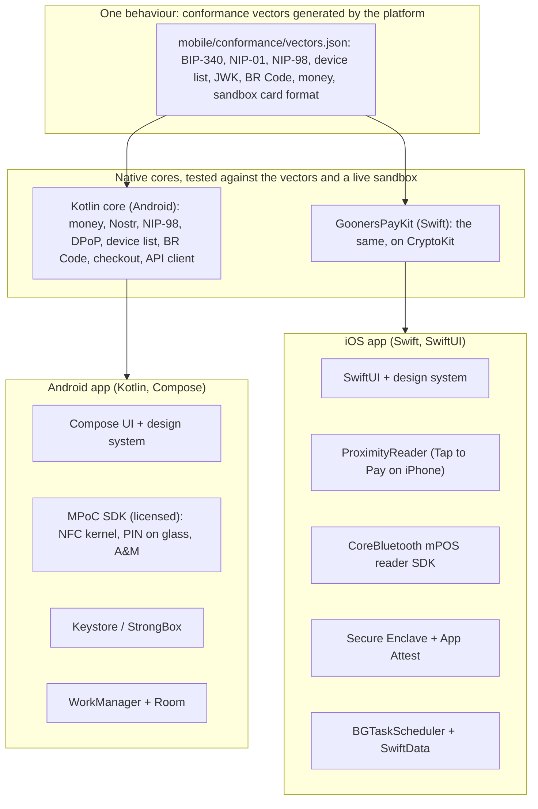
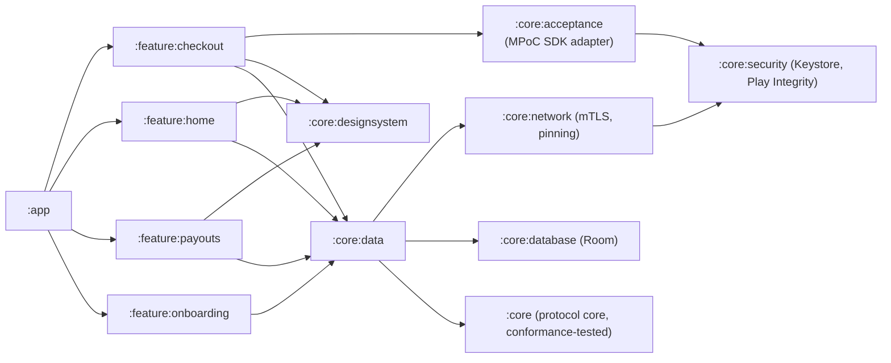
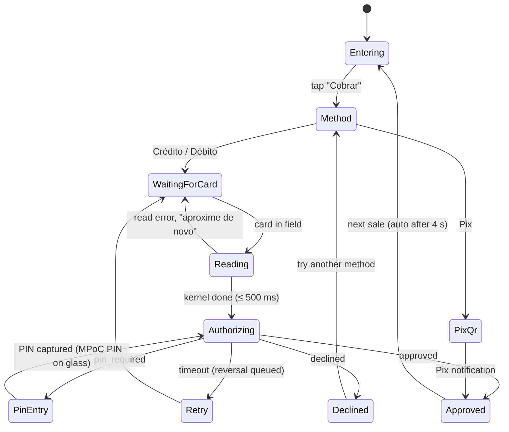
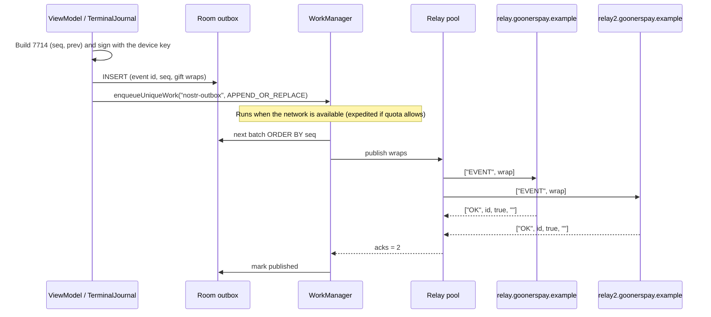
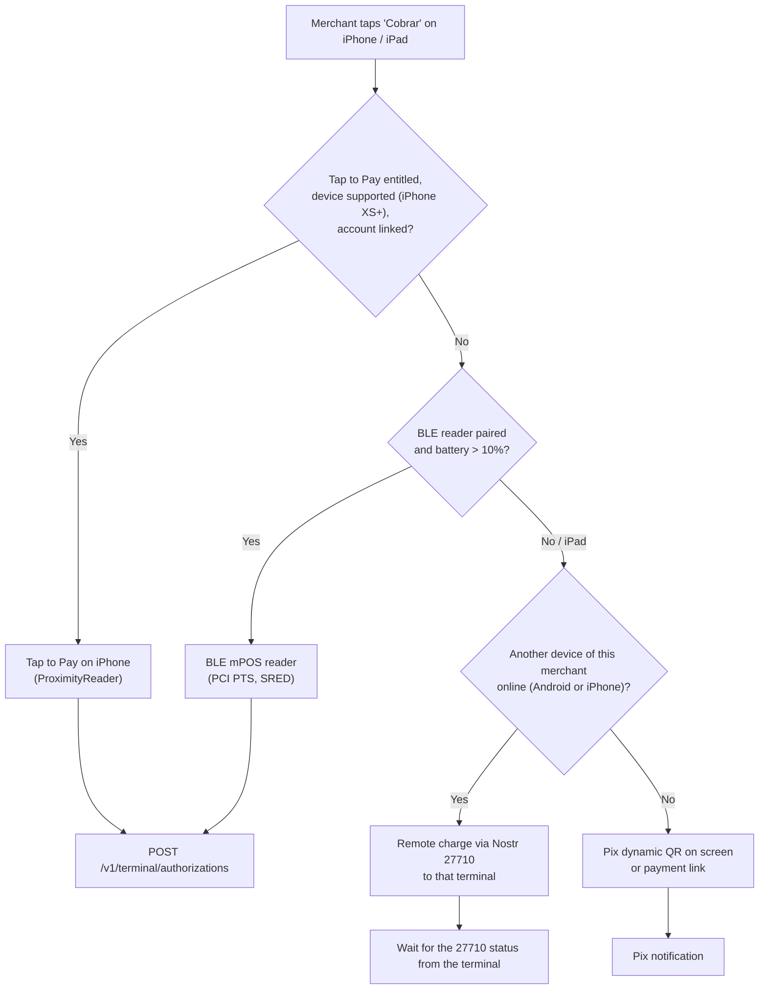
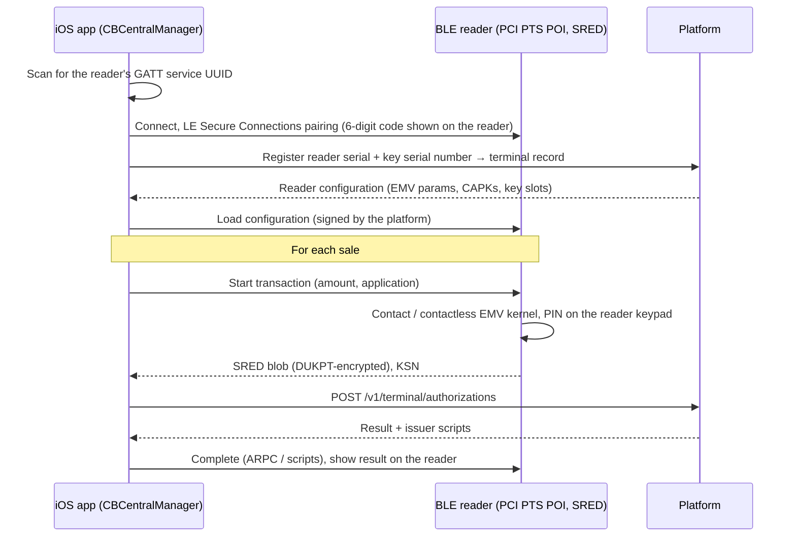

# Module 5: Mobile Engineering (Android and iOS)

The merchant app is a payment terminal, a bank account and a back office in one. It must take a tap in under two seconds on a R$ 900 Android phone in direct sunlight, keep working when the 4G drops, and stay inside PCI MPoC rules while doing it.

---

## 1. Shared architecture



**Decision: native UI, native cores, one behaviour.** Payment UI is platform-specific by nature (NFC on Android, ProximityReader on iOS), and both design systems need native feel and accessibility. The parts that must behave *identically* (Nostr event bytes, signatures, NIP-98 logins, DPoP proofs, device lists, money formatting, BR Code checks) are written once per platform and held identical by tests: the Go platform generates [`mobile/conformance/vectors.json`](../mobile/conformance/vectors.json) (`go run ./cmd/conformance`), and the Kotlin core, the Swift package and the JavaScript spec checker all reproduce it byte for byte, along with every signed event in [`nostr/examples/`](../nostr/examples). Both cores also run the whole app protocol against a live sandbox in CI.

The first version of this module put that code in Kotlin Multiplatform. The apps built so far ([`mobile/`](../mobile)) use a native core per platform instead, for three reasons: the iOS core must call CryptoKit and the Secure Enclave directly, which is simpler from Swift than through a Kotlin/Native framework; the shared logic is small (about a thousand lines per platform) next to the platform code around it; and a vector file checked by three languages catches more drift than one shared implementation would. Revisit Kotlin Multiplatform when the offline outbox and journal chain (§2.5) land, since that logic is larger and stateful.

---

## 2. Android terminal (production spec)

### 2.1 Stack

| Concern | Choice | Notes |
|---------|--------|-------|
| Language and async | Kotlin 2.x, Coroutines, Flow | Structured concurrency; no callbacks in app code |
| UI | Jetpack Compose, Material 3 with custom tokens ([06](06-design-system.md)) | One-activity architecture, type-safe navigation |
| State | Unidirectional: `ViewModel` → `StateFlow<UiState>`, intents in | Every screen state is a sealed type that can be tested |
| DI | Hilt | |
| Persistence | Room (outbox, receipts, journal), DataStore (preferences) | SQLCipher-free: sensitive rows are encrypted with a Keystore AES key at field level |
| Background | WorkManager (expedited for the outbox) | Survives process death and reboots |
| Network | OkHttp 5 with an mTLS client key held in Android Keystore, certificate pinning, HTTP/2 | The terminal certificate key never leaves the TEE / StrongBox |
| Serialization | kotlinx.serialization | Canonical JSON for Nostr is done in the shared core |
| Card acceptance | **Licensed PCI MPoC SDK** (EMV contactless kernels, PIN on glass, attestation and monitoring backend) | ADR-03: build in-house only when volume pays for kernel certification and MPoC evaluation |
| Device integrity | Play Integrity API (standard requests), hardware key attestation, MPoC SDK runtime protections | §2.4 |
| Minimum OS | Android 11 (API 30), NFC with ISO-DEP, Google Play services | Matches the market baseline. `targetSdk` follows Google Play's yearly target-API requirement |

### 2.2 Module graph



The MPoC SDK is reachable **only** from `:core:acceptance`, behind an interface. Feature modules never see card data or SDK types, which keeps the PCI-relevant surface in one auditable module.

### 2.3 Checkout state machine



```kotlin
// :feature:checkout
sealed interface CheckoutUiState {
    data class Entering(val amount: Money = Money.zero()) : CheckoutUiState
    data class Method(val amount: Money) : CheckoutUiState
    data class WaitingForCard(val amount: Money, val application: EmvApplication, val antenna: AntennaHint?) : CheckoutUiState
    data class Reading(val amount: Money) : CheckoutUiState
    data class Authorizing(val amount: Money) : CheckoutUiState
    data class PinEntry(val amount: Money, val attemptsLeft: Int) : CheckoutUiState
    data class Approved(val receipt: ReceiptUi, val settlement: SettlementUi) : CheckoutUiState
    data class Declined(val message: String, val canRetry: Boolean) : CheckoutUiState
    data class PixQr(val amount: Money, val brCode: String, val expiresAt: Instant) : CheckoutUiState
}

@HiltViewModel
class CheckoutViewModel @Inject constructor(
    private val acceptance: CardAcceptance,          // wraps the MPoC SDK
    private val payments: PaymentsRepository,        // payment intents, terminal authorizations
    private val journal: TerminalJournal,            // signs and queues kind 7714 entries
    private val haptics: Haptics,
) : ViewModel() {

    private val _state = MutableStateFlow<CheckoutUiState>(CheckoutUiState.Entering())
    val state: StateFlow<CheckoutUiState> = _state.asStateFlow()

    fun onCharge(amount: Money) {
        _state.value = CheckoutUiState.Method(amount)
    }

    fun onCardMethod(amount: Money, application: EmvApplication) = viewModelScope.launch {
        val intent = payments.createCardPresentIntent(amount)
        _state.value = CheckoutUiState.WaitingForCard(amount, application, acceptance.antennaHint())
        journal.append(JournalEntry.TapStarted(intent.id, amount))

        acceptance.read(amount, application).collect { event ->
            when (event) {
                is ReadEvent.CardDetected -> _state.value = CheckoutUiState.Reading(amount)
                is ReadEvent.Completed -> authorize(intent, amount, event.encrypted)
                is ReadEvent.RetryableError -> _state.value = CheckoutUiState.WaitingForCard(amount, application, acceptance.antennaHint())
            }
        }
    }

    private suspend fun authorize(intent: PaymentIntent, amount: Money, encrypted: EncryptedCardData) {
        _state.value = CheckoutUiState.Authorizing(amount)
        val result = payments.authorizeCardPresent(intent, encrypted)   // POST /v1/terminal/authorizations
        journal.append(JournalEntry.AuthResult(intent.id, amount, result.status))
        _state.value = when (result) {
            is AuthResult.Approved -> {
                haptics.success()
                CheckoutUiState.Approved(result.receipt.toUi(), result.settlement.toUi())
            }
            is AuthResult.PinRequired -> CheckoutUiState.PinEntry(amount, attemptsLeft = 3)
            is AuthResult.Declined -> CheckoutUiState.Declined(result.customerMessage, canRetry = true)
            is AuthResult.Timeout -> CheckoutUiState.Declined("Tempo esgotado. Aproxime o cartão de novo.", canRetry = true)
        }
    }
}
```

### 2.4 Attestation and device integrity

Tap-to-phone on a consumer phone is safe only if the platform can tell, continuously, that the phone and app are genuine. Three layers, all checked server-side:

| Layer | Signal | Checked | Failure action |
|-------|--------|---------|----------------|
| Hardware key attestation | Terminal mTLS key generated in StrongBox (or TEE) with a server challenge. The certificate chain proves hardware residence, a locked bootloader, verified boot state, the OS patch level and the app's signing certificate digest | At terminal registration and every certificate renewal (30 days) | Refuse the certificate |
| Play Integrity | Device recognition (`MEETS_STRONG_INTEGRITY` preferred, `MEETS_DEVICE_INTEGRITY` minimum), app recognition, licensing | At session start and every 15 minutes. A fresh token travels with each authorization | Block tap-to-phone and offer Pix and payment links |
| MPoC SDK attestation and monitoring | Runtime protections (hooking, debugger, emulator, overlay and accessibility abuse, screen recording), SDK integrity, kernel integrity | Continuously by the SDK and its attestation-and-monitoring backend | SDK stops accepting cards. The platform disables the terminal |

```kotlin
// :core:security — terminal key with hardware attestation (StrongBox when present)
fun generateTerminalKey(challenge: ByteArray): List<X509Certificate> {
    fun spec(strongBox: Boolean) = KeyGenParameterSpec.Builder(TERMINAL_KEY_ALIAS, KeyProperties.PURPOSE_SIGN)
        .setAlgorithmParameterSpec(ECGenParameterSpec("secp256r1"))
        .setDigests(KeyProperties.DIGEST_SHA256)
        .setAttestationChallenge(challenge)          // server nonce, single use
        .setIsStrongBoxBacked(strongBox)
        .build()

    val generator = KeyPairGenerator.getInstance(KeyProperties.KEY_ALGORITHM_EC, "AndroidKeyStore")
    try {
        generator.initialize(spec(strongBox = true))
        generator.generateKeyPair()
    } catch (e: StrongBoxUnavailableException) {
        generator.initialize(spec(strongBox = false))   // TEE-backed; attestation says which
        generator.generateKeyPair()
    }
    val keyStore = KeyStore.getInstance("AndroidKeyStore").apply { load(null) }
    return keyStore.getCertificateChain(TERMINAL_KEY_ALIAS).map { it as X509Certificate }
}
```

The server verifies the chain up to Google's attestation roots, checks the revocation list Google publishes, parses the attestation extension, and enforces policy: `attestationSecurityLevel ≥ TRUSTED_ENVIRONMENT`, `verifiedBootState = VERIFIED`, `deviceLocked = true`, OS patch level no older than 12 months, the expected package name and signing digest.

**App hardening.** `FLAG_SECURE` on every payment and PIN screen; `filterTouchesWhenObscured` against tapjacking; R8 with obfuscation; no WebViews in the payment flow; pinned TLS; and a server-driven **kill switch** by app and SDK version, which MPoC requires so a compromised version can be stopped within minutes.

### 2.5 Offline-first queue and Nostr sync

Signed journal entries, queued receipts and outgoing notifications go to a Room outbox first, then to relays. An event is "published" when **two relays** have acknowledged it with NIP-01 `OK true`.



```kotlin
// :core:database
@Entity(tableName = "outbox", indices = [Index(value = ["seq"], unique = true)])
data class OutboxItem(
    @PrimaryKey val eventId: String,      // inner event id: idempotency key for every retry
    val seq: Long,                        // journal sequence: publish order
    val kind: Int,
    val wrapsJson: String,                // one gift wrap per recipient
    val createdAt: Long,
    val acks: Int = 0,
)

@Dao
interface OutboxDao {
    @Insert(onConflict = OnConflictStrategy.IGNORE)
    suspend fun enqueue(item: OutboxItem)

    @Query("SELECT * FROM outbox WHERE acks < 2 ORDER BY seq LIMIT :limit")
    suspend fun nextBatch(limit: Int): List<OutboxItem>

    @Query("UPDATE outbox SET acks = :acks WHERE eventId = :eventId")
    suspend fun markAcked(eventId: String, acks: Int)
}

// :core:data
@HiltWorker
class NostrOutboxWorker @AssistedInject constructor(
    @Assisted context: Context,
    @Assisted params: WorkerParameters,
    private val outbox: OutboxDao,
    private val relays: RelayPool,
) : CoroutineWorker(context, params) {

    override suspend fun doWork(): Result {
        val deadline = TimeSource.Monotonic.markNow() + 8.minutes   // stay well inside the 10-minute limit
        while (deadline.hasNotPassedNow()) {
            val batch = outbox.nextBatch(limit = 50)
            if (batch.isEmpty()) return Result.success()
            for (item in batch) {                      // strictly in seq order: no skipping ahead
                val acks = relays.publishAll(item.wrapsJson, timeout = 5.seconds)
                if (acks < 2) return Result.retry()    // exponential backoff from the request
                outbox.markAcked(item.eventId, acks)
            }
        }
        return Result.retry()
    }

    override suspend fun getForegroundInfo(): ForegroundInfo =
        ForegroundInfo(NOTIFICATION_ID, syncNotification(applicationContext))  // needed for expedited work below Android 12
}

fun scheduleOutbox(context: Context) {
    val request = OneTimeWorkRequestBuilder<NostrOutboxWorker>()
        .setConstraints(Constraints(requiredNetworkType = NetworkType.CONNECTED))
        .setExpedited(OutOfQuotaPolicy.RUN_AS_NON_EXPEDITED_WORK_REQUEST)
        .setBackoffCriteria(BackoffPolicy.EXPONENTIAL, 10, TimeUnit.SECONDS)
        .build()
    WorkManager.getInstance(context).enqueueUniqueWork("nostr-outbox", ExistingWorkPolicy.APPEND_OR_REPLACE, request)
}
```

Ordering matters: the journal is a hash chain, and the platform flags `seq` gaps ([03 §7.1](03-nostr-layer.md#71-hash-chained-journal)). The worker therefore never publishes entry *n + 1* before entry *n* is acknowledged.

### 2.6 Device Nostr key

```kotlin
// :core:security — random secp256k1 device key, wrapped by a StrongBox AES key that needs biometrics
private fun wrappingKey(): SecretKey {
    val ks = KeyStore.getInstance("AndroidKeyStore").apply { load(null) }
    (ks.getKey(WRAP_ALIAS, null) as? SecretKey)?.let { return it }
    val spec = KeyGenParameterSpec.Builder(WRAP_ALIAS, KeyProperties.PURPOSE_ENCRYPT or KeyProperties.PURPOSE_DECRYPT)
        .setBlockModes(KeyProperties.BLOCK_MODE_GCM)
        .setEncryptionPaddings(KeyProperties.ENCRYPTION_PADDING_NONE)
        .setKeySize(256)
        .setUserAuthenticationRequired(true)
        .setUserAuthenticationParameters(30, KeyProperties.AUTH_BIOMETRIC_STRONG or KeyProperties.AUTH_DEVICE_CREDENTIAL)
        .setInvalidatedByBiometricEnrollment(true)
        .setIsStrongBoxBacked(hasStrongBox())
        .build()
    return KeyGenerator.getInstance(KeyProperties.KEY_ALGORITHM_AES, "AndroidKeyStore").run { init(spec); generateKey() }
}

fun createDeviceKey(): WrappedNostrKey {
    val secret = ByteArray(32).also { SecureRandom().nextBytes(it) }
    require(Secp256k1.secKeyVerify(secret))
    val cipher = Cipher.getInstance("AES/GCM/NoPadding").apply { init(Cipher.ENCRYPT_MODE, wrappingKey()) }
    val wrapped = WrappedNostrKey(iv = cipher.iv, ciphertext = cipher.doFinal(secret), pubkeyXOnly = xOnlyPubkey(secret))
    secret.fill(0)
    return wrapped
}

// Called inside a BiometricPrompt success callback (the AES key is usable for 30 s after authentication).
fun signEventId(wrapped: WrappedNostrKey, eventId: ByteArray): ByteArray {
    val cipher = Cipher.getInstance("AES/GCM/NoPadding")
        .apply { init(Cipher.DECRYPT_MODE, wrappingKey(), GCMParameterSpec(128, wrapped.iv)) }
    val secret = cipher.doFinal(wrapped.ciphertext)
    try {
        return Secp256k1.signSchnorr(eventId, secret, auxrand32 = ByteArray(32).also { SecureRandom().nextBytes(it) })
    } finally {
        secret.fill(0)
    }
}
```

The 30-second validity window lets a cashier take several sales after one fingerprint, while a stolen, unlocked-but-idle phone stops signing within half a minute.

### 2.7 Tap ergonomics

- **Where to tap.** On Android 14+ `NfcAdapter.getNfcAntennaInfo()` gives the antenna's position in millimetres. The waiting screen draws the target exactly there. On older versions the app falls back to a per-model table for Brazil's top 200 models, then to a generic "top back" hint.
- **Reader mode** is owned by the MPoC SDK (`FLAG_READER_NFC_A | FLAG_READER_NFC_B | FLAG_READER_SKIP_NDEF_CHECK | FLAG_READER_NO_PLATFORM_SOUNDS`), so Android never shows its own NFC sound or dialog during a payment.
- **Feedback** follows the EMV contactless indicator conventions: four status lights animated in the app, a success tone and a haptic on card read (not on approval), then a distinct approval sound.

### 2.8 Budgets and test matrix

| Budget | Target | Measured on |
|--------|--------|-------------|
| Cold start to keypad | ≤ 1.5 s | Mid-range reference device (Samsung Galaxy A-series, 4 GB RAM) |
| Keypad input to frame | ≤ 16 ms | Compose macrobenchmark |
| Card-in-field to "remove card" | ≤ 500 ms | Kernel, scheme test cards |
| Download size | ≤ 30 MB | App bundle, arm64 |
| Battery | ≤ 4% per hour of active checkout | Battery Historian |

Tests: unit tests (state machines, money), Compose UI tests with screenshot diffs in light, dark and sunlight themes ([06 §3](06-design-system.md#3-themes)), instrumented NFC tests with scheme test cards in a robotic tap rig, and the MPoC lab evaluation. A device farm covers the 50 most-used Android models in Brazil, refreshed quarterly from install analytics.

---

## 3. iOS architecture

### 3.1 Platform constraints

| Constraint | Consequence |
|------------|-------------|
| CoreNFC does not let third-party apps select EMV payment applications | Card acceptance on iPhone goes **only** through Apple's ProximityReader framework (Tap to Pay on iPhone) |
| Tap to Pay on iPhone needs an Apple entitlement and a payment provider Apple has enabled; it runs on iPhone XS or later | The platform must become an enabled provider (or route through one) before iPhone tap is available. Until then: BLE readers |
| The card data that ProximityReader returns is encrypted for the payment provider | The app forwards it to `terminal.goonerspay.example` without ever seeing card data. Same posture as MPoC on Android |
| Background execution is opportunistic | The outbox syncs on foreground, on `BGAppRefreshTask`, and after silent push. Nothing safety-critical depends on background time |
| Secure Enclave keys are P-256 only | The secp256k1 device key is wrapped by an Enclave key with ECIES (§3.6) |
| The NFC and SE Platform (iOS 18.1+, selected countries) is for *presenting* credentials, not accepting them | Out of scope for acceptance. It is the path for a future in-app wallet when the platform issues BaaS cards (entitlement and country availability to be confirmed) |

### 3.2 Acceptance modes and fallback



"Multi-app terminal switching" in this design means one checkout that can be completed by whichever acceptance device is best at that moment. An iPad on the counter builds the order, and the charge is sent to the cashier's Android phone as an encrypted, ephemeral kind 27710 event ([`nostr/examples/27710-remote-charge.json`](../nostr/examples/27710-remote-charge.json)). The iPad shows live status from the 27710 replies, and both devices see the receipt. No pairing server and no local-network discovery are needed, so it works across Wi-Fi and 4G.

### 3.3 SwiftUI architecture

| Concern | Choice |
|---------|--------|
| UI | SwiftUI; design tokens from [06](06-design-system.md) generated as Swift constants |
| State | Observation (`@Observable`) models on the main actor; unidirectional flow; every screen state is an `enum` |
| Concurrency | Swift Concurrency. **Actors** own the key vault, the relay pool, the BLE reader and the ProximityReader session, so no shared mutable state escapes |
| Persistence | SwiftData for the outbox and receipts, with sensitive fields encrypted under an Enclave-wrapped key |
| Background | `.backgroundTask(.appRefresh("outbox"))` (BGTaskScheduler) and silent push |
| Integrity | App Attest (`DCAppAttestService`) at session start, and an assertion per authorization request |
| Packages | Swift packages `DesignSystem`, `Checkout`, `Acceptance` (ProximityReader + BLE + remote), `Security`, plus `GoonersPayKit`, the protocol core tested against the platform's conformance vectors (§1) |

```swift
// Checkout/CheckoutModel.swift
@MainActor @Observable
final class CheckoutModel {
    enum Phase: Equatable {
        case entering
        case choosingMethod
        case reading(AcceptanceMode)
        case authorizing
        case approved(ReceiptViewData)
        case declined(message: String)
        case remote(deviceName: String, status: RemoteStatus)
    }

    private(set) var phase: Phase = .entering
    var amount = Money.zero(.brl)

    private let router: AcceptanceRouter   // decides the mode (§3.2)
    private let payments: PaymentsClient

    init(router: AcceptanceRouter, payments: PaymentsClient) {
        self.router = router
        self.payments = payments
    }

    func charge(application: EMVApplication) async {
        let intent: PaymentIntent
        do {
            intent = try await payments.createCardPresentIntent(amount: amount)
        } catch {
            phase = .declined(message: "Sem conexão. Tente Pix ou link de pagamento.")
            return
        }
        let mode = await router.bestMode()
        switch mode {
        case .tapToPay, .bleReader:
            phase = .reading(mode)
            do {
                let encrypted = try await router.read(mode: mode, amount: amount, application: application)
                phase = .authorizing
                let result = try await payments.authorizeCardPresent(intent: intent, card: encrypted)
                phase = result.isApproved ? .approved(result.receipt) : .declined(message: result.customerMessage)
            } catch {
                phase = .declined(message: "Não foi possível ler o cartão. Tente de novo.")
            }
        case .remote(let device):
            phase = .remote(deviceName: device.name, status: .sent)
            for await status in router.sendRemoteCharge(intent: intent, to: device) {
                phase = .remote(deviceName: device.name, status: status)
            }
        case .pixOnly:
            phase = .declined(message: "Use Pix para esta venda.")
        }
    }
}
```

```swift
// Acceptance/TapToPayAcceptor.swift — sketch; check names against the ProximityReader docs for your Xcode version.
import ProximityReader

actor TapToPayAcceptor {
    private let reader = PaymentCardReader()
    private var session: PaymentCardReaderSession?

    /// The token comes from the platform (as an enabled payment provider) and binds the reader to this merchant.
    func prepare(token: String) async throws {
        session = try await reader.prepare(using: PaymentCardReader.Token(rawValue: token))
    }

    /// Returns the card data encrypted for the payment provider. The app cannot read it.
    func read(amount: Decimal) async throws -> String {
        guard let session else { throw AcceptanceError.notPrepared }
        let request = PaymentCardTransactionRequest(amount: amount, currencyCode: "BRL", for: .purchase)
        let result = try await session.readPaymentCard(request)
        guard let blob = result.paymentCardData else { throw AcceptanceError.noCardData }
        return blob
    }
}
```

### 3.4 BLE mPOS readers



- `CBCentralManager` is created with `CBCentralManagerOptionRestoreIdentifierKey`, so iOS restores the connection after the app is suspended.
- Reader battery appears in the app's status bar. Below 20% the app shows an **amber** warning ([06 §2](06-design-system.md#2-colour-system)), and below 10% the router stops offering the reader for new sales.
- Firmware updates are signed by the vendor, then counter-signed by the platform's configuration service, and installed only while not charging a customer.

### 3.5 Wireframe drafts

```text
 ┌──────────────────────────┐  ┌──────────────────────────┐  ┌──────────────────────────┐
 │ Café Aurora      ● Online│  │ ← R$ 129,90              │  │                          │
 │ Disponível agora         │  │                          │  │        R$ 129,90         │
 │ R$ 1.842,20         [ ↗ ]│  │  ┌────────────────────┐  │  │                          │
 │──────────────────────────│  │  │  Crédito           │  │  │      ╭──────────╮        │
 │                          │  │  └────────────────────┘  │  │      │  ))))    │        │
 │        R$ 129,90         │  │  ┌────────────────────┐  │  │      │  aproxime│        │
 │                          │  │  │  Débito            │  │  │      ╰──────────╯        │
 │  ┌──────┬──────┬──────┐  │  │  └────────────────────┘  │  │   ● ○ ○ ○                │
 │  │  1   │  2   │  3   │  │  │  ┌────────────────────┐  │  │                          │
 │  ├──────┼──────┼──────┤  │  │  │  Pix               │  │  │  Leitor: Tap to Pay      │
 │  │  4   │  5   │  6   │  │  │  └────────────────────┘  │  │  [ Trocar para leitor ]  │
 │  ├──────┼──────┼──────┤  │  │  Parcelar  [ 1x  ▾ ]     │  │                          │
 │  │  7   │  8   │  9   │  │  │                          │  │                          │
 │  ├──────┼──────┼──────┤  │  │                          │  │                          │
 │  │  ,   │  0   │  ⌫   │  │  │                          │  │        [ Cancelar ]      │
 │  └──────┴──────┴──────┘  │  │                          │  │                          │
 │ [      COBRAR       ]    │  │                          │  │                          │
 └──────────────────────────┘  └──────────────────────────┘  └──────────────────────────┘
   1. Keypad (tap 1: Cobrar)     2. Method (tap 2)             3. Waiting for card

 ┌──────────────────────────┐  ┌──────────────────────────┐
 │                          │  │ Recebimentos          ⚙  │
 │          ✓               │  │ Disponível agora         │
 │      Aprovado            │  │ R$ 1.842,20  [Sacar Pix] │
 │      R$ 129,90           │  │──────────────────────────│
 │ Visa crédito •••• 0119   │  │ A receber                │
 │ Disponível em segundos   │  │ amanhã     R$   612,00   │
 │                          │  │ 28/11      R$ 4.311,40   │
 │   ┌──────────────┐       │  │ 28/12      R$   200,00   │
 │   │ ▓▓ QR  ▓▓    │       │  │ [ Receber agora: ver taxa ]│
 │   │ ▓ recibo ▓   │       │  │──────────────────────────│
 │   └──────────────┘       │  │ Hoje                     │
 │ Recibo para o cliente    │  │ 14:42 Visa  R$ 129,90 ✓  │
 │ [Compartilhar] [Nova]    │  │ 14:55 Pix   R$  45,00 ✓  │
 └──────────────────────────┘  └──────────────────────────┘
   4. Approved + receipt QR      5. Settlement timeline
```

### 3.6 Keys and integrity on iOS

```swift
// Security/DeviceKeyVault.swift — wrap the secp256k1 device key with a Secure Enclave P-256 key (ECIES)
actor DeviceKeyVault {
    private let tag = Data("br.com.gooners.pay.device-wrap".utf8)
    private let algorithm: SecKeyAlgorithm = .eciesEncryptionCofactorVariableIVX963SHA256AESGCM

    func enclaveKey() throws -> SecKey {
        let query: [String: Any] = [
            kSecClass as String: kSecClassKey,
            kSecAttrApplicationTag as String: tag,
            kSecAttrTokenID as String: kSecAttrTokenIDSecureEnclave,
            kSecReturnRef as String: true,
        ]
        var item: CFTypeRef?
        if SecItemCopyMatching(query as CFDictionary, &item) == errSecSuccess { return item as! SecKey }

        var error: Unmanaged<CFError>?
        guard let access = SecAccessControlCreateWithFlags(
            nil, kSecAttrAccessibleWhenUnlockedThisDeviceOnly, [.privateKeyUsage, .biometryCurrentSet], &error
        ) else { throw error!.takeRetainedValue() as Error }
        let attributes: [String: Any] = [
            kSecAttrKeyType as String: kSecAttrKeyTypeECSECPrimeRandom,
            kSecAttrKeySizeInBits as String: 256,
            kSecAttrTokenID as String: kSecAttrTokenIDSecureEnclave,
            kSecPrivateKeyAttrs as String: [
                kSecAttrIsPermanent as String: true,
                kSecAttrApplicationTag as String: tag,
                kSecAttrAccessControl as String: access,
            ],
        ]
        guard let key = SecKeyCreateRandomKey(attributes as CFDictionary, &error) else { throw error!.takeRetainedValue() as Error }
        return key
    }

    func wrap(_ nostrSecret: Data) throws -> Data {
        var error: Unmanaged<CFError>?
        guard let pub = SecKeyCopyPublicKey(try enclaveKey()),
              let sealed = SecKeyCreateEncryptedData(pub, algorithm, nostrSecret as CFData, &error)
        else { throw error!.takeRetainedValue() as Error }
        return sealed as Data
    }

    /// Triggers Face ID / Touch ID. The plaintext lives only for the duration of `body`.
    func withSecret<T>(_ wrapped: Data, _ body: (inout Data) throws -> T) throws -> T {
        var error: Unmanaged<CFError>?
        guard let plain = SecKeyCreateDecryptedData(try enclaveKey(), algorithm, wrapped as CFData, &error) else {
            throw error!.takeRetainedValue() as Error
        }
        var secret = plain as Data
        defer { secret.resetBytes(in: 0..<secret.count) }
        return try body(&secret)
    }
}
```

App Attest replaces Play Integrity: the app generates an attested key with `DCAppAttestService.shared.generateKey()`, the platform verifies the attestation against Apple's root once, and each authorization request carries a `generateAssertion` over the request hash.

---

## 4. Release and security engineering

| Practice | Android | iOS |
|----------|---------|-----|
| Signing | Play App Signing; upload key in an HSM-backed CI secret | App Store distribution certificate in CI keychain, with a manual approval gate |
| Staged rollout | 1% → 5% → 20% → 100%, gated on crash-free sessions ≥ 99.8% and authorization success | Phased release (7 days), same gates |
| Kill switch | Server config by app and SDK version: disable tap, force update | Same |
| Privacy | No analytics SDKs inside checkout. Crash reports scrubbed of amounts and IDs. No advertising IDs | Privacy manifest declared. Same scrubbing |
| Supply chain | Dependency verification (Gradle verification metadata), SBOM per release | SwiftPM pinned revisions, SBOM per release |
| Store compliance | Play's Financial Services policy declarations | App Store guidelines for payments; the Tap to Pay entitlement |
