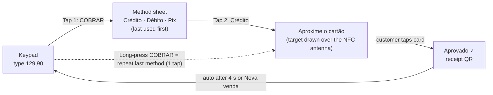

# Module 6: UI/UX Design System and Colour Psychology for BaaS

A merchant uses this app standing up, often in sunlight, with a customer waiting and one hand holding a coffee cup. The design system is built for that moment: **legible in glare, operable in two taps, calm when things go wrong**. The machine-readable tokens are in [`design/tokens.json`](../design/tokens.json) (W3C Design Tokens Community Group format). Every contrast ratio below is computed from that file by `npm run check`, which fails if the document and the tokens disagree.

---

## 1. Colour psychology, with the evidence in proportion

Colour associations are real but modest, and they depend on context and culture. Research on colour and psychological functioning (Elliot and Maier, *Annual Review of Psychology*, 2014) finds reliable effects in specific contexts, not universal emotional codes. Brand studies (Labrecque and Milne, 2012) link blue and dark hues to perceived competence and saturated warm hues to excitement. The palette uses these associations as a tie-breaker, never as a substitute for legibility, layout or words.

| Role | Colour | Intent | Rule that keeps it honest |
|------|--------|--------|----------------------------|
| **Trust and stability** | Midnight `#0B0F19`, slate `#1E293B` | Institutional, bank-grade calm; makes money figures the brightest thing on screen | Dark is the default because it is comfortable indoors and saves battery on OLED screens, not because "dark = secure". In bright light the app switches to the sunlight theme (§3) |
| **Action and success** | Electric mint `#10B981`, emerald `#059669` (pressed), `#047857` (green text on light) | Speed and positive cash flow. In Brazil green also reads as "aprovado" and as the national colour | Mint is a **fill with dark text**, never a text colour on light backgrounds (§2.2) |
| **Attention** | Warm amber `#F59E0B` / `#B45309` | Low reader battery, settlement delayed, document pending: "look when you can" | Amber never appears during an approval or a decline, so it never competes with the result |
| **Alerts and declines** | Coral `#FB7185` / `#BE123C` | Security alerts and declines, without the panic of pure red in front of a customer | Always paired with an icon, a plain sentence and the next action |
| **Information and focus** | Indigo `#818CF8` / `#4338CA` | Links, focus rings, informational banners | |

**Differentiation.** Mint on near-black is common among Brazilian fintechs. Distinctiveness comes from the typography, the motion, the indigo accent and the receipt QR moment, not from owning a hue.

---

## 2. Colour system

### 2.1 Verified contrast

WCAG 2.2 requires 4.5:1 for normal text (SC 1.4.3), 3:1 for large text and for the visual boundary of controls (SC 1.4.11), and 7:1 for AAA text (SC 1.4.6). The sunlight theme targets AAA.

| Theme | Use | Tokens | Foreground | Background | Ratio | Requirement |
|-------|-----|--------|------------|------------|-------|-------------|
| dark | Body text | `text-primary` on `canvas` | `#F8FAFC` | `#0B0F19` | 18.30:1 | ≥ 4.5:1 |
| dark | Secondary text on cards | `text-secondary` on `surface-raised` | `#94A3B8` | `#1E293B` | 5.71:1 | ≥ 4.5:1 |
| dark | CTA label | `on-action` on `action-fill` | `#0B0F19` | `#10B981` | 7.55:1 | ≥ 4.5:1 |
| dark | CTA shape vs background (non-text) | `action-fill` on `canvas` | `#10B981` | `#0B0F19` | 7.55:1 | ≥ 3:1 |
| dark | Positive amounts | `success-text` on `canvas` | `#34D399` | `#0B0F19` | 9.96:1 | ≥ 4.5:1 |
| dark | Warnings (battery, delays) | `attention-text` on `canvas` | `#F59E0B` | `#0B0F19` | 8.92:1 | ≥ 4.5:1 |
| dark | Security alerts, declines | `alert-text` on `canvas` | `#FB7185` | `#0B0F19` | 7.12:1 | ≥ 4.5:1 |
| dark | Links, info | `info-text` on `canvas` | `#818CF8` | `#0B0F19` | 6.42:1 | ≥ 4.5:1 |
| light | Body text | `text-primary` on `canvas` | `#0B0F19` | `#F8FAFC` | 18.30:1 | ≥ 4.5:1 |
| light | Secondary text | `text-secondary` on `surface` | `#475569` | `#FFFFFF` | 7.58:1 | ≥ 4.5:1 |
| light | CTA label | `on-action` on `action-fill` | `#0B0F19` | `#10B981` | 7.55:1 | ≥ 4.5:1 |
| light | CTA outline vs background (non-text) | `action-border` on `canvas` | `#047857` | `#F8FAFC` | 5.24:1 | ≥ 3:1 |
| light | Positive amounts | `success-text` on `surface` | `#047857` | `#FFFFFF` | 5.48:1 | ≥ 4.5:1 |
| light | Warnings | `attention-text` on `surface` | `#B45309` | `#FFFFFF` | 5.02:1 | ≥ 4.5:1 |
| light | Warning banner text | `on-attention` on `attention-fill` | `#0B0F19` | `#F59E0B` | 8.92:1 | ≥ 4.5:1 |
| light | Security alerts, declines | `alert-text` on `surface` | `#BE123C` | `#FFFFFF` | 6.29:1 | ≥ 4.5:1 |
| light | Alert banner text | `on-alert` on `alert-fill` | `#0B0F19` | `#FB7185` | 7.12:1 | ≥ 4.5:1 |
| light | Links, info | `info-text` on `surface` | `#4338CA` | `#FFFFFF` | 7.90:1 | ≥ 4.5:1 |
| sunlight | Body text (AAA) | `text-primary` on `canvas` | `#000000` | `#FFFFFF` | 21.00:1 | ≥ 7:1 |
| sunlight | CTA label (AAA) | `on-action` on `action-fill` | `#000000` | `#10B981` | 8.28:1 | ≥ 7:1 |
| sunlight | CTA outline (non-text) | `action-border` on `canvas` | `#000000` | `#FFFFFF` | 21.00:1 | ≥ 3:1 |
| sunlight | Positive amounts | `success-text` on `canvas` | `#047857` | `#FFFFFF` | 5.48:1 | ≥ 4.5:1 |
| sunlight | Alerts | `alert-text` on `canvas` | `#BE123C` | `#FFFFFF` | 6.29:1 | ≥ 4.5:1 |

### 2.2 Combinations the brief implied, rejected

| Foreground | Background | Ratio | Why rejected |
|------------|------------|-------|--------------|
| `#FFFFFF` | `#10B981` | 2.54:1 | White label on mint fails AA |
| `#FFFFFF` | `#059669` | 3.77:1 | Still fails AA for normal text |
| `#10B981` | `#FFFFFF` | 2.54:1 | Mint text on white is illegible |
| `#F59E0B` | `#FFFFFF` | 2.15:1 | Amber text on white is illegible |

The fix keeps the brand hue and changes what sits on it: **dark text on mint** (7.55:1), and `#047857` whenever green has to be *text* on a light background.

### 2.3 Colour-vision deficiency

Roughly 1 in 12 men of Northern European ancestry and about 1 in 200 women have a red-green colour-vision deficiency. Prevalence varies between populations but stays in that range, so every busy shop has customers and cashiers who have one. Simulating the palette (Machado et al. 2009, full severity) shows why colour can never carry the result of a payment on its own:

| Pair | Normal vision ΔE | Deuteranopia ΔE | Protanopia ΔE | Luminance contrast |
|------|------------------|-----------------|---------------|--------------------|
| Mint `#10B981` vs coral `#FB7185` (approved vs declined) | 106.6 | **8.6** | 23.2 | 1.06:1 |
| Mint `#10B981` vs amber `#F59E0B` | 95.3 | 61.8 | 46.2 | 1.18:1 |

A ΔE below about 10 is easy to confuse. For a deuteranope, "approved" mint and "declined" coral look almost the same muddy beige, at nearly the same brightness. So:

1. **Approved** is a full-screen state with a large check icon, the word "Aprovado", the amount, a rising two-note sound and a success haptic.
2. **Declined** is an inline card that keeps the amount and shows a different icon (✕ in a circle), the word "Recusado", the next action ("Tentar outro cartão", "Usar Pix"), a single low tone and a double-pulse haptic.
3. The layouts differ, so the result is readable in a glance even in greyscale. Screenshot tests run every state through the three simulations and through greyscale.

---

## 3. Themes

| Theme | When | Characteristics |
|-------|------|-----------------|
| **Dark** (default) | Indoors, evening, OLED phones | Midnight canvas, slate cards, mint actions with dark labels |
| **Light** | User choice; printed-receipt look in the dashboard | Off-white canvas, mint actions with a `#047857` outline (5.24:1 against the canvas) |
| **Sunlight** | Bright ambient light (auto on Android, quick toggle on iOS) | Pure white canvas, black text (21:1), black 2 dp borders on every control, type one step larger, weights +100, shadows and translucency off, animations shortened |

**Switching to sunlight.** On Android the app reads `Sensor.TYPE_LIGHT`. Above 20,000 lux for 3 seconds it offers sunlight mode (automatic after the user's first acceptance), and it switches back below 10,000 lux for 30 seconds. The hysteresis stops the screen flickering under passing clouds. iOS has no public ambient-light API, so the app offers a quick toggle on the checkout screen and suggests it when the screen has been at maximum brightness for 10 seconds.

Why white in sunlight, when dark is better indoors: in direct sun, reflected ambient light swamps the emitted light of dark pixels and their effective contrast collapses. A white background drives the display at full luminance against the reflection, and black text keeps the largest possible luminance difference.

---

## 4. Typography, layout and touch

| Token | Spec | Use |
|-------|------|-----|
| `amount-display` | Inter 56/64 sp, weight 700, tabular figures (`tnum`) | The amount on the keypad and the result screens. Tabular figures stop digits jumping as the amount is typed |
| `title` | Inter 22/28 sp, 600 | Screen titles |
| `body` | Inter 16/24 sp, 400 | Minimum size for any sentence |
| `label` | Inter 14/20 sp, 600 | Buttons, chips |
| `caption` | Inter 12/16 sp, 500 | Timestamps, metadata only, never for actions |

On iOS the system font (SF Pro) with `.monospacedDigit()` replaces Inter, to respect Dynamic Type and platform feel.

| Size token | Value | Rule |
|------------|-------|------|
| `touch-min` | 48 dp | Every target (Android 48 dp, iOS 44 pt minimum, so the larger wins) |
| `keypad-key` | 72 dp | Usable with a thumb while holding the phone in the same hand |
| `cta-height` | 56 dp | The primary action sits in the bottom 25% of the screen, in thumb reach |
| `gutter` | 16 dp | Side margins on phones |
| `grid` | 4 dp | Every spacing value is a multiple |

Currency follows pt-BR: `R$ 1.234,56`, with a non-breaking space after `R$`, a thousands dot and a decimal comma. Screen readers get the amount spelled out ("cento e vinte e nove reais e noventa centavos"), not the digits. At 200% Dynamic Type the amount shrinks to a 32 sp floor rather than truncating, because a truncated amount is a financial error, not a cosmetic one.

---

## 5. The two-tap checkout

Rules that keep it at two taps:

- The keypad is the home screen. There is no menu to open before charging.
- The method sheet remembers the last method and puts it first, under the thumb.
- Installments (*parcelas*) default to 1×. Choosing more is one extra tap on the sheet, and only for credit.
- After approval the app returns to the keypad by itself after 4 seconds. The cashier's next action is always "type the next amount".
- Nothing in the flow asks for confirmation. A wrong sale is undone with "Cancelar venda" on the result screen (a reversal before clearing, [02 §4.6](02-api-reference.md#46-capture-cancel-refund)), which is faster than confirming every right one. A Pix sale cannot be reversed, so "Cancelar venda" refunds it to the payer (app sessions may refund their own merchant's sales only). A crypto sale is returned in crypto to an address the customer gives, which the app explains instead ([09 §3.2](09-digital-assets-international-b3.md#32-a-payment-in-crypto)).
- A bar under the result shows the 4 seconds before the keypad returns, so the return is never a surprise; tapping the receipt QR (the customer is scanning it) keeps the result on screen.
- Quick amounts (R$ 10, 20, 50, 100) sit above the keypad while it is empty.

Implemented in both cores (`CheckoutController` in Kotlin and Swift) and unit-tested with the same cases: the method order, the long press, the auto-return and a failed cancellation that offers the sale again.

---

## 6. Zero-cognitive-friction dashboard

| Principle | Implementation |
|-----------|----------------|
| **One number first** | "Disponível agora" (available now) is the hero figure. Everything else is secondary |
| **Time, not jargon** | Receivables are a timeline ("amanhã", "28/11"), not "D+30" or "UR" |
| **One action per card** | "Sacar via Pix", "Receber agora: ver taxa", "Enviar documento". Never two primary buttons in one card |
| **Prices before commitment** | "Receber agora" opens a quote with the exact fee in reais and the effective monthly rate, before any confirmation ([02 §7.1](02-api-reference.md#71-post-v1payoutsquotes)) |
| **Progressive disclosure** | Details (MDR per transaction, interchange, Merkle proof) sit one tap down, for those who want them |
| **Verifiable by default** | A small "verificado" badge on each daily statement opens the proof view: the statement's root in the public log ([03 §6](03-nostr-layer.md#6-verifiable-settlement-transparency-log)) |
| **Calm errors** | Every error names what happened, what it means for the money, and the next step: "Pix demorando mais que o normal. Seu dinheiro está seguro; avisaremos quando cair." |

---

## 7. Motion, sound and haptics

| Moment | Motion | Sound | Haptic |
|--------|--------|-------|--------|
| Card detected | Status lights advance (EMV contactless indicator pattern) | Short click | Light tick |
| Approved | Check draws in 400 ms (`motion.approve`), amount scales 1.0 → 1.04 → 1.0 | Two rising notes | Success pattern |
| Declined | Card shakes 2 px horizontally, once | One low note | Double pulse |
| Under review (a crypto payment held while compliance checks who sent it) | None: plain text, neither the approval's mint nor the decline's coral | None | None. The screen says the payment arrived, is being checked and will reach the balance once cleared, and offers one action, Nova venda; it never says why ([09 §6.5](09-digital-assets-international-b3.md#65-screening-who-sends-each-deposit)) |
| Warning banner | Slides in 200 ms | None | None |

With "reduce motion" on, the motions become cross-fades. Sounds follow the device's ring mode, except the approval tone, which the merchant can force on in settings because a busy counter often needs it.

As built: Android uses `HapticFeedbackConstants.CONFIRM`/`REJECT`/`CLOCK_TICK`, `ToneGenerator` (two beeps for approval, one low note for a decline) and the system animator scale for "reduce motion"; the tone switch lives in Ajustes. iOS uses `sensoryFeedback` (.success, .error, a light impact on card read), `accessibilityReduceMotion`, and tones the kit synthesizes (`Tone`: a 2 kHz click, C6 then G6 for approval, A3 for a decline; soft attack and release, no audio files) played through `AVAudioEngine`: in the ambient category, which follows the silent switch, except the approval tone with the switch in Ajustes on, which plays in the playback category. The kit's tests measure each tone's frequencies.

---

## 8. Platform mapping

| Token layer | Android | iOS |
|-------------|---------|-----|
| Colours | Generated `ColorScheme` + an extended `IpColors` for roles Material lacks (attention, alert, on-alert, sunlight) | Generated `Color` assets with Any/Dark appearances + a sunlight environment value |
| Typography | `Typography` with Inter variable font, `fontFeatureSettings = "tnum"` on amounts | `Font.system(…).monospacedDigit()`, Dynamic Type styles |
| Sizes | `Dp` constants | `CGFloat` constants |
| Source of truth | `design/tokens.json` → Style Dictionary → Kotlin + Swift, regenerated in CI | Same pipeline |
