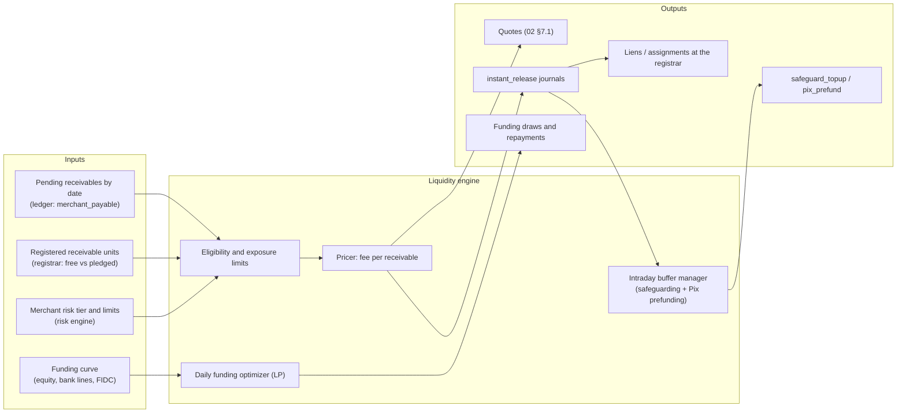
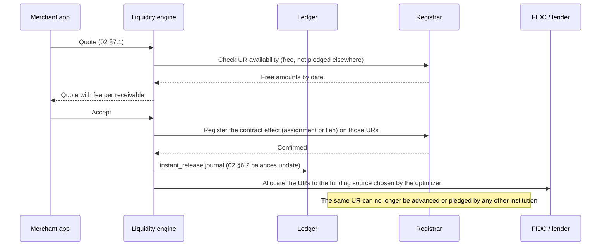
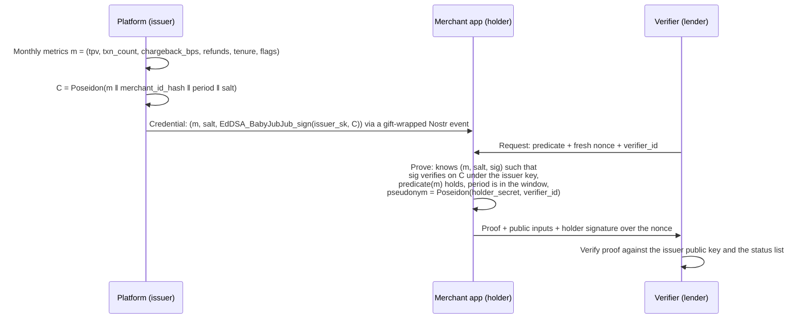
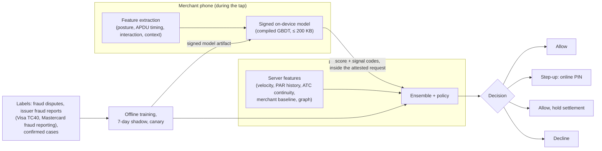

# Module 7: goonersPAY Superior Enhancements

Three features, each re-scoped from the brief so that it is legal, buildable and better than the market baseline. A fourth section lists smaller advantages that fall out of the earlier modules.

---

## 1. Instant Liquidity Engine

### 1.1 What "instant" really costs

When a merchant is paid the moment a card is tapped, the platform is fronting money the issuer will pay up to 30 days later (60 or 90 days for later installments, [01 §8.2](01-acquiring-engine.md#82-settlement-terms-that-drive-liquidity)). So the price of instant settlement has three parts:

1. **Time value**: the cost of funds over the gap, in Brazilian business days (the DU/252 convention used for CDI).
2. **Expected loss**: chargebacks and fraud the platform can no longer net against future settlements, because the money has already left.
3. **Operating cost**: registrar fees, Pix fees and funding operations.

The market prices this as one flat premium tier, which is simple but wrong in both directions. Public price tables in Brazil in October 2026 show instant plans adding roughly a percentage point to debit MDR. Fronting debit for one business day at a 16.5% annual funding cost costs about 0.06%. The same flat tier under-prices a risky merchant selling 12-installment credit.

### 1.2 Architecture



### 1.3 Pricing an advance

For each pending receivable *i* with amount *Aᵢ*, settling in *dᵢ* business days, for a merchant in risk tier *t*:

```text
fee_i = round_half_up( A_i × ( (1 + r_f + s_t) ^ (d_i / 252) − 1 ) )

r_f   funding cost, annual (assumed 15.00% in the examples; in production the optimizer's marginal cost, §1.5)
s_t   tier spread covering expected loss and margin: A = 1.50%, B = 3.00%, C = 6.00%, D = not eligible
d_i   business days until the scheme settles receivable i
```

| Example | Amount | d | Tier | Fee | Effective |
|---------|--------|---|------|-----|-----------|
| Credit tap, single payment ([04 §3.4](04-serverless-backend.md#34-posting-catalogue)) | R$ 125,76 | 21 | A | R$ 1,61 | 1.28% a month |
| Quote, debit part ([02 §7.1](02-api-reference.md#71-post-v1payoutsquotes)) | R$ 612,00 | 1 | B | R$ 0,40 | 0.07% |
| Quote, credit part | R$ 1.545,80 | 21 | B | R$ 21,47 | 1.39% a month |
| Debit, R$ 1.000,00 | R$ 1.000,00 | 1 | A | R$ 0,61 | 0.06% |

`npm run check` recomputes every fee in this table and in the API and ledger examples.

The merchant sees the result in reais before confirming. A merchant who does not need cash today can leave receivables to settle on their own dates and pay nothing.

### 1.4 Eligibility, limits and reserves

| Input | Effect |
|-------|--------|
| Risk tier (chargeback and fraud history, tenure, MCC, KYB strength, volume stability, device integrity) | Spread *sₜ*, exposure limit, reserve percentage |
| **Exposure limit** = advanced but not yet settled, per merchant | Tier A: up to 30 days of average volume. Tier C: 3 days |
| Rolling reserve | 0% (A) to 10% (C) of advanced amounts, held 90 days in `merchant_reserve` |
| Automatic downgrade | VAMP ratio above 60% of the threshold, a fraud spike, a journal fork ([03 §7.1](03-nostr-layer.md#71-hash-chained-journal)), KYB changes, a sudden ticket-size shift |
| "Hold settlement" decision from the fraud shield (§3.6) | That sale is approved but settles on its normal date. No advance |

### 1.5 Funding optimizer

Every morning, and again at 14:00, the optimizer solves a small linear programme:

```text
minimize    Σ_j  c_j · x_j                         (cost of using source j)
subject to  Σ_j  x_j ≥ F̂_advance + B_safety         (forecast advances, p95, plus buffer)
            0 ≤ x_j ≤ cap_j                          (line limits, FIDC subscription capacity, equity allocation)
            x_equity ≥ κ · Σ_j x_j                    (minimum skin in the game for the FIDC and the lenders)
            LCR_30d ≥ 1.2                             (30-day liquidity coverage of the funding stack)
```

| Source *j* | Typical cost basis | Notes |
|------------|--------------------|-------|
| Own equity | Target return on equity | Most expensive; used for the first-loss layer |
| Committed bank credit lines | CDI + spread | Fast to draw; covenants on concentration |
| FIDC (receivables investment fund) senior quotas | CDI + a lower spread, because collateral is registered receivable units | The fund buys URs, transferred at the registrar; the platform holds subordinated quotas |
| Assignment of receivables to banks | Per-deal discount | Peak-season overflow |

Intraday, the buffer manager keeps the safeguarding reserve above client liabilities (L5, [04 §3.6](04-serverless-backend.md#36-safeguarding-reconciliation)) and the Pix settlement account pre-funded, so an instant release never waits for a transfer.

### 1.6 Registrar interplay



Registering the contract effect first is what makes double-financing impossible, both inside the platform and across the market.

### 1.7 Yield on balances: the compliant version

The brief asked for "immediate yield-generation on settled funds via decentralized short-term liquidity pools". For client money in Brazil, that is not an option:

- E-money balances must be held in the CCME account at the BCB or in federal government securities in Selic. **They cannot be lent, pooled or deployed on-chain** ([00 §2, C3](00-executive-summary.md#2-what-this-specification-changes-from-the-brief)).
- What merchants experience as "a conta rende" is, in compliant Brazilian products, an **opt-in automatic investment**: available balance above a threshold is swept daily into an investment with daily liquidity, typically a partner bank's CDB covered by the FGC (up to R$ 250.000 per depositor per institution), and redeemed automatically when the merchant pays out. The platform needs a distribution arrangement and suitability rules for this. Counsel must confirm the exact structure.
- DeFi is excluded for the platform's **own** treasury in Phases 1 and 2 as well. Smart-contract, counterparty and regulatory risk do not fit the risk appetite of a payment institution whose licence depends on liquidity. If the BCB's tokenization initiatives produce tokenized deposits or government bonds with clear rules, the funding optimizer can treat them as one more source *j*.

### 1.8 Success measures

| KPI | Target |
|-----|--------|
| Share of eligible volume settled instantly | ≥ 60% |
| Instant settlement loss rate (unrecovered chargebacks / advanced volume) | ≤ 0.05% |
| Weighted cost of funds | ≤ CDI + 2.0% |
| Price vs the baseline flat tier, tier A debit | ≥ 10× cheaper |

---

## 2. Zero-Knowledge Compliance (ZKC)

### 2.1 The boundary

The platform is the acquirer. It sees every transaction and **must** report them: DIMP to the state tax authorities, federal tax obligations, COAF for AML and the BCB for supervision ([04 §2.4](04-serverless-backend.md#24-regulatory-reporting)). Zero knowledge does not change that, and must not try.

What ZK *can* do is let the merchant prove facts about its business to **third parties**, such as a lender, a landlord, a marketplace, a franchisor or a supplier offering trade credit, without handing over statements that reveal its exact volume, its customers or its seasonality.

| Verifier | Today | With ZKC |
|----------|-------|----------|
| Third-party lender | Twelve months of statements (every sale, every customer pattern) | "Average monthly card volume over 12 months ≥ R$ 50.000 and chargeback ratio < 0.5%" |
| Commercial landlord | Bank statements, tax returns | "Active, KYB-verified merchant for ≥ 24 months, with monthly volume ≥ R$ 30.000 in each of the last 6 months" |
| Marketplace onboarding | Manual document checks | "Verified merchant, MCC in an allowed set, not restricted by the acquirer" |
| A government or association programme limited to small businesses | Self-declaration | "Card + Pix volume over the last 12 months ≤ the programme ceiling" (for example the MEI revenue ceiling) |

### 2.2 Two tiers

| Tier | Technology | Proves | When |
|------|-----------|--------|------|
| **1. Selective disclosure** | W3C Verifiable Credentials 2.0 encoded as IETF SD-JWT VC, issued monthly by the platform | Bucketed claims chosen by the merchant: `tpv_12m_bucket: "50k-100k"`, `chargeback_bucket: "<0.5%"`, `kyb: "verified"`, `mcc: "5812"` | Phase 2. Standard, widely supported, no custom cryptography |
| **2. Zero-knowledge predicates** | A SNARK circuit (Noir with an UltraHonk backend, or Circom/Groth16) over platform-signed commitments | Exact thresholds of the verifier's choosing, never the value itself | Phase 3, after a cryptography audit |

Buckets leak an interval. Predicates leak one bit per question. Tier 1 covers most real verifiers and ships first.

### 2.3 Tier 2 construction



Circuit interface:

| Public inputs | Private inputs (witness) |
|---------------|--------------------------|
| Issuer EdDSA public key | Metrics *m* for each month in the window |
| Predicate thresholds (for example `tpv_avg ≥ 5_000_000` centavos, `chargeback_bps < 50`) | Salts, issuer signatures |
| Window (first and last period) | `merchant_id_hash`, `holder_secret` |
| Verifier nonce, `verifier_id` | |
| Pseudonym (output) | |

```rust
// Illustrative Noir sketch (not audited): average monthly TPV over 12 signed monthly credentials.
fn main(
    issuer_pk: pub EdDSAPublicKey,
    min_avg_tpv: pub u64,
    max_chargeback_bps: pub u32,
    first_period: pub u32,
    verifier_id: pub Field,
    pseudonym: pub Field,
    months: [MonthlyMetrics; 12],
    sigs: [EdDSASignature; 12],
    merchant_id_hash: Field,
    holder_secret: Field,
) {
    let mut total: u64 = 0;
    for i in 0..12 {
        let m = months[i];
        assert(m.period == first_period + i as u32);
        let c = poseidon::hash([m.tpv as Field, m.txn_count as Field, m.chargeback_bps as Field,
                                m.period as Field, merchant_id_hash, m.salt]);
        assert(eddsa::verify(issuer_pk, sigs[i], c));
        assert(m.chargeback_bps < max_chargeback_bps);
        total += m.tpv;
    }
    assert(total >= min_avg_tpv * 12);
    assert(poseidon::hash([holder_secret, verifier_id]) == pseudonym);   // unlinkable across verifiers
}
```

### 2.4 Freshness, revocation and binding

- Credentials expire after the month following their period. Verifiers can demand the latest *k* months.
- Revocation uses a W3C Bitstring Status List published by the platform. If a merchant is offboarded for fraud, every credential index is flipped.
- **Holder binding**: the proof is accompanied by a signature from the merchant's root or device Nostr key over the verifier's nonce, and `merchant_id_hash` is bound inside the credential, so a proof cannot be lent to another merchant.
- **Unlinkability**: the per-verifier pseudonym lets a lender recognize repeat applications from the same merchant, while two different verifiers cannot correlate their records.

### 2.5 Honest limits

| Limit | Consequence |
|-------|-------------|
| The issuer is trusted for the truth of the metrics | ZK proves statements about platform-signed data. If the platform's data is wrong, the proof is a correct proof of a wrong number. The transparency log ([03 §6](03-nostr-layer.md#6-verifiable-settlement-transparency-log)) and audited statements are what make the issuer's data trustworthy |
| Volume *through this platform* is not total revenue | Credentials say "card and Pix volume on goonersPAY". Verifiers must not read them as total revenue |
| Metric gaming (self-purchases to inflate volume) | The risk engine flags circular flows. Flagged months are issued with `flags ≠ 0`, which predicates can require to be zero |
| Proving cost on phones | Target ≤ 5 s on a mid-range phone for the 12-month circuit. To be validated in a prototype before committing to Tier 2 |

---

## 3. Autonomous Fraud Shield

### 3.1 Goal and stance

Score each tap **on the device, during the tap**, using signals the server never sees (sensor timing, interaction, local device posture), and combine that score with the server's view in the authorization decision. "Zero-day fraud" in practice means *patterns the server-side model has not seen yet*: a new relay rig, a new overlay malware family, a new card-testing script. On-device features catch some of those first because they look at physical behaviour, not at historical labels.

The stance is non-negotiable: **the device is in the attacker's hands**. Its score is one feature among many, protected by attestation, and it is never trusted alone. A device that reports "everything is fine" gains nothing. A device that reports trouble only adds friction.

### 3.2 Pipeline



### 3.3 On-device features

| Family | Examples | Why it catches novel fraud |
|--------|----------|----------------------------|
| Device posture | Integrity verdict level, root or jailbreak indicators, hooking frameworks, debugger, emulator, developer options, USB debugging, **enabled accessibility services and overlays**, active screen recording or sharing | Overlay and accessibility-abuse malware is a recurring pattern in Brazilian mobile banking fraud. It shows up as posture before it shows up in chargebacks |
| **Relay timing** | Round-trip time of each APDU, especially the cryptogram generation command, compared with the distribution for that card product (AID + issuer application data profile) | A relay attack forwards the APDUs to a card that is somewhere else, adding latency. EMV kernel C-8's relay resistance protocol, where the card supports it, gives a cryptographic bound. Timing is a probabilistic fallback, because phone timing is noisy |
| Interaction | Time from amount entry to tap, keypad cadence, amount patterns (very round, repeated, just under limits), number of cancelled taps | Card-testing and "mule merchant" scripts behave unlike a cashier |
| Context | Coarse location vs the merchant's registered area (with consent), time of day vs the merchant's baseline, battery and charging state | Stolen-phone and remote-merchant fraud |
| Session | Cards tapped in the last 10 minutes, distinct BIN ranges, decline streaks | Testing many stolen cards on one terminal |

Server-only features add the cardholder side: the last seen application transaction counter (ATC) for the same Payment Account Reference (a jump backwards suggests a clone), PAR velocity across terminals, and the merchant's graph neighbourhood (devices, bank accounts and people shared with known-bad merchants).

### 3.4 Model

| Property | Value |
|----------|-------|
| Type | Gradient-boosted trees, about 40 features, 200 trees of depth 6 |
| Packaging | Compiled into each platform's native core (no interpreter), plus Core ML on iOS where faster |
| Size / latency | ≤ 200 KB, ≤ 5 ms on a mid-range phone, computed while the card is in the field |
| Output | Calibrated probability + up to 5 signal codes (for example `apdu_rtt_p99_exceeded`, `overlay_active`) |
| Integrity | The model file is signed (Ed25519). The app verifies it before loading, and the model hash is part of the attested request |
| Updates | Monthly, or within 48 h for an emergency pattern. Server-side policy can neutralize a bad model immediately |

### 3.5 Privacy

Raw features never leave the phone. Only the score, the model version and the signal codes are sent: data minimization by construction. Location is used only as "inside or outside the registered area", and only with consent. The RIPD (data protection impact assessment) covers the features and the automated-decision logic. Merchants can see why a sale was stepped up ("PIN solicitado por segurança") and appeal holds.

### 3.6 Decision policy

| | Server score low | Server score medium | Server score high |
|---|---|---|---|
| **Device score low** | Allow | Allow, hold settlement | Step-up PIN, hold settlement |
| **Device score medium** | Allow | Step-up PIN | Decline |
| **Device score high** | Step-up PIN, hold settlement | Decline | Decline, freeze terminal for review |

**"Allow, hold settlement"** is the control a non-acquirer cannot offer. The customer's sale goes through, so there is no friction for the honest case, but the money is not advanced instantly. If a fraud dispute arrives, the funds have not left. It turns uncertainty into a delay instead of a decline.

### 3.7 Targets

| Metric | Target |
|--------|--------|
| Card-present fraud rate | ≤ 1 bp of volume |
| Step-up rate (PIN asked for risk) | ≤ 2% of taps |
| False decline rate (declined by risk, later shown genuine) | ≤ 0.1% of taps |
| Detection lead time on new attack patterns vs server-only | Measured per incident; goal: hours instead of weeks |

### 3.8 Adversarial considerations

| Attack | Defence |
|--------|---------|
| Tampered app reports low scores | Attestation (Play Integrity, App Attest, MPoC A&M). The score is only one input, and "low" never overrides a high server score |
| Model extraction to craft evasions | Models rotate monthly; the server ensemble uses features the device never sees |
| Poisoning via fake labels | Labels come from scheme fraud reports and confirmed cases, never from merchant self-reports |
| Replay of an old "good" request | The attested request includes the nonce, the payment intent and a fresh integrity token |

### 3.9 What the reference implementation builds

The first version replaces the trained models with transparent, weighted rules, so the whole pipeline (signals, scores, the §3.6 policy, holds, reviews) runs today and the models can be swapped in behind it. Scores are combined as a noisy OR in integer thousandths: each signal, heaviest first, keeps `(1000 − weight) / 1000` of the remaining "clean" mass, truncated at every step. Integer arithmetic makes the phones and the platform agree bit for bit; the conformance vectors check it in Go, Kotlin, Swift and JavaScript.

**Device model `gp-device-1`** (both app cores, `RiskMonitor`). The authorization carries `device_risk: {score, model, signals}` with at most five codes. The platform recomputes the score from the codes and keeps the higher one; a report whose score is below what its own codes give adds the server signal `device_score_inconsistent`.

| Code | Weight | What the phone saw |
|------|-------:|--------------------|
| `hooking` | 700 | Frida, Xposed/LSPosed, Substrate or similar loaded in the app's process |
| `root_indicators` | 600 | `su` binaries, Magisk, test-keys builds (Android); Cydia/Sileo, writable system paths (iOS) |
| `debugger` | 600 | A debugger attached (`Debug.isDebuggerConnected`, `P_TRACED`) |
| `emulator` | 500 | Emulator build properties; the iOS Simulator |
| `apdu_rtt_p99_exceeded` | 500 | Reserved for the MPoC kernel's relay timing (§3.3) |
| `overlay_active` | 400 | A touch reached the checkout through another app's window (Android); overlays are also hidden from the app's window |
| `accessibility_service` | 350 | An accessibility service is enabled (Android) |
| `decline_streak` | 350 | The phone's last three card results were declines |
| `tap_burst` | 300 | Eight or more card reads within two minutes |
| `screen_captured` | 300 | The screen is being recorded, mirrored or shared (Android 15+, iOS) |
| `fast_amount_to_tap` | 250 | The card was read less than 1.5 s after the first digit of the amount |
| `adb_enabled` | 200 | USB debugging is on (Android) |
| `cancelled_taps` | 200 | Three or more sales abandoned in ten minutes |
| `repeated_amount` | 150 | The same amount as each of the last two card sales |
| `just_under_limit` | 150 | Within 5% under the R$ 200,00 contactless limit without cardholder verification |
| `developer_options` | 100 | Developer options are on (Android) |

**Server rules** (`internal/risk`), from the platform's own history: every card-present attempt is recorded as an assessment before the issuer sees it, and the next assessment reads those rows (cards by vault fingerprint, across terminals and partners).

| Code | Weight | Rule |
|------|-------:|------|
| `atc_replay` | 900 | The card's application transaction counter (EMV 9F36) equals one already seen for that physical card (PAN, expiry, PAN sequence) |
| `atc_regression` | 800 | The counter is below one already seen: a clone or a pre-played cryptogram |
| `device_score_inconsistent` | 700 | The phone's score is below what its own codes give |
| `card_multi_merchant` | 500 | The card was presented to five or more merchants in an hour (three is an afternoon at a mall) |
| `terminal_card_testing` | 500 | Five or more distinct cards on one terminal in ten minutes |
| `card_velocity` | 400 | Five or more earlier attempts with the card in ten minutes |
| `amount_above_baseline` | 350 | Above ten times the merchant's 30-day median card sale (with at least 20 sales) |
| `terminal_decline_streak` | 300 | The terminal's last three issuer answers were declines (the platform's own risk declines neither count nor break the streak) |
| `new_merchant_large_amount` | 300 | R$ 1.000,00 or more at a merchant younger than seven days |
| `terminal_bin_spread` | 200 | Four or more distinct BINs on one terminal in ten minutes |

Levels: device low below 400, medium below 750, high from 750; server low below 300, medium below 700, high from 700. The §3.6 table then decides. A step-up without a PIN returns `pin_required` before anything reaches the issuer. A hold approves the sale but marks its receivables `held`: no instant release, no advance, no scheduled settlement, shown to the merchant as held in the balance and on the sale screen. A hold or a frozen terminal opens a review (`GET /v1/risk/reviews`, `POST /v1/risk/reviews/{id}/resolve` with `release` or `fraud`, webhooks `risk.review_opened` and `risk.review_resolved`): releasing lets the money settle and the terminal sell again, confirming fraud keeps the money held for the chargeback and revokes a frozen terminal. Once a refund or a chargeback has charged the loss to the merchant, the hold has done its job and the money settles on its schedule (keeping it would charge the merchant twice). `RISK_MODE=shadow` records every decision and enforces none (the §3.4 shadow period); production refuses `RISK_MODE=off`.

---

## 4. Other advantages that fall out of the design

| Advantage | Where |
|-----------|-------|
| Receipts the customer owns, verifiable offline, with no app or account | [03 §3](03-nostr-layer.md#3-receipts) |
| Publicly anchored settlement statements | [03 §6](03-nostr-layer.md#6-verifiable-settlement-transparency-log) |
| One checkout, any acceptance device (tap, BLE reader, a colleague's phone) | [05 §3.2](05-mobile.md#32-acceptance-modes-and-fallback) |
| Expected-margin routing that raises approval rates | [01 §6](01-acquiring-engine.md#6-smart-transaction-routing) |
| Split payments and sub-ledgers for partners, settled atomically | [02 §6](02-api-reference.md#6-accounts-sub-ledgers-and-transfers) |
| No password anywhere, so password phishing has nothing to steal | [03 §4.3](03-nostr-layer.md#43-logins) |
| Survives the loss of any one cloud provider | [04 §5](04-serverless-backend.md#5-multi-region-multi-provider-resilience) |
