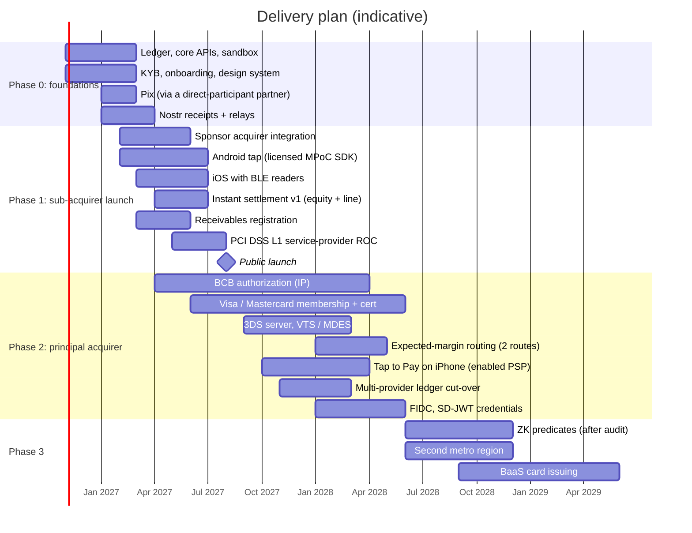

# Roadmap, Certification Path and Risk Register

---

## 1. Phases

**Where Phase 0 stands.** The integration layer exists as a tested reference implementation in [`platform/`](../platform): the ISO 8583 switch with sessions, reversals and store-and-forward; the ledger; Pix through API Pix with webhooks and payouts; receipts; the HTTP API; and simulators of the card host and the PSP. What remains for Phases 0 and 1 is counterparty work (dialect transcription, homologation, certification) and the production key-custody adapters ([`integration/`](../integration)).

| Phase | Exit criteria |
|-------|---------------|
| 0 | Ledger invariants L1–L5 green in staging for 30 days; sandbox used by 3 design partners; receipts claimable end to end |
| 1 | 1,000 merchants live; authorization availability ≥ 99.95% for 60 days; PCI DSS ROC issued; registrar integration certified; DIMP filed |
| 2 | BCB authorization granted; scheme certification complete for both schemes; ≥ 30% of volume on direct routes; provider-loss game day passed in production |
| 3 | Cryptography audit of the ZK circuits passed; second-metro failover tested |

## 2. Certification and licensing

| Item | Counterparty | Typical lead time | Depends on |
|------|--------------|-------------------|------------|
| PCI DSS v4.0.1 Level 1 (service provider) | QSA | 4–6 months for the first ROC | CDE built, 3 months of logs |
| PCI MPoC | Licensed SDK vendor (Phase 1); MPoC lab (in-house, later) | Vendor: integration and attestation onboarding, weeks. In-house: 9–15 months | — |
| EMV L2 contactless kernels (only if built in-house) | EMVCo-accredited lab | 6–12 months per kernel | In-house decision |
| EMVCo 3DS Server + PCI 3DS | EMVCo lab, QSA | 6–9 months, or licensed from a certified vendor | Phase 2 |
| Scheme principal membership + host certification | Visa, Mastercard | 9–15 months | BCB authorization in progress, capital, BIN/ICA |
| Token requestor onboarding (VTS, MDES) | Visa, Mastercard | 3–6 months | Membership |
| Tap to Pay on iPhone | Apple | Partnership, entitlement and review timing set by Apple | Acquirer or PSP status |
| BCB authorization: *credenciador* and *emissor de moeda eletrônica* | Banco Central do Brasil | About 12 months from filing | Governance, capital, cyber policy (Res. BCB 85/2021) |
| Receivables registrar participation | CERC / Núclea / B3 / TAG | 2–4 months | Arrangement participation |
| ICP-Brasil timestamp contract | Accredited TSA | Weeks | — |

## 3. Risk register

| ID | Risk | L | I | Mitigation | Owner |
|----|------|---|---|------------|-------|
| R1 | BCB authorization or scheme membership slips by 6+ months | M | H | Phase 1 runs fully on the sponsor; nothing in the product depends on Phase 2 dates | CEO / Legal |
| R2 | Sponsor acquirer changes terms or fails | M | H | A second sponsor contracted before launch; the scheme-adapter abstraction makes switching a configuration change | BD |
| R3 | MPoC SDK vendor lock-in or security incident | M | H | The SDK sits behind `:core:acceptance`; a second vendor evaluated; kill switch per SDK version | Mobile |
| R4 | Instant settlement losses exceed pricing (fraud ring, merchant default) | M | H | Exposure limits, rolling reserves, "hold settlement" control, daily loss monitoring, automatic tier downgrade | Risk |
| R5 | Funding cost rises (Selic up) and erodes instant-settlement margins | H | M | Pricing uses the optimizer's marginal cost every day; quotes expire in 15 minutes | Treasury |
| R6 | Safeguarding breach (reserve below liabilities) | L | Critical | L5 after every journal, treasury buffer, P1 paging, daily CCME reconciliation | CFO |
| R7 | Ledger bug corrupts balances | L | Critical | Append-only design, independent verifier, double-entry checks in the service *and* the verifier, reproducible test suite (`check-ledger.mjs`) | Engineering |
| R8 | A provider-wide cloud outage | L | H | Multi-provider ledger and warm-standby CDE ([04 §5](04-serverless-backend.md#5-multi-region-multi-provider-resilience)) | SRE |
| R9 | Nostr relays censored, flooded or unavailable | M | L | Own relays on three providers; relays are not on the money path | Platform |
| R10 | Custom Nostr kinds collide with a future NIP | M | L | Re-check the NIPs table each release; propose a NIP; versioned `v` field | Protocol |
| R11 | Merchants lose root keys (24 words) | H | M | Re-KYB rebinding path ([03 §4.4](03-nostr-layer.md#44-recovery-compromise-and-rebinding)); onboarding teaches backup; NIP-49 encrypted export | Product |
| R12 | Card-testing attacks through the e-commerce API | H | M | Edge bot management, velocity per BIN range, 3DS step-up, VAMP enumeration monitoring | Risk |
| R13 | VAMP / Mastercard programme thresholds tighten | M | M | Thresholds are configuration; alerts at 60% of the limit | Risk |
| R14 | LGPD complaint about on-device fraud features or the transparency log | L | M | RIPD, consent for location, data minimization, public explanation of what the log does not reveal | DPO |
| R15 | Tap to Pay on iPhone access delayed | M | M | BLE readers and remote charge cover iOS merchants | Partnerships |
| R16 | Brand confusion with InfinitePay | H | M | Choose a distinct brand before launch (see [00](00-executive-summary.md)) | Marketing / Legal |
| R17 | ZK circuit bug lets merchants prove false statements | L | H | Tier 1 (SD-JWT) first; Tier 2 only after an external audit; issuer-side limits on what credentials can claim | Security |
| R18 | Post-quantum break of secp256k1 signatures on archived receipts | L (near term) | M | Hash-based timestamps anchor history; plan a post-quantum co-signature once a Nostr standard exists | Security |

L = likelihood, I = impact (L / M / H).

## 4. Questions for counsel and partners

1. The exact structure for offering yield on balances (CDB sweep, distribution licence, disclosure) under current BCB and CVM rules ([07 §1.7](07-enhancements.md#17-yield-on-balances-the-compliant-version)).
2. Whether the per-merchant reserve (`merchant_reserve`) counts as e-money for safeguarding. The spec assumes yes, which is the conservative choice.
3. The DIMP responsibility split with the sponsor acquirer in Phase 1 (Convênio ICMS 134/2016 allows the obligation to be transferred).
4. Registrar contract effects to use for FIDC assignments vs liens.
5. Whether publishing daily transparency roots needs any disclosure in the merchant contract (the spec assumes a clause is added).
6. Retention periods for receipts and journals in the archive. The spec assumes 10 years, to cover the longest financial-record obligation with margin.

## 5. Definition of done for "production-grade"

- [ ] Every API in [02](02-api-reference.md) is in `openapi.yaml`, lints clean, and has contract tests against the sandbox.
- [ ] Ledger invariants L1–L5 run continuously in production, with paging.
- [ ] Every money movement has an idempotency key from the API to the ledger.
- [ ] Provider-loss game day passed in production with no lost writes.
- [ ] PCI DSS ROC, MPoC listing (vendor or own) and 3DS certification in hand.
- [ ] Penetration test of the apps, APIs and CDE, with all high findings fixed.
- [ ] Runbooks for every alert, and on-call rotations staffed.
- [ ] `npm run check` green in CI for this specification.
