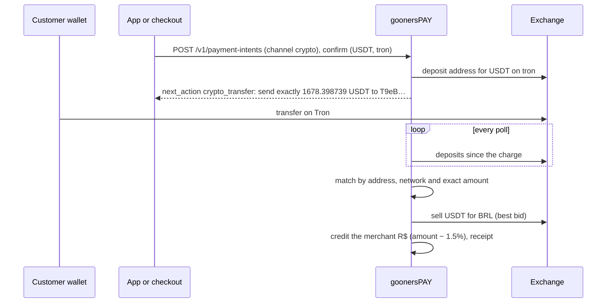

# Module 9: Crypto, Accounts Abroad and B3

A merchant on goonersPAY can take a payment in a stablecoin and receive reais, hold and trade crypto, keep dollars, euros and pounds with bank details to receive from abroad and pay abroad, and buy and sell shares at B3. This module is how each works, what it costs, which partners carry it, the rules that apply, and what remains before production.

Everything here is built and tested against simulators that behave like the venues (`go test ./...`, the smoke run, the web console and both apps). In production each line runs only through an authorized partner, and the platform refuses to start without naming it (§6).

---

## 1. What is built

| Capability | Platform | Web console | Apps | In production it needs |
|------------|----------|-------------|------|------------------------|
| Crypto payment, settled in reais | Unique-amount charges, deposit polling, sale at once, fee | Charge with QR and countdown | Checkout method (opt-in) | An exchange account and a VASP authorization (§6.1) |
| Crypto prices, holdings, buy and sell | Router across Binance, Kraken and Coinbase | Markets, holdings, quote and confirm | Ativos: holdings, quote and confirm | Same |
| Crypto withdrawal | Address checks per network, sanctions screening before anything moves, fees | Enviar cripto | Not in the apps (final once sent) | Same, plus withdrawal allow-lists at the venue and the lists or provider of §6.1 |
| Custody reconciliation | Each venue's balances against the ledger, every night; unapplied deposits | | | The venues' read-only keys |
| DeCripto (monthly report to the Receita) | The file in the layout of ADE COPES 2/2025, written on the first days of each month | | | Filing at the Coleta Nacional with the company's e-CNPJ certificate |
| Accounts abroad (USD, EUR, GBP) | Balances, bank details, references, credits | Accounts, details, simulated credit | Ativos: balances and details to copy | A câmbio institution and a Wise Platform contract (§6.2) |
| Buying and selling foreign currency | Quotes with IOF apart | Converter | Ativos | Same |
| Paying abroad | IBAN, ABA, sort code checks; reversal on failure | Pagar no exterior | Not in the apps | Same |
| B3 shares, units, BDRs | Tickers, lots, fractional market, session, D+2, fees | Suitability, quote, order, portfolio | Ativos: positions | A broker (corretora) that is a B3 participant (§6.4) |

---

## 2. One ledger, many assets

The ledger of [04 §3](04-serverless-backend.md) now keeps balances in any asset. An account has one currency; a journal moves one currency and balances to zero in it. A conversion is two journals, one per currency, written together with the same reference.

| Asset | Smallest unit | Decimals | Networks |
|-------|---------------|:--------:|----------|
| BRL, USD, EUR, GBP | centavo, cent, penny | 2 | |
| BTC | satoshi | 8 | bitcoin |
| ETH | gwei | 9 | ethereum |
| USDT | micro-USDT | 6 | tron, ethereum, polygon, solana |
| USDC | micro-USDC | 6 | ethereum, polygon, solana |

ETH is kept in gwei, not wei, so every amount fits a signed 64-bit integer; a withdrawal never asks for less than a gwei. Decimal amounts cross the API as strings ("0.00099303"), never floats, and parsing refuses more decimals than the asset has. Conversions round against the platform (a buyer never receives more than the price allows).

| Account | Meaning |
|---------|---------|
| `asset.custody.<venue>.<asset>` | What the platform holds at an exchange, a bank abroad or a broker |
| `liability.merchant_holding.<merchant>.<asset>` | What it owes each merchant in that asset |
| `liability.asset_clearing.<asset>` | A customer's crypto between its arrival and its sale |
| `liability.broker_settlement.<broker>` | Owed to the broker for purchases until B3 settles them |
| `liability.iof_payable` | IOF withheld on câmbio, owed to the Receita Federal |
| `revenue.conversion_fees` | The visible fee on conversions and crypto payments |
| `revenue.conversion_result` | The difference between the price promised and the price obtained (may be negative) |
| `expense.venue_fees.<asset>` | What the exchange charged |

Three invariants are checked by `ledger.Verify` after every test run and by the nightly job:

- **L4**: the trial balance is zero **in each currency**.
- **L5**: the safeguarded reais cover every merchant wallet and reserve (the rule that already applied, now with the crypto and B3 flows moving the reserve with the wallet).
- **L6**: in each asset other than reais, the custody accounts cover the merchants' holdings: the platform never owes more bitcoin than it holds.

A crypto payment of R$ 9.000,00 in USDT, as the sandbox posts it (one journal in reais after the sale):

| Account | Debit | Credit |
|---------|------:|-------:|
| `asset.custody.simex.brl` (proceeds of the sale) | 9.036,18 | |
| `liability.merchant_wallet.m` | | 8.865,00 |
| `revenue.conversion_fees` (1.5%) | | 135,00 |
| `revenue.conversion_result` (the spread the sale earned) | | 36,18 |
| `asset.safeguarding_reserve` / `asset.settlement_bank` | 8.865,00 | 8.865,00 |

---

## 3. Crypto

### 3.1 Venues

The platform is a client of exchanges; it does not run an order book. Each adapter signs requests as the venue documents and is tested against a fake server that checks the signature.

| Venue | Authentication | Order idempotency | Reference |
|-------|----------------|-------------------|-----------|
| Binance | `X-MBX-APIKEY` header; HMAC-SHA256 over the query string and body, with `timestamp` and `recvWindow` | `newClientOrderId`; a duplicate (-2010) is looked up by `origClientOrderId` | [Binance: request security](https://developers.binance.com/docs/binance-spot-api-docs/rest-api/request-security) |
| Kraken | `API-Key`; `API-Sign` = base64(HMAC-SHA512(base64-decoded secret, path ‖ SHA-256(nonce ‖ body))) | `cl_ord_id`; withdrawals by named key (`KRAKEN_WITHDRAW_KEYS`) | [Kraken: Spot REST authentication](https://docs.kraken.com/api/docs/guides/spot-rest-auth) |
| Coinbase Advanced Trade | A fresh ES256 JWT per request: `kid` = key name, random `nonce`, `iss` "cdp", `uri` "METHOD host/path", 120 s | `client_order_id` | [Coinbase: JWT authentication](https://docs.cdp.coinbase.com/get-started/authentication/jwt-authentication) |

`EXCHANGES=binance,kraken,coinbase` turns them on. The router asks each venue for its book and buys at the lowest ask and sells at the highest bid; `GET /v1/crypto/markets` shows both and where. Market orders are sized by quote amount for buys (so R$ 350,00 buys what R$ 350,00 buys) and by base amount for sales.

Before executing, the platform re-reads the book; if the price moved more than **1%** against the quote (the slippage guard), the conversion fails and nothing is charged.

### 3.2 A payment in crypto

- **Price.** The charge converts the amount in reais at the best bid less a 0.5% spread (`CRYPTO_SPREAD_BPS`), so the sale on arrival covers it.
- **Matching.** Several charges can share a deposit address, so each pending charge asks for a different amount: the platform adds a tail in the last decimals until no other pending charge to that address asks for the same. A deposit matches when address, network and amount are exactly a pending charge's, once the venue reports it confirmed. A transfer on another network or of another amount is not matched; it is recorded for operations to return or apply by hand.
- **Expiry.** 15 minutes. An expired charge is canceled; a late transfer is not credited automatically.
- **Settlement.** The asset is sold at once (`revenue.conversion_result` keeps the difference between the promised and the obtained price), and the merchant is credited in reais less the fee (`CRYPTO_FEE_BPS`, 150 by default). The receipt is a Nostr receipt like any other ([03](03-nostr-layer.md)).
- **Refunds.** A crypto payment is not refunded through `POST /v1/refunds` (`409`): the sender's address may belong to an exchange, and the asset's price has moved. The merchant returns crypto to an address the customer gives: buy it (`POST /v1/conversions`) and send it (`POST /v1/crypto/withdrawals`). The apps say so when "Cancelar venda" is tapped on a crypto sale.

### 3.3 Holdings, conversions and withdrawals

A merchant may also keep crypto: buy with reais from the wallet, sell into it, and send it out. Every conversion is quoted first (30 seconds, the fee shown apart) and executed only on request; execution is idempotent. A withdrawal checks the address against the network (Bitcoin bech32 or base58, Ethereum and Polygon hex, Tron base58 `T…`, Solana base58), screens it against sanctions lists (§6.1), takes the network fee from the holding, and is final once the exchange accepts it. It also records its value in reais at the best price to sell at that moment, and whether it goes to a wallet no provider keeps or to an account at another provider (`destination_type`), which the DeCripto reports apart.

---

## 4. Accounts abroad

### 4.1 Model

Each merchant has a USD, EUR and GBP balance (accounts `liability.merchant_holding.<m>.usd` and so on) held at the platform's account with an electronic money institution abroad, today the Wise Platform API. Payers abroad pay into the platform's account in that currency with the merchant's **reference**, `GP` and ten hexadecimal characters derived from the merchant's ID (`merchant_fx_reference()` in migration 0014). The platform reads the account's movements, credits the merchant whose reference is on the payment, and leaves anything else for manual review.

| Call | Wise Platform API |
|------|-------------------|
| Rates | `GET /v1/rates` |
| Quotes | `POST /v3/profiles/{profileId}/quotes` |
| Incoming credits | Balance statements of the multi-currency account |
| Bank details to receive | The account details of each balance (IBAN and BIC, ABA routing and account, sort code) |
| Paying abroad | Recipient (`POST /v1/accounts`), quote, `POST /v1/transfers` with the quote, then funding from the balance |

The [Wise Platform API reference](https://docs.wise.com/api-reference/preview) and its [send-money guide](https://docs.wise.com/guides/product/send-money/use-cases/enterprise/send-money) describe the same four steps; every write carries an idempotency UUID derived from the platform's own operation ID, so a retry never pays twice.

### 4.2 Converting and paying

Buying foreign currency with reais, or selling it into reais, is a conversion like §3.3 with IOF withheld and shown on the quote. A payment abroad debits the balance plus a fee in the same currency (USD 5.00, EUR 4.00, GBP 4.00), checks the beneficiary (IBAN by mod-97, ABA routing number by its checksum, UK sort code), and is reversed in full if the transfer fails.

### 4.3 IOF

IOF on câmbio is withheld on each conversion and posted to `liability.iof_payable`. The defaults follow the rates in force at the time of writing, and both are configuration (`IOF_FX_OUT_BPS`, `IOF_FX_IN_BPS`) because they have changed twice since 2025:

| Operation | Default | Basis |
|-----------|--------:|-------|
| Reais into a foreign balance (outbound) | 3.5% (350 bps) | Decree 12.499/2025 |
| A foreign balance back into reais (inbound) | 0.38% (38 bps) | Decree 6.306/2007 |

Decree 12.499 of 11 June 2025 raised IOF on outbound remittances to 3.5%; Congress suspended it (Legislative Decree 176/2025); a provisional STF decision of 16 July 2025 restored it, and at the time of writing the merits had not been judged ([PwC](https://www.pwc.com.br/pt/consultoria-tributaria-societaria/thinking-about-taxes/tax-legis/2025/iof-alteracoes-decreto-federal-12499-2025.html), [Demarest](https://demarest.com.br/wp-content/uploads/2025/07/DEMAREST_Majoracao_IOF-Decisao_Cautelar_16_07_25_v2.pdf), [Agência Brasil](https://agenciabrasil.ebc.com.br/economia/noticia/2025-07/entenda-como-fica-iof-apos-decisao-de-ministro-do-stf), [O Tributo](https://o-tributo.com/iof-cambio-remessas-exterior-2026)). Remittances classified as investment abroad pay 1.1%; the platform does not classify them that way and charges the general rate. The câmbio institution that carries the operation (§6.2) confirms the rate in force before go-live.

---

## 5. B3

### 5.1 What the platform enforces

| Rule | Implementation |
|------|----------------|
| Tickers | Four letters and a class: 3 to 8 shares, 11 units (and ETFs, FIIs), 31 to 35 and 39 BDRs (`brokerage.Parse`) |
| Lots | Shares trade in lots of 100; the rest goes to the fractional market as ticker + `F` (PETR4F), so 150 shares are two orders. Units and BDRs trade in lots of 1 ([B3 circular on lot size](https://www.b3.com.br/data/files/00/13/31/FB/5FE307105217B1078C094EA8/OC%20011-2020%20PRE%20Altera%C3%A7%C3%A3o%20no%20Tamanho%20do%20Lote-padr%C3%A3o%20de%20Negocia%C3%A7%C3%A3o%20no%20Mercado.pdf), [Mais Retorno](https://maisretorno.com/portal/termos/m/mercado-fracionario)) |
| Session | 10:00 to 16:55 Brasília while the United States keeps daylight time, 10:00 to 17:55 otherwise; in 2026 the long session returns on 3 November ([Jornal do Comércio](https://www.jornaldocomercio.com/economia/2026/10/1268516-b3-amplia-horario-de-negociacao-ate-17h55-a-partir-de-3-11-com-fim-do-horario-de-verao-nos-eua.html), [Renova Invest](https://renovainvest.com.br/blog/horario-da-bolsa-quando-abre-e-fecha-o-pregao-na-b3/)). Outside it, production orders are refused; the sandbox trades at any hour |
| Trading days | Brazilian business days, without 24 and 31 December |
| Settlement | D+2: two trading days after the trade ([B3](https://www.b3.com.br/pt_br/noticias/liquidacao-em-d-2.htm), [gov.br](https://www.gov.br/investidor/pt-br/investir/como-investir/como-funciona-a-bolsa/liquidacao-e-custodia)). A purchase is paid from the wallet at once and owed to the broker until D+2; a sale's proceeds reach the wallet at D+2 (`SettleInvestments`, a nightly job) |
| Fees | B3 trading and settlement fees of 0.03% of the value, rounded up to the centavo (`brokerage.Fees`); the broker's brokerage is the broker's own price |
| Suitability | Three questions give *conservador*, *moderado* or *arrojado* (CVM Resolution 30). No profile on file: no order. A conservative profile cannot buy variable income |

B3 is studying a move to D+1; the settlement rule is one function (`brokerage.Settlement`) for that day.

### 5.2 Brokers and prices

goonersPAY is not a B3 participant. Orders go to a broker through a small contract (`BROKER_URL`): `GET /quotes/{ticker}` and `POST /orders`, idempotent by the platform's order ID, answered with the fills. Prices for display may come from [brapi.dev](https://brapi.dev/docs) (`BRAPI_TOKEN`); the price that counts is the broker's fill. Custody of the shares is at B3's depository in the merchant's name, through the broker; the platform's ledger mirrors positions and cash, not the custody itself.

---

## 6. Rules and authorizations

### 6.1 Crypto: the Central Bank's VASP rules

Law 14.478/2022 set the legal framework for virtual-asset service providers, and Decree 11.563/2023 made the Central Bank their regulator. Resolutions BCB 519, 520 and 521, of 10 November 2025, in force from 2 February 2026, set the authorization of the providers (SPSAVs), how they operate (including segregating clients' assets from their own) and which crypto operations count as câmbio ([Mattos Filho](https://www.mattosfilho.com.br/unico/normas-regulamentacao-ativos-virtuais/), [Demarest](https://demarest.com.br/wp-content/uploads/2025/11/Demarest_BC_regulamenta_a_prestacao_de_servicos_de_ativos_virtuais.pdf), [Cescon Barrieu](https://cesconbarrieu.com.br/novas-resolucoes-do-banco-central-sobre-ativos-virtuais/)). For goonersPAY:

- Holding crypto for merchants and converting it is a VASP activity. Production starts only with `CRYPTO_AUTHORIZATION` naming the platform's own authorization or the authorized provider it acts for; the platform refuses otherwise.
- Segregation is already the ledger's shape: custody accounts per venue and asset, merchant holdings per merchant, and invariant L6.
- Payments in stablecoins to or from abroad may be câmbio under Resolution 521; the crypto payments here are domestic (a Brazilian merchant, an exchange in Brazil or abroad through the authorized provider). Counsel classifies each flow before launch ([08](08-roadmap-risks.md)).
- Transition deadlines for providers already operating ran through 2026; one guide gives 30 October 2026 for filing authorization requests. Confirm against the Central Bank's text.
- **Sanctions screening.** Every withdrawal address is screened before anything moves, against all the sources configured, and the result is recorded (`address_screenings`), clear or not. A listed address is refused (`403 address_refused`) and the attempt is kept for compliance; a screening that cannot be completed refuses too (`503`): an error is never a pass. The sources are lists, refreshed every six hours and refused once older than 72 hours: OFAC's `SDN.CSV`, whose remarks carry each "Digital Currency Address - XBT …" ([OFAC Sanctions List Search](https://sanctionssearch.ofac.treas.gov/)), or one address per line, such as the nightly lists extracted from OFAC's data ([0xB10C/ofac-sanctioned-digital-currency-addresses](https://github.com/0xB10C/ofac-sanctioned-digital-currency-addresses)) or a compliance team's own; and a screening provider through a small contract (`GET {SCREENING_URL}?network=…&address=…` answering `{"sanctioned": …, "matches": […]}`) an adapter translates to the contracted vendor's API. Production refuses to start crypto without at least one source. The sandbox refuses its own synthetic test addresses (`0x0000000000000000000000000000000000000bad` and `TSanctionedTestAddressForSandbox12`) so integrations can see a refusal.

### 6.2 Câmbio and accounts abroad

Foreign-currency balances, conversions and payments abroad are câmbio operations and require an institution authorized by the Central Bank for câmbio, or a partnership with one under the foreign-exchange framework of Law 14.286/2021 (the eFX model). `FX_AUTHORIZATION` names it; production refuses to start without it. IOF is §4.3.

### 6.3 Reporting crypto to the Receita Federal

IN RFB 2.291 of 14 November 2025 created the DeCripto, replacing IN RFB 1.888/2019 with per-operation reporting aligned with the OECD's crypto-asset framework; providers in Brazil report their clients' operations, monthly, through e-CAC ([Mattos Filho](https://www.mattosfilho.com.br/unico/decripto-receita-federal-ocde/), [Normas Legais](https://www.normaslegais.com.br/legislacao/instrucao-normativa-rfb-2291-2025.htm), [Cepeda](https://cepeda.law/instrucao-normativa-rfb-no-2-291-2025-declaracao-de-criptoativos-decripto/?lang=en)). Sources differ on the first month due (July 2026 is the most cited). The monthly obligation started on 1 July 2026, and each month is due by the last business day of the next, 23:59:59 Brasília ([Receita Federal: atos da DeCripto](https://www.gov.br/receitafederal/pt-br/assuntos/orientacao-tributaria/declaracoes-e-demonstrativos/criptoativos/decripto), [DNA Law](https://dnalaw.law/2025/11/19/in-rfb-no-2-291-2025-inaugura-novo-marco-regulatorio-para-reporte-de-criptoativos/)).

The platform writes the file itself (`internal/decripto`), in the national-provider ("Exchange") layout of version 1.0, as the [Manual de Orientação do Leiaute da DeCripto](https://www.gov.br/receitafederal/pt-br/centrais-de-conteudo/publicacoes/manuais/manual-orientacao-leiaute-criptoativos/manual-de-orientacao-do-leiaute-da-decripto-v1.pdf) (version 1.01) describes it: UTF-8 text, one record per line ending in CR LF, fields joined by `|`, decimal commas without thousands separators, dates as DDMMAAAA in Brasília, CNPJ and CPF as digits only. The tests reproduce the manual's own examples of records 0110, 0350, 0450 and 0650 byte for byte. Each operation of the platform's clients becomes:

| Operation | Records |
|-----------|---------|
| A crypto payment to a merchant | 0350 (code III, transfer in for the sale of goods or services, `TipoTransferenciaEntrada` 6) and 0110 (code I, the merchant sells the coins to the platform for the amount in reais, with the fee) |
| A conversion | 0110: buying, the merchant is the buyer and the platform the seller; selling, the reverse |
| A withdrawal to an account at another provider | 0450 (code IV, `TipoTransferenciaSaida` 1), valued in reais when sent |
| A withdrawal to a wallet no provider keeps | 0650 (code VI) |
| December's file (delivered in January) | Also 1000/1010, each client's balance in reais and in each crypto-asset on 31 December, from the ledger's postings; and 2000/2999, the platform's CARF identification (constituted in Brazil, `CARF902`), with no reportable persons: its clients are Brazilian businesses |

Record 0000 names the platform (`PLATFORM_DOCUMENT`, `REPORTING_NAME`, `REPORTING_URL`) and 9999 closes the file with the count and total of each record type. The file is written on the first days of each month for the previous one and kept with its SHA-256 (`decripto_reports`); `platform decripto -month YYYY-MM` writes it out for review, and once operations has transmitted it through the Coleta Nacional with the company's e-CNPJ certificate, `platform decripto-filed` records the receipt. A filed month is never rewritten: a correction is a rectifying file. Warnings (a withdrawal without a price in reais, a December balance of zero reais beside crypto, which the layout does not accept) are listed for operations to resolve before filing.

### 6.4 B3 and the investor's profile

Orders reach B3 only through a broker authorized by the CVM and accepted as a B3 participant; goonersPAY is the merchant's interface and keeps the record. CVM Resolution 30 makes the distributor verify that a product suits the client's profile ([CVM study, Capital Aberto](https://capitalaberto.com.br/regulamentacao/estudo-sobre-cvm-30-aponta-melhorias-para-a-norma/)); the platform records the answers and the profile, refuses orders without one, and refuses variable income to a conservative profile. The broker remains responsible for its own suitability process and may replace the questionnaire with its own.

---

## 7. Configuration

| Variable | Meaning |
|----------|---------|
| `EXCHANGES` | `binance`, `kraken`, `coinbase`, comma-separated; `sandbox` (the default in the sandbox) is an in-memory venue |
| `BINANCE_API_KEY`, `BINANCE_SECRET_KEY` | Binance spot keys (trade and withdraw, IP-restricted) |
| `KRAKEN_API_KEY`, `KRAKEN_SECRET_KEY`, `KRAKEN_WITHDRAW_KEYS` | Kraken keys; withdrawal key names per address (`address=name;…`), as Kraken only withdraws to named addresses |
| `COINBASE_KEY_NAME`, `COINBASE_PRIVATE_KEY` | CDP key name (`organizations/…/apiKeys/…`) and its EC private key (PEM) |
| `CRYPTO_AUTHORIZATION` | Required in production with any exchange (§6.1) |
| `CRYPTO_FEE_BPS`, `CRYPTO_SPREAD_BPS` | Defaults 150 and 50 |
| `FX_PROVIDER` | `wise`, or `sandbox` (the default in the sandbox) |
| `WISE_TOKEN`, `WISE_PROFILE_ID`, `WISE_BASE_URL` | Wise Platform credentials and profile |
| `FX_AUTHORIZATION` | Required in production with an FX provider (§6.2) |
| `FX_FEE_BPS`, `FX_SPREAD_BPS`, `IOF_FX_OUT_BPS`, `IOF_FX_IN_BPS` | Conversion fee and spread; IOF out and in (defaults 350 and 38) |
| `BROKER_URL`, `BROKER_TOKEN`, `BROKER_NAME` | The broker contract of §5.2; the sandbox uses an in-memory broker |
| `BRAPI_TOKEN` | Display prices from brapi.dev |
| `SANCTIONS_LISTS` | Lists of sanctioned addresses, comma-separated paths or https URLs: OFAC's `SDN.CSV`, or one address per line (§6.1) |
| `SCREENING_URL`, `SCREENING_TOKEN` | A screening provider's adapter (§6.1). With the lists, production needs at least one source |
| `PLATFORM_DOCUMENT`, `REPORTING_NAME`, `REPORTING_URL` | The platform's CNPJ, name and URL in the DeCripto (record 0000); production needs the CNPJ and the URL with crypto on |

Every basis-point setting accepts 0 to 2000. Production refuses the sandbox venue, the sandbox FX provider, and either line without its authorization.

---

## 8. Operations and what is left

The periodic jobs run every minute under a lease, so one replica runs them: crypto deposits are polled and matched (a deposit that matches nothing is recorded in `crypto_deposits` for operations); expired crypto charges are canceled; credits into the accounts abroad are polled and applied by reference (a credit without a known reference is kept in `fx_credits` without a merchant, for operations); B3 trades are settled after D+2; last month's DeCripto is written on the first days of the month. Operations procedures are in the [operations runbook](../integration/operations-runbook.md).

**Custody reconciliation, every night after 02:00 Brasília.** For each venue the platform reads the account's balances (Binance `GET /api/v3/account`, Kraken `Balance`, Coinbase `GET /api/v3/brokerage/accounts`, every page; available plus held) and compares each asset with the sum of `asset.custody.<venue>.<asset>` across every tenant, plus the deposits the venue credited that the ledger has not applied. Before comparing, it records the venue's last week of deposits for every asset, so a transfer that arrived when no charge was waiting is found too. Each difference is a `custody_mismatch` exception (expected, actual, and the gap) and each unapplied deposit an `unapplied_crypto_deposit`, in the reconciliation queue under the platform tenant (`00000000-0000-0000-0000-000000000000`); `platform recon-custody` runs it on demand. A venue that cannot be read is an exception too (`custody_unreadable`), never a pass. In the sandbox the in-memory venue keeps balances as a real account would, so the end-to-end test proves the books and the venue agree after payments, conversions and withdrawals, and catches a coin that leaves without a journal.

Before production, in order:

1. The authorizations of §6 (or the partners that hold them), and contracts with the exchanges, the FX institution, the broker and a screening provider (or the lists' sources).
2. The câmbio reporting the FX institution requires; the first DeCripto filings reviewed with the accountants before transmission.
3. Travel-rule data for withdrawals above the thresholds the Central Bank sets, and screening of the senders of deposits.
4. Read-only keys at each venue for the custody reconciliation, separate from the trading keys.
5. Classification by counsel of each flow under Resolution BCB 521 (domestic payment, câmbio, or international transfer).
