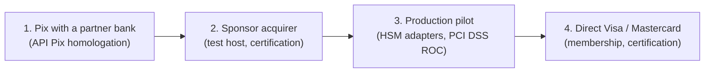

# Integration kit: card hosts, Visa, Mastercard and banks for Pix

This folder explains how to connect the platform ([`../platform`](../platform)) to its real counterparties. For each one it covers what is already built and tested, what the counterparty must provide, and the steps to go from the simulators to their test environment and then to production.

## Readiness at a glance

| Counterparty | Built and tested here | Counterparty provides | Still to build | Guide |
|--------------|----------------------|-----------------------|----------------|-------|
| **Sponsor acquirer** (Phase 1 card acceptance) | ISO 8583 codec with JSON dialects, persistent sessions (sign-on, echo, reconnect), switch with timeout reversals and store-and-forward, routing, ledger, receivables, settlement reconciliation with true-ups, chargebacks | Host interface specification, test host, credentials, merchant-ID scheme, settlement report and chargeback formats | Transcribe their dialect; map their private fields; a converter from their report and chargeback formats to the import CSVs | [sponsor-acquirer.md](sponsor-acquirer.md) |
| **Visa** (Phase 2, direct) | Everything above; a Visa structural template dialect (BCD, EBCDIC, binary prefixes, 22-byte header) | Membership, BIN, licensed V.I.P. / BASE I and BASE II specifications, connectivity, certification | Dialect from the licensed spec; BASE II clearing files; VTS, 3DS, dispute integrations | [visa.md](visa.md) |
| **Mastercard** (Phase 2, direct) | Everything above; a Mastercard structural template dialect (EBCDIC) | Membership, ICA, MIP installation, licensed Customer Interface Specification and IPM clearing formats, testing facility | Dialect from the licensed spec; IPM clearing files; MDES, 3DS, Mastercom integrations | [mastercard.md](mastercard.md) |
| **Bank / PSP for Pix** | API Pix client (OAuth2 over mutual TLS, `cob`, `pix`, devolução, webhook), mTLS webhook receiver that re-reads every Pix before crediting, daily reconciliation by `GET /pix` that heals missed webhooks, MED returns, BR Code, payouts through a sender seam, PSP simulator | Account and Pix key, API Pix homologation and production URLs, OAuth client, certificates, its transfer API | An adapter for the bank's transfer API (one file) | [pix.md](pix.md) |
| **Operations** (day to day) | Merchant lifecycle (KYB approval, restriction, closure), terminal and API key revocation, chargeback intake and outcomes, settlement and Pix reconciliation with an exception queue, an audit trail, Prometheus metrics | Operators with SSO identities; a Prometheus and alerting stack | A back-office UI over the same commands | [operations-runbook.md](operations-runbook.md) |
| **Key custody** (production) | Typed seams: `vault.KEK`, `carddata.Decryptor`, `nostr.Author` | An HSM / KMS, a payment HSM, an enclave | Three adapters | [hsm.md](hsm.md) |
| **Receivables registrar** (CERC, Núclea, B3, TAG) | Every receivable unit registered with its total; the platform's assignment registered before any advance, at capture and in payouts; liens of other institutions respected; reversals cancel the assignment; a nightly re-registration. Interface, in-memory registrar and a generic JSON contract | Participation in the arrangement, API credentials, the registrar's API specification | An adapter from the registrar's API to `internal/registrar`'s contract (`REGISTRAR_URL`) | [07 §1.6](../docs/07-enhancements.md#16-registrar-interplay) |
| **Device attestation** (Apple, Google) | Offline verification of App Attest and Android hardware key attestation; sessions pinned to the attested key; phones added by the owner attest at their first login | Apple's App Attestation Root CA, Google's hardware attestation roots, the release signing certificate digest, the Team ID | Play Integrity through Google's decode API; the attestation revocation list | [05 §2.4](../docs/05-mobile.md#24-attestation-and-device-integrity) |
| **Transparency anchoring** | Daily statements and the chain of signed public roots, published to relays, with inclusion proofs through the API | An ICP-Brasil timestamp authority; at least two independent relays | RFC 3161 and OpenTimestamps clients | [03 §6.6](../docs/03-nostr-layer.md#66-anchoring) |

[security-assessment.md](security-assessment.md) is the internal security assessment: method, findings and their fixes, controls verified, and what an independent test must still cover.

[certification-test-plan.md](certification-test-plan.md) maps every scenario a counterparty will ask you to prove onto the simulator command or the automated test that exercises it today.

## Recommended order

1. **Pix first.** It needs only a bank account with API Pix, has a public, standard contract (the code already speaks it), and gives merchants a working payment method on day one.
2. **Sponsor acquirer next.** It brings card acceptance without scheme membership. The work is transcribing one host specification into a dialect file and passing the sponsor's certification scripts.
3. **Production** needs the key-custody adapters ([hsm.md](hsm.md)), a PCI DSS assessment, and an MPoC-validated terminal SDK ([05 §2](../docs/05-mobile.md#2-android-terminal-production-spec)).
4. **Direct scheme connections** come last: BCB authorization, scheme membership and certification take 12–18 months ([08](../docs/08-roadmap-risks.md#2-certification-and-licensing)). The switch already supports several routes at once, so the sponsor stays connected as the secondary route.

## What "ready for integration" means here, honestly

- The **transport, session, reversal and ledger behaviour** that certifications test is implemented and exercised end to end against simulators, including the failure paths (timeouts, late responses, dropped connections, duplicate requests).
- The **field layouts** of Visa, Mastercard and most sponsors are confidential documents licensed to members. This repository cannot contain them. The codec takes them as JSON, so integrating means transcribing the specification, not writing code. The platform refuses to run an unverified dialect outside the sandbox.
- **Certification is done by the counterparty.** Passing these tests does not certify anything. It means you arrive at certification with the hard parts already working.
