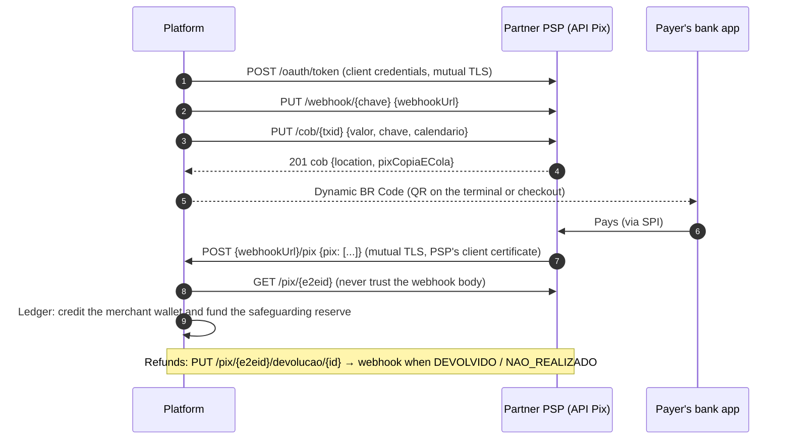

# Connecting to a bank (PSP) for Pix

The platform receives Pix through a partner PSP (a bank or payment institution that participates in Pix) using the **API Pix**. That is the standard the Banco Central publishes (github.com/bacen/pix-api, v2.x) and every PSP exposes to its receiving users. Because the contract is standard, the integration is mostly configuration. The one piece that is not standard is sending Pix (payouts), which goes through a small bank-specific adapter.

## Model A: receiving user of a PSP (implemented)



### What to obtain from the PSP

| Item | Variable |
|------|----------|
| API Pix base URL for homologation and production, including the major version (`…/v2`) | `PIX_BASE_URL` |
| OAuth token URL and how client credentials are sent (HTTP Basic, the usual choice, or form fields) | `PIX_TOKEN_URL`, `apipix.Config.TokenAuth` |
| `client_id` / `client_secret` with scopes `cob.write cob.read pix.write pix.read webhook.write webhook.read` | `PIX_CLIENT_ID`, `PIX_CLIENT_SECRET` |
| The client certificate for mutual TLS (issued by the PSP, or an ICP-Brasil certificate registered with it) and the PSP's server CA | `PIX_TLS_CERT`, `PIX_TLS_KEY`, `PIX_TLS_CA` |
| The Pix key of the platform's receiving account (CNPJ or random EVP key) | `PIX_KEY` |
| The CA of the PSP's **webhook client certificate**, so the platform can verify the PSP when it calls the webhook | `PIX_WEBHOOK_TLS_CA` |
| The transfer (payout) API documentation | A `pixout.Sender` adapter |

### Steps

1. **Run against the simulator.** `docker compose up` already runs this whole flow with `pixsim` (API Pix with mutual TLS both ways). `internal/pixsim/sim_test.go` and `internal/e2e` exercise every call.
2. **Point to the PSP's homologation environment**: set the variables above, `PLATFORM_ENV=certification`, and a public HTTPS address for `PIX_WEBHOOK_ADDR` (`PIX_WEBHOOK_PUBLIC_URL`). The platform registers the webhook at start. The PSP will POST to `<PIX_WEBHOOK_PUBLIC_URL>/pix`, which is exactly the path the receiver serves.
3. **Check PSP-specific behaviour** against the standard: token auth style, scope names, whether `PUT /webhook` is allowed or must be done in the PSP's portal, webhook retry policy, and certificate rotation. The client already retries 429 and 5xx on idempotent calls, refreshes the token on 401, and maps problem responses (with `violacoes`) to `apipix.Error`.
4. **Run the Pix scenarios** of [certification-test-plan.md](certification-test-plan.md) with the PSP's test payers.
5. **Production**: switch the URLs and certificates, and keep the webhook CA pinned to the PSP's client CA only.

### Payouts (sending Pix)

API Pix covers receiving only. Each bank exposes its own API for sending transfers, so payouts go through the `pixout.Sender` interface:

```go
type Sender interface {
	Send(ctx context.Context, t Transfer) (Result, error) // idempotent on t.IdempotencyKey (the payout ID)
	Get(ctx context.Context, id string) (Result, error)
}
```

`pixout.HTTPSender` implements a small generic contract (`POST /pagamentos/pix`, `GET /pagamentos/pix/{id}`), which is what `pixsim` serves. For a real bank, write an adapter that maps `Transfer` to the bank's request (amount as `"123.45"`, key type and key, idempotency header or field), maps its statuses to `EM_PROCESSAMENTO`, `REALIZADO` and `NAO_REALIZADO`, and returns `pixout.ErrRejected` for definitive refusals. Network errors leave the payout `processing`, and `ReconcilePayouts` resolves it with `Get`. The ledger never pays twice: the wallet is debited once, by the payout's own idempotency key.

### Gaps to close before production volume

| Gap | What to add |
|-----|-------------|
| **MED** (Mecanismo Especial de Devolução) returns started by the payer's PSP appear as devoluções with `natureza` `MED_OPERACIONAL` / `MED_FRAUDE`, which the platform did not request | Handle them in `applyDevolucoes`: debit the merchant (or `merchant_recoverable`), open a risk case |
| Daily reconciliation | List `GET /pix?inicio=…&fim=…` and compare with captured intents and ledger postings |
| Due-date charges (`cobv`), Pix Automático (`rec`, `cobr`) | Same client pattern, new endpoints of the same standard |
| Static QR codes for offline sale (docs/03 §7.2) | `brcode.Encode` already supports static codes. Add their reconciliation by `txid` |

## Model B: direct SPI participant (future)

Becoming a direct Pix participant means a BCB authorization as a Pix participant with its own ISPB, connection to the RSFN, ICP-Brasil certificates, ISO 20022 messages to the SPI (`pacs.008` credit transfers, `pacs.002` status, `pacs.004` returns), the DICT API for keys, and homologation with the Banco Central. None of that is in this repository. The seams are where it would plug in: an SPI-backed `pixout.Sender` for outgoing transfers, and an inbound handler that turns SPI credits into the same `OnPix` path the API Pix webhook uses today.
